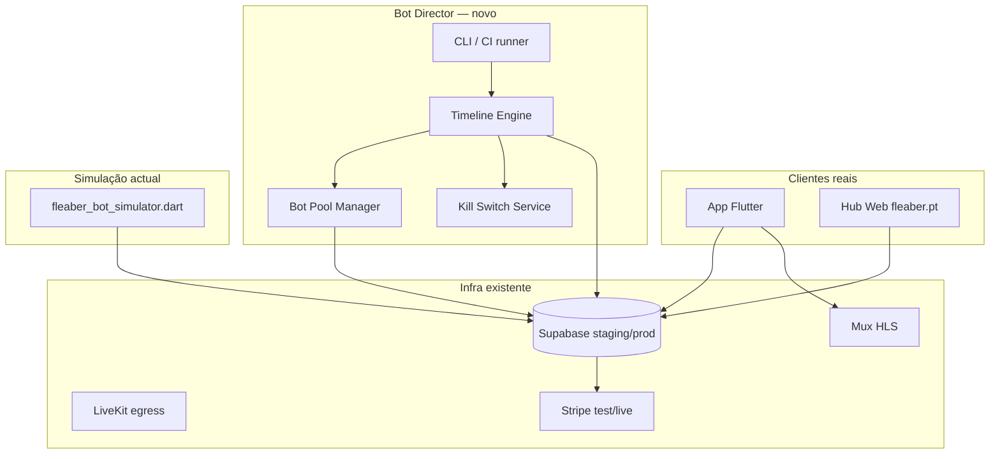
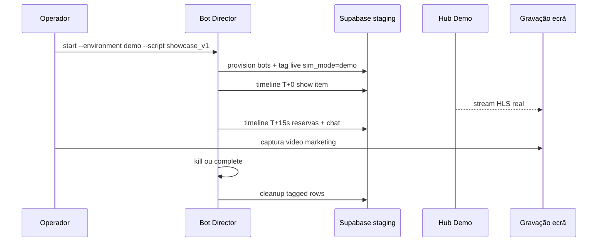

# Bot Director de Lives — Arquitectura Técnica

> **Estado:** análise / design only — **nada implementado**.  
> **Relacionado:** [`docs/bot-simulator.md`](./bot-simulator.md) · [`docs/live-ops-automacao-batata.md`](./live-ops-automacao-batata.md) · [`docs/live-hub-master-plan.md`](./live-hub-master-plan.md)  
> **Última revisão:** 2026-07-05

---

## 1. Resumo executivo

O **Bot Director** é um orquestrador **server-side + CLI** que executa **roteiros temporais** de directos (show de artigos, chat, reservas, rifas, aceites seller, checkout simulado) sobre a infra Fleaber existente (Supabase, Mux HLS, RPCs `batata_*`).

Diferencia-se do **Bot Simulator** actual (`tool/fleaber_bot_simulator.dart`), que só simula **compradores/viewers** de forma ad-hoc, sem timeline, sem acções de seller, sem kill switch global nem modelo de sessão persistente.

| Dimensão | Bot Simulator (V0) | Bot Director (alvo) |
|----------|----------------------|---------------------|
| Actor principal | Bots comprador | Director + pool buyer + actor seller (opcional) |
| Orquestração | Cenários paralelos fixos | **Timeline** declarative (YAML/JSON) |
| Seller studio | Manual / Maestro | Acções seller **scriptadas** via RPC/service_role |
| Pagamentos | Bloqueado | **Simulado** (staging) ou **proibido** (prod) |
| Kill switch | Não | **Global + por live + por run** |
| Audit | `events.jsonl` local | **BD append-only** + export local |
| Ambientes | Staging guard | **QA / Demo / Prod** com políticas distintas |

**Princípio BATATA:** o Director **nunca** altera layout do player, carrossel, nem fluxos Mux/LiveKit na app. Opera só via APIs/RPCs já existentes ou extensões **aditivas** (flags, audit, caps).

---

## 2. Posicionamento na stack actual



**Reutilização directa:**

| Peça | Uso pelo Director |
|------|-------------------|
| `lives`, `live_items`, `live_messages` | Estado da live |
| `live_reservation_requests` + RPCs `batata_*` | Fila, saco, convert |
| `live_raffles` + `batata_live_raffle_audit` | Rifas scriptadas |
| `batata_live_viewer_ping` | Contagem viewers simulados |
| `batata_live_item_stock` | Validação stock pós-acção |
| `create-payment-intent` / reconcile | Checkout **só staging + flag** |
| `LiveOpsStagingClient` / guards | Base de cliente HTTP |
| `BotProvisioner` | Pool de contas simuladas |

**Fora de scope inicial (como no Bot Simulator):** publicação RTMP/WebRTC real, Maestro UI, ingest OCR Facebook.

---

## 3. Entidades

### 3.1 `director_runs` — sessão de orquestração

Representa uma execução completa de roteiro.

| Campo | Tipo | Descrição |
|-------|------|-----------|
| `id` | uuid PK | |
| `run_code` | text UNIQUE | Ex.: `QA-HUB-C1-20260705-001` |
| `environment` | enum | `qa` · `demo` · `production` |
| `live_id` | uuid FK → `lives` | Live alvo (pode ser criada pelo run) |
| `script_id` | uuid FK | Versão do roteiro |
| `status` | enum | `pending` · `running` · `paused` · `killed` · `completed` · `failed` |
| `started_at` / `ended_at` | timestamptz | |
| `started_by` | uuid / text | Operador ou CI job id |
| `kill_reason` | text | Preenchido se `killed` |
| `config_snapshot` | jsonb | Flags/limites efectivos no arranque |
| `report_uri` | text | S3/local path do pacote de evidências |

**Índices:** `(live_id, status)`, `(environment, started_at DESC)`.

### 3.2 `director_scripts` — roteiro versionado

| Campo | Tipo | Descrição |
|-------|------|-----------|
| `id` | uuid PK | |
| `name` | text | Ex.: `hub_c1_bag_sync` |
| `version` | int | Incremental |
| `environment_allowlist` | text[] | `['qa','demo']` — prod exige script explícito |
| `timeline` | jsonb | Lista ordenada de eventos (§7) |
| `fixtures` | jsonb | Stock inicial, items, preços, bots necessários |
| `checksum` | text | SHA256 do timeline+fixtures |

### 3.3 `director_timeline_events` — plano materializado (opcional)

Desnormalização do script para execução com `scheduled_at` absoluto. Alternativa: calcular in-memory a partir de `t_offset_ms`.

| Campo | Tipo |
|-------|------|
| `run_id` | uuid FK |
| `seq` | int |
| `t_offset_ms` | bigint |
| `action` | text |
| `actor_ref` | text |
| `payload` | jsonb |
| `status` | `planned` · `executed` · `skipped` · `failed` |

### 3.4 `director_sim_profiles` — perfis simulados

Extensão do pool actual (`demo_bot_01@staging.fleaber.bot`).

| Campo | Tipo | Descrição |
|-------|------|-----------|
| `profile_id` | uuid FK → `profiles` | Conta real em auth (staging) |
| `sim_kind` | enum | `buyer_bot` · `seller_bot` · `viewer_only` |
| `internal_tag` | text UNIQUE | Ex.: `DEMO_BOT_07`, `DIRECTOR_SELLER` |
| `display_name` | text | Nome visível no chat (demo-mode) |
| `environment` | enum | Onde pode actuar |
| `is_active` | bool | Desactivar sem apagar user |
| `metadata` | jsonb | Persona (ritmo chat, probabilidade reserva) |

**Coluna derivada em `profiles` (proposta):** `sim_account_kind text NULL CHECK (sim_account_kind IN ('director_bot','director_seller','human'))` — permite RLS/triggers detectarem bots.

### 3.5 `director_audit_log` — trilho append-only

Paralelo a `live_raffle_audit_log` e `events.jsonl` do Bot Simulator, mas **persistido na BD** para auditoria cross-run.

| Campo | Tipo |
|-------|------|
| `id` | bigserial PK |
| `run_id` | uuid |
| `live_id` | uuid |
| `seq` | bigint monotonic per run |
| `occurred_at` | timestamptz |
| `actor_type` | `director` · `buyer_bot` · `seller_bot` · `system` · `human_override` |
| `actor_id` | uuid nullable |
| `action` | text |
| `payload` | jsonb |
| `expected` | jsonb nullable |
| `actual` | jsonb nullable |
| `outcome` | `ok` · `fail` · `skip` · `blocked` |
| `duration_ms` | int |
| `correlation_id` | uuid |

**Regras:** INSERT only; REVOKE UPDATE/DELETE except service_role archival job.

### 3.6 `director_kill_switch` — estado global

| Campo | Tipo |
|-------|------|
| `scope` | `global` · `environment` · `live` · `run` |
| `scope_key` | text | ex.: `qa`, live uuid, run uuid |
| `is_active` | bool |
| `activated_at` | timestamptz |
| `activated_by` | text |
| `reason` | text |

Lookup em **cada tick** da timeline engine antes de executar evento.

### 3.7 Extensões em entidades existentes (aditivas)

| Tabela | Coluna proposta | Propósito |
|--------|-----------------|-----------|
| `lives` | `director_run_id uuid NULL` | Marca live criada/orquestrada |
| `lives` | `sim_mode enum NULL` | `none` · `qa` · `demo` |
| `live_reservation_requests` | `director_run_id uuid NULL` | Cleanup + exclusão de métricas prod |
| `live_reservation_requests` | `notes` | Já usado: prefixo `STRESS_TEST:` / `DIRECTOR:{run_code}` |
| `orders` | `director_run_id uuid NULL` | Impede reconcile prod acidental |
| `profiles` | `sim_account_kind` | Gates stock/pagamento |

---

## 4. Flags e configuração

### 4.1 Flags de ambiente (ficheiro + BD)

Ficheiro: `tool/director_staging.env` (espelho de `live_ops_staging.env`).

| Flag | Default QA | Demo | Prod |
|------|------------|------|------|
| `DIRECTOR_ALLOWED_PROJECT_REFS` | staging ref | staging ref | **vazio (bloqueado)** |
| `DIRECTOR_ENVIRONMENT` | `qa` | `demo` | — |
| `DIRECTOR_ALLOW_PAYMENT_SIM` | `true` | `false` | `false` |
| `DIRECTOR_ALLOW_STRIPE_TEST` | `true` | `false` | `false` |
| `DIRECTOR_ALLOW_SELLER_AUTOMATION` | `true` | `true` | `false` |
| `DIRECTOR_ALLOW_LIVE_CREATE` | `true` | `true` | `false` |
| `DIRECTOR_FORCE_CLEANUP` | `true` | `true` | n/a |
| `DIRECTOR_DEMO_MODE` | `false` | `true` | n/a |
| `DIRECTOR_OBSERVE_UI` | opcional | `true` | `false` |
| `DIRECTOR_I_KNOW_THIS_IS_STAGING` | override CLI | override CLI | **ignorado** |

### 4.2 Flags por run (CLI / API)

```bash
# Exemplo conceptual — não implementado
dart run tool/fleaber_bot_director.dart \
  --script hub_c1_bag_sync \
  --environment qa \
  --live-id <uuid> \
  --kill-on-fail \
  --dry-run
```

| Flag run | Efeito |
|----------|--------|
| `--dry-run` | Valida script + fixtures; não escreve BD |
| `--pause-on-fail` | `status=paused`; aguarda humano |
| `--kill-on-fail` | Activa kill switch do run + rollback parcial |
| `--no-cleanup` | Mantém dados taggados para análise |
| `--max-duration` | Kill automático após T |
| `--human-checkpoints` | Pausa em eventos `checkpoint:*` |

### 4.3 Flags na BD (`director_runs.config_snapshot`)

```json
{
  "payment_simulation": "reconcile_only",
  "stock_mutation": "allowed",
  "chat_humanize": true,
  "viewer_ping_interval_ms": 30000,
  "seller_actions_via": "service_role",
  "notes_tag": "DIRECTOR:QA-HUB-C1-20260705-001"
}
```

---

## 5. Limites e caps

### 5.1 Limites operacionais por ambiente

| Recurso | QA | Demo | Prod |
|---------|----|----|------|
| Bots simultâneos | 100 | 30 | 0 |
| Chat msgs/min (total) | 120 | 40 | 0 |
| Reservas/min | 60 | 20 | 0 |
| Runs concurrentes | 3 | 1 | 0 |
| Duração max run | 2 h | 45 min | — |
| Lives director activas | 5 | 2 | 0 |

### 5.2 Limites de integridade (hard stops)

O engine **aborta o evento** (ou o run, conforme política) se:

1. `batata_live_item_stock.available_qty < 0` após mutação.
2. Reserva `converted` sem `order_id` coerente.
3. Total saco (unidades) ≠ `HubReservationSummary` esperado no script.
4. Raffle draw sem entrada em `live_raffle_audit_log`.
5. Pagamento simulado tenta usar chave Stripe **live**.
6. Actor não tem `sim_account_kind` compatível com ambiente.
7. Kill switch activo no scope relevante.

### 5.3 Rate limiting

- **Cliente:** token bucket por `run_id` + acção (reutilizar padrão jitter do Bot Simulator).
- **Servidor (proposta):** RPC `director_assert_rate_limit(p_run_id, p_action)` — no-op fora de runs director.

---

## 6. Audit logs

### 6.1 Camadas

| Camada | Suporte | Retenção |
|--------|---------|----------|
| **L1 — Evento** | `director_audit_log` | 90 dias staging; 30 dias demo |
| **L2 — Domínio** | `live_raffle_audit_log`, notes em reservas | Política existente |
| **L3 — Ficheiro** | `tool/reports/director_<run>/events.jsonl` | Gitignored; export ZIP QA |
| **L4 — Snapshot** | `db_snapshot_before/after.json` | Igual Bot Simulator |
| **L5 — Journal launcher** | `launcher_step_journal.jsonl` | Quando run acoplado a bateria manual |

### 6.2 Correlation

Cada evento da timeline recebe `correlation_id` propagado a:

- reservas (`notes` suffix `corr:<uuid>`),
- orders (`metadata` Stripe simulado),
- chat (`live_messages.metadata` se existir coluna jsonb).

### 6.3 Evidência para auditoria Cursor (regra QA)

Para marcar PASS num teste acoplado ao Director:

1. Maestro/manual OK **ou** timeline `completed` sem `fail`.
2. Screenshot/hierarchy se UI.
3. `director_audit_log` sem `outcome=fail` não justificado.
4. UI ↔ BD: stock, fila, totais saco (tolerância sync ≤ 2 s documentada).
5. Actualizar `tool/test_battery_registry.json` com resultado **auditado**.

---

## 7. Timeline — modelo e acções

### 7.1 Formato declarativo (YAML conceptual)

```yaml
script: hub_c1_bag_sync
version: 3
environment: qa
fixtures:
  seller: DIRECTOR_SELLER
  buyers: [DEMO_BOT_01, DEMO_BOT_02, DEMO_BOT_03]
  live_items:
    - ref: REF-A
      price: 12.00
      qty: 5
timeline:
  - at: 0s
    action: live.ensure_active
  - at: 5s
    action: catalog.show_item
    item: REF-A
  - at: 15s
    action: buyer.reserve
    actor: DEMO_BOT_01
    qty: 2
  - at: 20s
    action: buyer.reserve
    actor: DEMO_BOT_02
    qty: 1
  - at: 25s
    action: seller.accept_reservation
    buyer: DEMO_BOT_01
  - at: 30s
    action: assert.stock
    item: REF-A
    expect:
      available_qty: 2
      pending_reservations: 1
  - at: 45s
    action: checkpoint:human
    message: "Confirmar barra reservas visível no Hub"
  - at: 60s
    action: buyer.checkout_simulate
    actor: DEMO_BOT_01
    mode: reconcile_only
  - at: 75s
    action: assert.reservation_status
    buyer: DEMO_BOT_01
    expect: converted
  - at: 90s
    action: run.complete
```

### 7.2 Catálogo de acções (V1)

| Acção | Actor | RPC / API |
|-------|-------|-----------|
| `live.ensure_active` | director | PATCH `lives` + guard staging |
| `live.end` | director | `complete-mux-live` edge |
| `catalog.show_item` | seller_bot | UPDATE `live_items.is_active` + INSERT `live_item_show_events` |
| `catalog.set_price` | seller_bot | `batata_update_live_item` |
| `buyer.viewer_ping` | buyer_bot | `batata_live_viewer_ping` |
| `buyer.chat` | buyer_bot | INSERT `live_messages` |
| `buyer.reserve` | buyer_bot | INSERT `live_reservation_requests` |
| `buyer.bag_remove` | buyer_bot | `batata_live_bag_remove_request` |
| `seller.accept_reservation` | seller_bot | `batata_process_live_reservation_request` |
| `seller.reject_reservation` | seller_bot | idem |
| `raffle.open` / `join` / `draw` | mixed | RPCs `batata_*raffle*` |
| `buyer.follow_seller` | buyer_bot | INSERT `follows` |
| `buyer.checkout_simulate` | buyer_bot | Ver §9 |
| `assert.*` | director | Leitura + comparação; não muta |
| `checkpoint:human` | — | Pausa run; resume via CLI |
| `run.complete` / `run.cleanup` | director | Teardown taggado |

### 7.3 Semântica temporal

- **`at`:** offset desde `run.started_at` **ou** `since: previous` para encadeamento.
- **Jitter:** ±N ms configurável por acção (`buyer.chat` ±2 s).
- **Wait until:** `wait_until: { reservation_status: accepted, buyer: DEMO_BOT_01, timeout: 30s }`.
- **Parallel groups:** `parallel: [event, event]` — máx 5 ramos em QA.

### 7.4 Motor de execução

```
loop:
  if kill_switch(active): mark killed; exit
  fetch next due events (scheduled_at <= now)
  for each event:
    audit: planned
    validate caps + environment policy
    execute handler
    audit: outcome + actual
    on fail: pause | kill | continue (script policy)
  sleep until next deadline or wakeup (human resume)
```

---

## 8. Perfis simulados

### 8.1 Taxonomia

| Tipo | Email pattern | Visível na UI | Pode pagar |
|------|---------------|---------------|------------|
| `buyer_bot` | `{tag}@staging.fleaber.bot` | Sim; tag no sender_label em QA | Sim (staging test) |
| `seller_bot` | `director_seller@staging.fleaber.bot` | Não (actua via studio API) | N/A |
| `viewer_only` | idem buyer | Sim | Não |

### 8.2 Provisioning

Reutilizar `BotProvisioner` com extensões:

1. Criar/ligar perfil Supabase Auth (Admin API).
2. INSERT `director_sim_profiles`.
3. SET `profiles.sim_account_kind = 'director_bot'`.
4. Cache em `tool/.director_pool_cache.json` (gitignored).

### 8.3 Demo mode (`--demo-mode` / `environment=demo`)

- Nomes PT amigáveis («Ana», «João») — já em `chat_phrases.dart`.
- **Ocultar** tags `DEMO_BOT_XX` no Hub público (filtrar `sender_label` ou usar display_name puro).
- Ritmo mais lento (2× jitter).
- Chat phrases naturais; sem texto técnico.

### 8.4 Separação de métricas

Views agregadas (`hub_*`, FOMO, viewer count) devem **excluir** ou **segmentar** tráfego director:

- Proposta: RPC FOMO aceita `exclude_sim=true` por defeito em prod.
- `batata_live_viewer_ping`: metadata `is_sim boolean` ou join `director_sim_profiles`.

---

## 9. Segurança de stock e pagamentos

### 9.1 Stock — princípios

1. **Todas** as mutações de stock passam pelos RPCs existentes (`batata_update_live_item`, `batata_recompute_live_item_status`, `batata_live_item_stock`) — o Director **nunca** faz UPDATE directo em qty excepto via RPC.
2. Após cada acção de reserva/accept/cancel, evento `assert.stock` obrigatório em scripts QA de regressão.
3. Reservas director taggadas: `notes LIKE 'DIRECTOR:%'` → excluídas de dashboards seller reais (view materializada).
4. Cleanup apaga por `director_run_id` + cascade conhecido (ordem: orders sim → reservas → messages → raffle test).

### 9.2 Pagamentos — modos

| Modo | Ambiente | Comportamento |
|------|----------|---------------|
| `none` | demo | Para antes de checkout; valida preço via `LiveItemPriceGate` |
| `reconcile_only` | qa | Cria order `reserva_pendente`; **simula** `pago` via RPC `batata_live_reconcile_stripe_order` / update controlado service_role — **sem** Stripe HTTP |
| `stripe_test` | qa | `create-payment-intent` com chaves test; WebView opcional Maestro |
| `forbidden` | demo/prod | Handler rejeita; audit `blocked` |

### 9.3 Guard rails pagamento

```text
SE environment IN (demo, production):
  BLOQUEAR create-payment-intent, stripe_test, reconcile com orders não taggados

SE order.director_run_id IS NULL e actor sim_account_kind IS NOT NULL:
  BLOQUEAR mutate

SE Stripe key prefix != sk_test_:
  BLOQUEAR sempre (hardcoded no runner)
```

### 9.4 Trigger BD (proposta)

```sql
-- Conceptual
CREATE FUNCTION director_block_prod_payment() ...
  IF NEW.director_run_id IS NOT NULL
     AND current_setting('app.environment', true) = 'production' THEN
    RAISE EXCEPTION 'director_payment_forbidden';
```

### 9.5 Cross-user auth (teste A424)

Scripts QA devem incluir acção negativa: bot B tenta converter order de bot A → expect `403` / RPC error; registar em audit.

---

## 10. Kill switch

### 10.1 Níveis

| Scope | Quem activa | Efeito |
|-------|-------------|--------|
| **global** | On-call / env var | Todos os runs param em ≤1 s |
| **environment** | `DIRECTOR_ENVIRONMENT=qa` | Só QA |
| **live** | Operador / seller real entra na live | Pausa director dessa live |
| **run** | `--kill-on-fail`, timeout, humano | Só esse run |

### 10.2 Mecanismo

1. **Hot path:** poll `director_kill_switch` cada 500 ms **ou** Supabase Realtime subscription.
2. **CLI:** `dart run tool/fleaber_bot_director.dart kill --scope live --id <uuid>`.
3. **App seller (futuro):** banner «Simulação activa» + botão «Parar simulação» → scope `live`.

### 10.3 Teardown on kill

Ordem segura:

1. Parar schedulers / cancelar timers.
2. `run.status = killed`.
3. Opcional: `live.end` se live foi criada pelo director e flag `end_live_on_kill`.
4. Cleanup conforme política (`force_cleanup`).
5. Escrever `kill_reason` + audit final.

### 10.4 Fail-safe produção

- Edge Function `director-control` **não deployada em prod** na V1.
- Tabela `director_*` vazia em prod ou RLS deny all.
- CI: teste que falha se `DIRECTOR_ENVIRONMENT=production` detectado no runner.

---

## 11. Separação QA / Demo / Produção

### 11.1 Matriz

| Aspecto | QA | Demo | Produção |
|---------|----|----|----------|
| **Objectivo** | Regressão automática, CI, Cursor audit | Gravações marketing, formação seller | Tráfego real |
| **Project Supabase** | staging (`fxdknzrqjenzqcvnwqqq`) | staging (live dedicada) | prod |
| **Bots visíveis** | Sim (tags opcionais) | Sim (nomes limpos) | **Proibido** |
| **Pagamentos** | reconcile / stripe test | none | real — **Director off** |
| **Mux stream** | seed ou live test seller | vídeo real recomendado | real |
| **Cleanup** | automático default | automático | n/a |
| **Quem corre** | CI, agente QA, dev | equipa produto | — |
| **Métricas seller** | excluídas | excluídas | incluídas |

### 11.2 Isolamento técnico

1. **Project ref guard** — extender `assertBotSimStagingAllowed` → `assertDirectorEnvironmentAllowed`.
2. **Row tagging** — `director_run_id` em todas as mutações.
3. **RLS** — humanos em prod nunca leem `director_audit_log` via anon.
4. **Hub público** — demo runs usam handle seller de teste (`@fleaber-demo`), nunca handle prod.
5. **Stripe** — wallets Connect de contas sim **separadas** do seller real.

### 11.3 Fluxo demo gravável



---

## 12. Componentes software (implementação futura)

```
tool/
  fleaber_bot_director.dart          # CLI entry
  director/
    config.dart                      # flags + limits
    staging_guard.dart               # QA/demo/prod
    engine/
      timeline_runner.dart
      action_handlers.dart
      kill_switch.dart
    scripts/                         # YAML versionados
      qa/
      demo/
    audit/
      db_audit_writer.dart
      report_exporter.dart
    pool/
      profile_pool.dart              # extends BotProvisioner
    cleanup/
      run_teardown.dart
supabase/
  sql/director_batata.sql            # tabelas + RLS + triggers
  functions/director-control/        # opcional V2 — kill/resume remoto
docs/
  bot-director-architecture.md       # este documento
```

**Integração com baterias existentes:**

- `tool/test_battery_launcher/hub_live_v2_battery.json` — item opcional «Pré-aquecer live com Director script X».
- `tool/hub_live_v2_validate.ps1` — flag `-DirectorScript` (futuro).

---

## 13. Fases de entrega sugeridas

| Fase | Entrega | Dependências |
|------|---------|--------------|
| **D0** | Este documento + review | — |
| **D1** | Tabelas `director_runs`, `director_audit_log`, kill switch SQL | D0 aprovado |
| **D2** | Timeline runner + acções buyer (reutilizar Bot Simulator handlers) | D1 |
| **D3** | Acções seller + asserts stock | D2 |
| **D4** | Payment `reconcile_only` + testes A424/A007 | D3 + V0 live ops scripts |
| **D5** | Demo mode + cleanup + export ZIP | D4 |
| **D6** | Integração launcher QA + doc operacional | D5 |

---

## 14. Riscos e mitigações

| ID | Risco | Mitigação |
|----|-------|-----------|
| R-D1 | Director em prod por misconfig | Project ref guard + CI + tabelas vazias prod |
| R-D2 | Stock corrupto cross-run | RPC-only mutations + assert + cleanup |
| R-D3 | Pagamento sim confundido com real | `director_run_id` + Stripe sk_test guard + UI banner demo |
| R-D4 | FOMO inflacionado | Excluir sim de agregados públicos |
| R-D5 | Seller real vs seller_bot colisão | Um seller_bot por run; lock `live.director_run_id` |
| R-D6 | Timeline frágil a latency | `wait_until` + timeouts + checkpoint humano |
| R-D7 | Kill switch lento | Realtime + poll 500 ms |

---

## 15. Decisões em aberto

1. **YAML vs JSON** para scripts — YAML legível; JSON melhor para CI parsing.
2. **Seller automation:** service_role vs conta `seller_bot` autenticada (preferência: **seller_bot** para RLS realista).
3. **Criar live automaticamente** vs exigir live seed (Maestro hoje usa seed).
4. **Supabase Edge vs pure CLI** para kill switch remoto.
5. **Integrar ou fundir** Bot Simulator no Director (simulator = subset «buyer chaos mode»).
6. **Coluna `profiles.sim_account_kind`** vs tabela separada só — impacto em Trust/Risk futuro.

---

## 16. Referências no repo

| Artefacto | Relevância |
|-----------|------------|
| `tool/fleaber_bot_simulator.dart` | Pool, cenários, guard staging |
| `tool/bot_sim/staging_guard.dart` | Padrão de bloqueio prod |
| `supabase/sql/live_reservation_requests_batata.sql` | Fila reservas |
| `supabase/sql/live_raffles_batata.sql` | Audit rifas |
| `lib/hub/hub_ps_demo.dart` | Demo mode in-app (query `ps_demo=1`) |
| `tool/regression/staging_guard.dart` | Guard regressão |
| `.cursor/rules/test-audit-cursor.mdc` | Formato auditoria PASS/FAIL |
| `docs/live-ecosystem-test-matrix-A424` | Stripe auth cross-user |

---

## Apêndice A — Exemplo `director_audit_log` (JSON)

```json
{
  "run_id": "a1b2c3d4-…",
  "seq": 42,
  "occurred_at": "2026-07-05T10:15:30.123Z",
  "actor_type": "buyer_bot",
  "actor_id": "…",
  "action": "buyer.reserve",
  "payload": { "live_item_id": "…", "qty": 2 },
  "expected": { "status": "pending" },
  "actual": { "status": "pending", "queue_position": 1 },
  "outcome": "ok",
  "duration_ms": 187,
  "correlation_id": "f9e8d7c6-…"
}
```

## Apêndice B — Checklist pré-run (operador QA)

1. Confirmar `DIRECTOR_ALLOWED_PROJECT_REFS` = staging.
2. Live seed com ≥2 `live_items` e stock conhecido.
3. Script version checksum registado no run.
4. Kill switch global **off**.
5. Nenhuma live prod do mesmo seller em paralelo.
6. Após run: verificar `inconsistencies.md` vazio + `batata_stock_audit.dart` se script tocava stock.
