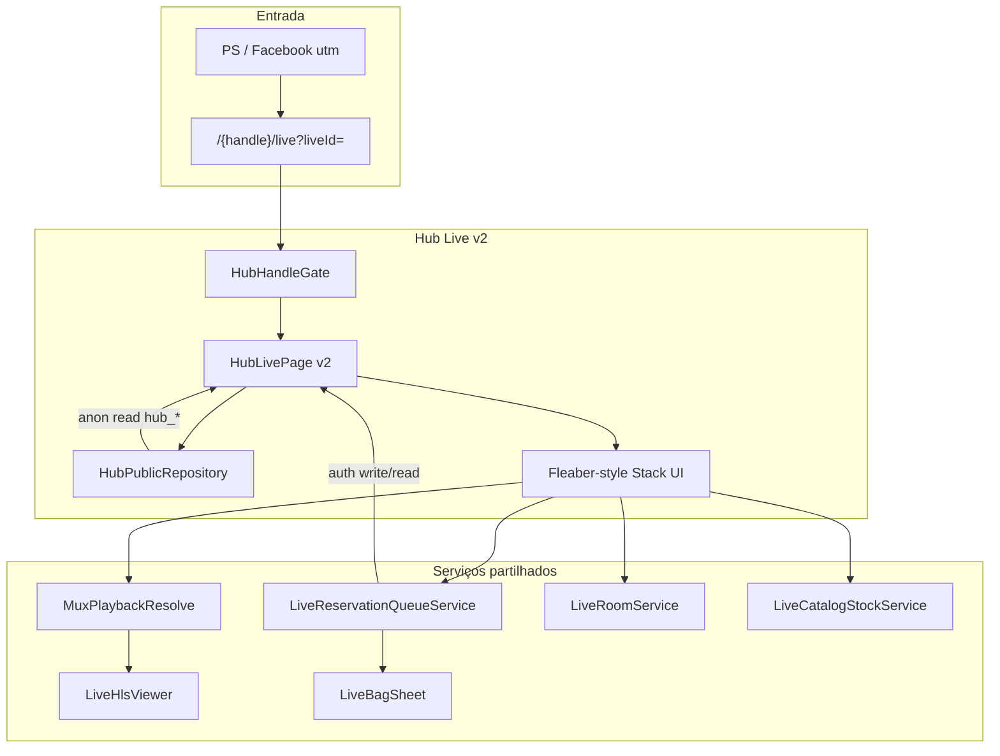

# Hub Live v2 — Proposta técnica (análise, sem implementação)

> **Estado:** documento de arquitectura e UX derivado do código existente.  
> **Não implementar** nesta ronda. Complementa `docs/project-h-fleahub-v1.md` (secção A9).

---

## Contexto

Hoje a **Live Hub** (`/{handle}/live`) é uma página autónoma com `CustomScrollView`: vídeo no topo, secções empilhadas (FOMO, item activo, reservas, chat estático, catálogo, marketplace). A experiência **Fleaber Live** (`FleaberLivePlayerWidget`) é um ecrã imersivo `Stack`: vídeo fullscreen, chat e catálogo em overlay glass, saco/reservas integrados na operação.

**Objectivo v2:** aproximar Hub Live da UX real dos directos Fleaber (vídeo + chat + catálogo principais), mantendo capacidades Hub (reservas, fila, estados, funil PS, Hub → App).

---

## Mapa do código actual

| Camada | Hub Live (actual) | Fleaber Live (referência) |
|--------|-------------------|---------------------------|
| Página | `lib/hub/pages/hub_live_page.dart` | `lib/fleaber_live_player/fleaber_live_player_widget.dart` |
| Dados públicos | `HubPublicRepository` → views `hub_*` | Queries directas `lives`, `live_items`, `live_room` |
| Vídeo | `LiveHlsViewer` + `MuxPlaybackResolve` | Idem + poll/retry live→VOD |
| Chat | `HubSocialFeed` — fetch estático, sem input | `LiveRoomService` + realtime + input (live) / replay sync (VOD) |
| Catálogo | `HubCatalogStrip` — tap → reservar | Carrossel horizontal + spotlight «A MOSTRAR» + stock poll |
| Reservas comprador | `HubMyReservationsSection` — secção scroll | `LiveReservationQueueService.liveBagRequests` + `LiveBagSheet` |
| Commerce | `HubLiveCommerceActions` — reserva OK; compra → snack + app | Checkout in-stream, Stripe, saco completo |
| Auth pós-acção | `HubActions.requireAuth` + `setRedirectLocationIfUnset(uri)` | Login nativo app |
| FOMO | RPC `batata_hub_live_fomo_snapshot` | Viewer count + stock por item |
| Routing gravados | `?liveId=` → `fetchLiveById` | `liveId` param directo |

---

## 1. O que pode ser reutilizado directamente da UX Live Fleaber?

### Componentes e serviços (sem reescrever lógica de negócio)

| Peça | Ficheiro | Reutilização v2 |
|------|----------|-----------------|
| Player HLS | `lib/widgets/live_hls_viewer.dart` | Já usado no Hub; manter |
| Resolução Mux live/VOD | `lib/utils/mux_playback_resolve.dart`, `mux_urls.dart` | Já usado em `_HubLiveVideoArea`; mesma pipeline |
| Serviço de reservas/fila | `lib/utils/live_reservation_queue_service.dart` | Já usado em `HubLiveCommerceActions` e `HubMyReservationsSection`; **fonte única** para posição, estados, saco |
| Labels de estado comprador | `LiveReservationQueueService.buyerBagStatusLabel` | Já usado no Hub |
| Linhas de chat | `lib/widgets/live_public_chat_line.dart` | Substituir `HubSocialFeed` estático |
| Sala / mensagens | `lib/utils/live_room_service.dart` | Realtime live; replay VOD com sync playhead (já maduro no player) |
| Stock catálogo | `lib/utils/live_catalog_stock_service.dart` | Qty disponível, reservas cross-pool no card |
| Cards catálogo live | Padrões em `fleaber_live_player_widget.dart` (`_buildSpotlightCatalogCard`, carrossel) | Layout overlay; dados podem vir de `hub_live_items_public` mapeados para shape compatível |
| Saco / checkout | `lib/widgets/live_bag_sheet.dart`, `live_bag_checkout_sheet.dart` | Hub web: sheet modal sobre vídeo (checkout completo pode manter funil app onde Stripe web não existir) |
| Humanizer chat sistema | `lib/utils/live_system_chat_humanizer.dart` | Mensagens de reserva/venda no feed |
| Tokens visuais live | Accent `0xFF00A3AD`, glass opacity, sombras overlay | Alinhar Hub Live ao chrome Fleaber (não ao `HubTheme` de montra) |
| Wake lock / orientação | `FleaberScreenWakeMixin` | Directo Hub fullscreen |

### Padrão estrutural

O **modelo Stack + Positioned** do `FleaberLivePlayerWidget.build` (vídeo `Positioned.fill`, chat `bottom`, carrossel `bottom`, sidebar direita, top bar seller) é o alvo de layout v2 — não o `CustomScrollView` actual.

---

## 2. O que teria de ser adaptado?

### A. Camada de dados (Hub ↔ Fleaber)

- Hub lê **views públicas** (`hub_lives_public`, `hub_live_items_public`, `hub_live_messages_public`); o player Fleaber lê tabelas com RLS/auth.
- **Adaptação:** manter `HubPublicRepository` para anon/crawler; para acções autenticadas (reservar, saco, chat enviar) usar os **mesmos serviços** que a app (`LiveReservationQueueService`, `LiveRoomService`) — já parcialmente feito.
- Mensagens Hub são snapshot paginado; live real precisa **subscription** ou poll — adaptar entrada do `LiveRoomService` para aceitar `liveId` Hub sem depender de navegação app.

### B. Layout e navegação

| Actual Hub | Adaptação v2 |
|------------|--------------|
| `AppBar` + scroll longo | Top bar overlay (seller, viewers, copiar link) como Fleaber |
| `HubMyReservationsSection` no meio da página | Painel compacto / chip «Tens N reservas» + sheet expansível |
| `HubSectionHeader` + listas | Overlays ou bottom sheets; marketplace Hub pode ficar em tab secundária ou link «Ver loja» |
| `HubFomoStrip` separado | Integrar em barra superior ou badge no item activo |
| Chat sem composer | Composer live (desactivado em VOD com copy «Chat da gravação» — já padrão Fleaber A313) |
| `HubLiveCommerceActions.buyNow` → só app | v2: tentar `LiveInStreamCheckout` onde possível; senão CTA app explícito sem perder contexto `liveId` |

### C. Gravados (`?liveId=`)

- Routing já correcto: `resolveLiveForPage` → `fetchLiveById` se `liveId` presente; senão `pickPrimaryLive`.
- v2 deve **preservar `liveId` em todos os links** (partilha, redirect pós-login, canonical SEO) — correcção mínima já aplicada em `HubUrls.live`.
- Replay: reutilizar lógica VOD do player (highlight catálogo por playhead, chat acumulado, sem poll activo).

### D. Web vs App

- Player Fleaber assume app (`context.push` checkout, etc.).
- Hub é **browser-first**: sheets modais, `HubActions.requireAuth` → `/login` → redirect URI com query intacta.
- **Não extrair** o widget monolítico de 5k linhas para web; extrair **sub-widgets** (overlay chat, carrossel, saco trigger) ou modo `FleaberLivePlayerMode.hubWeb`.

### E. Capabilities stub

- `HubCapabilities.crossChannelReservations = false` em `hub_models.dart` — v2 prepara UI unificada; ingest PS continua fora de scope.

---

## 3. Onde encaixam reservas, fila, estados, comprador Facebook?

### Reservas do utilizador

**Hoje:** `HubMyReservationsSection` filtra `live_reservation_requests` por `live_id` + `buyer_id` após login.

**v2 — posição na arquitectura:**

```
┌─────────────────────────────────────┐
│  Vídeo (fullscreen)                 │
│  ┌──────────────────────────────┐   │
│  │ Chip: «Tens 3 reservas»      │   │  ← poll 15–30s ou realtime
│  └──────────────────────────────┘   │
│  [Chat overlay]  [Sidebar: Saco]    │
│  [Carrossel catálogo]               │
└─────────────────────────────────────┘
        │ tap chip / saco
        ▼
   LiveBagSheet (reutilizado)
   — lista por live_id
   — buyerBagStatusLabel + queuePosition
```

- **Serviço:** `LiveReservationQueueService().liveBagRequests(liveId: …)` (já usado no player).
- **Estados:** `buyerBagStatusLabel(status, queuePosition, notes)` — «No saco · fila #N», «Lista de espera · posição N», etc.

### Fila / posição

- Campo `queue_position` em `live_reservation_requests` — já exposto no Hub.
- v2: mostrar **no overlay** (não só na secção scroll): badge no card activo + linha no saco.
- FOMO RPC (`batata_hub_live_fomo_snapshot`) pode complementar pressão social; fila pessoal vem do serviço de reservas.

### Estados dos artigos

- Hub: `HubLiveItemHero` + `HubCatalogStrip` com `is_active`, preço, vacation.
- Fleaber: stock snapshot + badges «vendido», «reservas: N», «disp. X».
- v2: unificar via `LiveCatalogStockService` nos cards Hub (dados públicos + enrich auth).

### Comprador vindo do Facebook (futuro PS)

**Fluxo alvo** (doc PS + A9):

```
Facebook Live / comentário «quero»
        ↓
   PS (ingest → live_reservation_requests, source=facebook_manual)
        ↓
   Link FleaHub /{handle}/live?liveId=&utm_source=fb
        ↓
   Hub Live v2 (mesma UX que directo Fleaber)
        ↓
   Login → redirect com query → saco visível
        ↓
   Funil app (checkout completo)
```

**Encaixe técnico:**

- `LiveReservationSource.facebookManual` já existe em `live_reservation_queue_service.dart`.
- Reservas PS gravadas na **mesma tabela** que reservas Hub/app — lista unificada por `buyer_id` + `live_id`.
- UI: badge origem «Facebook» (humanizer já mapeia `facebook_manual` → «Facebook»).
- **Não** criar página separada de reservas — tudo dentro da superfície Live (princípio A9).

---

## 4. Como evitar que uma utilizadora Facebook fique perdida após login?

### Mecanismos já no código

1. **`HubActions.requireAuth`** grava `GoRouterState.of(context).uri.toString()` em `AppStateNotifier.setRedirectLocationIfUnset` antes de `context.go('/login')`.
2. **`nav.dart`** devolve `redirectLocation` após login bem-sucedido — inclui `?liveId=` e `utm_*` se presentes.
3. **`HubRouteRedirect.rebuildPath`** preserva query string em redirect de handle.

### Lacunas v2 deve fechar (proposta)

| Problema | Risco | Mitigação proposta |
|----------|-------|-------------------|
| Utilizadora lands anon, vê só vídeo | Não vê reservas PS até scroll | **Banner pós-auth imediato** no topo do overlay: «Tens N reservas neste directo» |
| Login interrompe contexto emocional | Abandono | Manter vídeo a reproduzir atrás do dialog login; redirect volta à mesma URL |
| Reservas noutro `live_id` da mesma seller | PS associou live errada | Query saco por **seller_id** + live activo primário como fallback documentado; PS deve enviar `liveId` correcto no link |
| Só snackbar após reservar | Utilizadora não encontra saco | Abrir `LiveBagSheet` auto após primeira reserva pós-login |
| Deep link app vs web | Perde Hub | Smart banner «Continuar na app» com deep link que inclui `liveId` |

### Fluxo de aceitação (A9)

> Compradora com reservas (Hub ou PS) abre `/{handle}/live?liveId=…`, autentica-se, e **de imediato** vê contagem + lista no overlay/saco, **com vídeo visível**.

Implementação futura: hook `onAuthStateChange` em `HubLivePage` → `_reloadReservations()` + animar chip + optional auto-open sheet se `utm_source=fb` e `rows.isNotEmpty`.

---

## 5. Como mostrar imediatamente «Tens X reservas», posição na fila, artigos reservados?

### Dados

```dart
// Padrão já usado no player Fleaber
final bag = await LiveReservationQueueService().liveBagRequests(
  liveId: liveId,
  buyerId: currentUserUid,
);
final count = bag.length;
final top = bag.first; // queuePosition, status, live_item_id
```

Hub actual só mostra isto **dentro de secção scroll** e **só após scroll até «As minhas reservas»**.

### Proposta UX (sem implementar)

| Elemento | Onde | Comportamento |
|----------|------|---------------|
| **Contagem** | Chip flutuante top-left ou ao lado do botão Saco | «Tens 3 reservas» — visible se `count > 0` |
| **Posição fila** | Chip secundário ou subtítulo | «Fila #2» na reserva mais urgente (`queue_position` mínimo activo) |
| **Artigos** | `LiveBagSheet` | Thumbnail + ref + estado por linha (reutilizar row builder do player) |
| **Item activo** | Spotlight card | «Já tens este artigo no saco ✓» (padrão Fleaber `_openCatalogItemSheet`) |
| **Refresh** | Timer 15s live / on-focus pós-login | Substituir Future estático único de `HubMyReservationsSection` |

### Prioridade visual (alinhamento Fleaber)

1. Vídeo ocupa ecrã.
2. Chip reservas + botão Saco na **sidebar direita** (mesma hierarquia que gorjeta/partilha no player).
3. Chat e catálogo **nunca empurram** o vídeo para fora do viewport inicial.
4. Marketplace Hub desce para sheet «Loja» — não compete com operação live.

---

## Arquitectura alvo (diagrama)



---

## Fases sugeridas (implementação futura — fora desta ronda)

| Fase | Entrega | Risco |
|------|---------|-------|
| **v2.0** | Layout Stack + chat realtime live + carrossel Fleaber + chip reservas | Médio — refactor `hub_live_page` |
| **v2.1** | VOD replay parity (chat sync, vitrine playhead) | Alto — copiar subconjunto VOD do player |
| **v2.2** | Saco + checkout web onde Stripe permitir | Médio |
| **v2.3** | PS cross-channel + banner FB pós-login | Dependente PS |

---

## Fora de scope (confirmado)

- Hero, Shop, Reviews, PS ingest, pagamentos externos UI, cockpit seller.
- Substituir Perfil Fleaber ou Arena home.
- Alterações visuais na Home Hub nesta ronda.

---

## Referências de código

| Tópico | Path |
|--------|------|
| Routing gravados | `hub_route_paths.dart`, `hub_handle_gate.dart`, `hub_public_repository.dart` |
| Live Hub actual | `hub_live_page.dart`, `hub_reservations_section.dart` |
| Player referência | `fleaber_live_player_widget.dart` |
| Reservas/fila | `live_reservation_queue_service.dart` |
| Auth redirect Hub | `hub_actions.dart`, `nav.dart` |
| Requisitos produto | `docs/project-h-fleahub-v1.md` § A9 |
| PS relação | `docs/project-h-fleahub-v1.md` § Projecto Spy |

---

*Documento gerado por análise estática do repositório — Jun 2026.*
