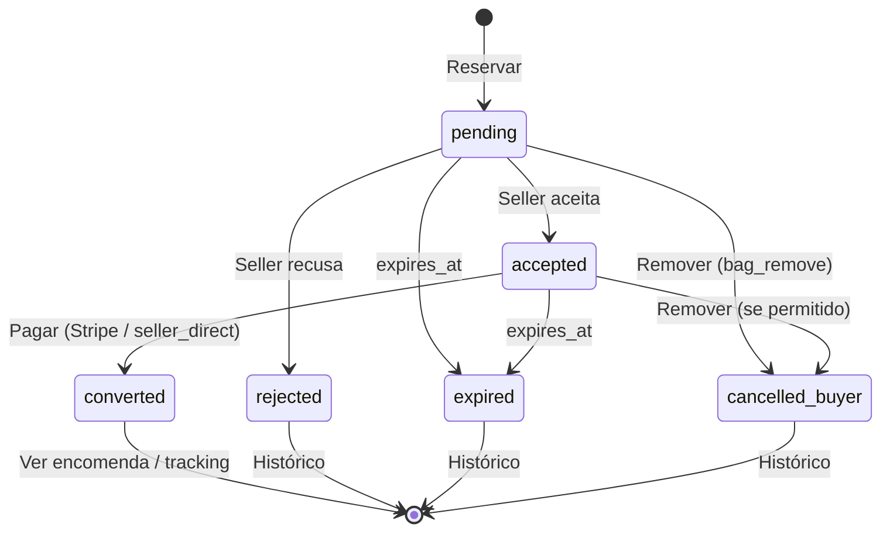
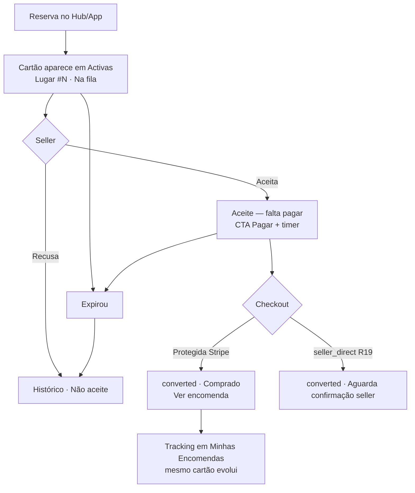
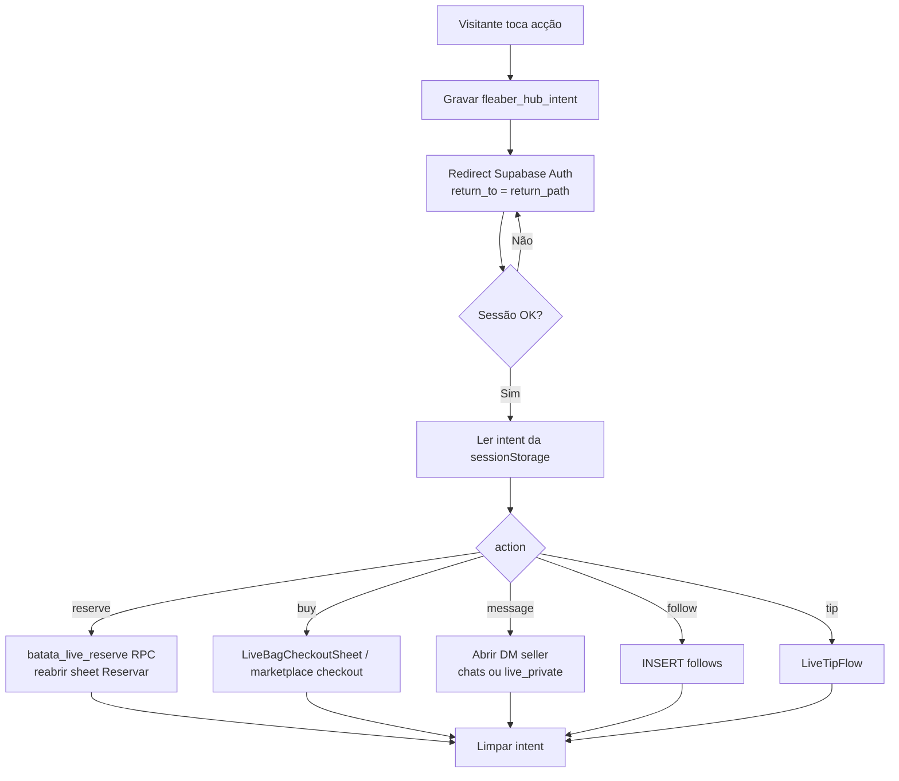
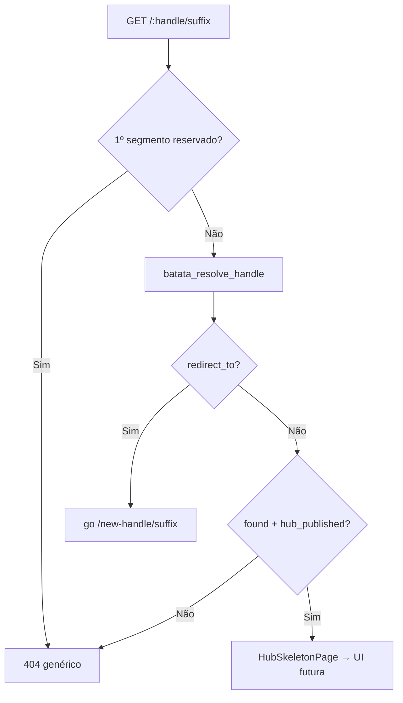
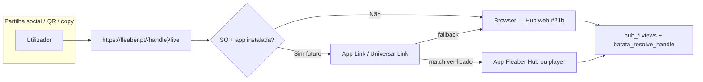

# Fleaber Live Hub — Plano Mestre (Documento Vivo)

> **Fonte única de verdade** para o Fleaber Live Hub e domínios associados.
> Este documento é **permanente** e deve ser **lido antes de qualquer nova análise** e **atualizado em cada iteração**.

**Como manter este documento (regras fixas):**
1. Ler sempre este ficheiro antes de iniciar nova análise.
2. Nova decisão → adicionar, marcar `DECIDIDO`, com **data** e **origem**.
3. Hipótese ainda aberta → marcar `EM ANÁLISE`.
4. Decisão alterada → **não apagar**; mover para [Decisões Substituídas](#decisões-substituídas) e explicar porquê.
5. Manter o [Resumo Executivo](#1-resumo-executivo) sempre atualizado no topo.
6. Cobre: Hub Perfil · Hub Direto · Identidade · Facebook · Mensagens · Reservas · Marketplace · Pagamentos · Trust & Verification · Funil Hub→Fleaber · Roadmap.

**Convenções de estado:** `DECIDIDO` · `EM ANÁLISE` · `SUBSTITUÍDO` · `RISCO`
**Última atualização:** 2026-06-20 — Projecto H scope v1 (`docs/project-h-fleahub-v1.md`)

---

## 1. Resumo Executivo

### Visão atual
O **Live Hub** é uma **camada web pública browser-first** sobre a infraestrutura Fleaber existente (Supabase + Mux/LiveKit + Stripe + Flutter web em `fleaber.pt`). Superfícies oficiais:

| URL | Superfície |
|---|---|
| `https://fleaber.pt/{handle}` | **Hub Perfil** — vitrine seller (marketplace, lives, avaliações) |
| `https://fleaber.pt/{handle}/live` | **Hub Direto** — vídeo, catálogo, FOMO, chat público |
| `https://fleaber.pt/{handle}/shop` | Marketplace tab (Fase 1.1) |
| `https://fleaber.pt/{handle}/reviews` | Avaliações tab (Fase 1.1) |

A **app Fleaber** (Android/iOS) mantém-se para sessão autenticada, seller studio e player in-app; links Hub partilhados abrem **sempre** o browser se a app não interceptar (ver [2.26](#226-hub-browser-first--domínio--app-links-decisão)).

O Hub **não cria sistemas paralelos**: reutiliza fila de reservas única, sistema de mensagens único, identidade única (uma pessoa = uma conta) e os fluxos de pagamento existentes. Funciona como **funil** para a app Fleaber (seguir, instalar, notificações, checkout, marketplace).

### Estado atual
- **~80% da infraestrutura de backend já existe** e é reutilizável (ver secções por domínio).
- **Reservas** e **Mensagens**: prontos, multi-origem já previsto. ✅
- **Pagamentos**: Stripe Checkout (com proteção/escrow) + Stripe Connect (payouts c/ KYC) prontos; retorno web já antecipado. ✅
- **Identidade**: base sólida (1 conta = `auth.users`/`profiles`); **handle público** arquitectura fechada (Iteração 11, secção 2.21). OAuth social ainda em falta. ⚠️ implementação pendente (#20)
- **Trust & Verification**: badges email/telemóvel existem; KYC delegado ao Stripe Connect (já bloqueia levantamentos). ⚠️
- **Trust Engine + Risk Engine**: arquitetura desenhada (Iteração 4) — dois motores complementares, 5 níveis de seller, denylist polimórfica, caps graduados. ⚠️
- **Modelo de dados Trust/Risk** (Iteração 5): 6 componentes definidos (`account_trust`, `trust_events`, `risk_events`, `risk_denylist`, `account_caps`, pipeline). Escrita server-only, event-sourcing + estado materializado, recompute híbrido. Falta tuning de pesos/caps + escolha de fila (pg_cron/pgmq). ⚠️
- **Fluxos Hub** (Iteração 6): mapeados ponta-a-ponta (visitante, reserva, minhas reservas, compra, mensagens, tracking, funil, conta existente, duplicação, marketplace×live, pós-live) + Top 20 pontos de confusão. Decisões-chave: login-on-action, lista única de reservas, conversa lógica única, sincronização de stock. ⚠️
- **Reservas (R17) e Método próprio (R19)** (Iteração 7–8): R19 **fechado** (`seller_direct`). R17 **revisto:** múltiplas posições legítimas; anti-duplicação por `idempotency_key` + janela anti-toque-duplo. ✅
- **Minhas Reservas** (Iteração 9): spec funcional completa — superfície global Hub+App, estados/transições/acções, sync Realtime, relação com Saco da live. ⚠️ `RISCO` R23: código App actual incrementa qty (conflito R17).
- **Fluxo Visitante + RLS** (Iteração 10–13): views `hub_*` + RPC FOMO. ✅ **#19b deployed staging** `fxdknzrqjenzqcvnwqqq` (2026-06-19) · prod não tocada
- **Handles públicos** (Iteração 11–12): DDL deploy **staging** `fxdknzrqjenzqcvnwqqq` (2026-06-19). Dry-run backfill: 41 sellers. Backfill real pendente aprovação. ✅ staging · 0 handles publicados
- **Hub web routing** (Iteração 14–18): browser-first `fleaber.pt/{handle}/*` · UI #21b · **SEO/OG #21c** [2.28](#228-hub-seo--open-graph--canonical-21c) · **CTAs seller app #21d** [2.29](#229-ctas-seller-na-app-21d). ✅ · App Links **#22** pendente

### Próximos temas em aberto (prioridade)
1. ~~Handle público + DDL~~ → **RESOLVIDO** (Iterações 11–12, secções 2.21–2.22). Deploy **#20b** staging ✅ → **#19b**. ⚠️
2. ~~Definir políticas RLS de leitura pública~~ → **RESOLVIDO** + **#19b deployed staging** (secções 2.20 + 2.23). ✅
3. Login Facebook + camada de resolução de identidade (`external_identities`, `account_contacts`). `EM ANÁLISE`
4. Tuning de pesos do Trust Score e dos caps por nível (carece de dados reais). `EM ANÁLISE`
5. Escolher infra do consumer/recompute (pg_cron síncrono vs `pgmq` + workers) e partição das tabelas de eventos. `EM ANÁLISE`
6. Governança da denylist (auditoria, expiração, recurso/appeal, retenção GDPR) + DPIA de profiling (Art. 22). `EM ANÁLISE`
7. ~~Hosting/SEO do Hub (Flutter Web vs site dedicado)~~ → **DECIDIDO browser-first** `fleaber.pt` (Iteração 15, secção 2.26). Implementação hosting + meta #21b/#22. ✅

---

## 2. Domínios

### 2.1 Hub Perfil

- `DECIDIDO` (2026-06-18, sessão arquitetura) — Conteúdo: perfil da seller, avaliações, marketplace, próximas lives, info pública.
- `DECIDIDO` — Dados já existem: `profiles`, `reviews`/`reviews_gerais`, `products` (`list_on_marketplace`), `lives`, `follows`/`v_seguidores_stats`.
- `DECIDIDO` (Iteração 10) — **Vitrine pública forte:** visitante vê perfil, marketplace, avaliações, lives (agendadas/activas/gravadas), CTA Seguir/Instalar/Login **sem** pedir conta à entrada. Spec completa: [2.20 Fluxo Visitante](#220-fluxo-visitante--rls-pública).
- `DECIDIDO` (Iteração 10) — Hub Perfil lê **`hub_profiles_public`** + **`hub_products_public`** + **`hub_lives_public`** + **`hub_reviews_public`** (views); **não** SELECT directo em `profiles`/`products`/`lives` para `anon`.
- `DECIDIDO` (Iteração 11) — URL **`fleaber.pt/{handle}`** via `profiles.handle` (≠ `full_name`). Spec: [2.21](#221-handles-públicos).
- `RISCO` (R24) — Hoje `profiles_select_anon` expõe **todas** as colunas (telefone, IBAN, moradas) → substituir por view na implementação.

### 2.2 Hub Direto

- `DECIDIDO` (2026-06-18) — Componentes: vídeo (Mux HLS), artigo atual (`live_items`/`live_item_show_events`), Reservar/Comprar, fila, minhas reservas, mensagens, tracking, marketplace, FOMO.
- `DECIDIDO` — Player/HLS (`MuxUrls.playbackHls`) reutilizável em web; chat público via Realtime quando autenticado.
- `DECIDIDO` — Regra BATATA: layout do player, carrossel de artigos e fluxos Mux/LiveKit **não se alteram** sem combinar; Hub é aditivo.
- `DECIDIDO` (Iteração 10) — Visitante no Hub Direto vê **vídeo + catálogo + FOMO agregado + chat público (leitura)**; **Reservar/Comprar/Mensagem/Seguir/Gorjeta** exigem login. Spec: [2.20](#220-fluxo-visitante--rls-pública).
- `DECIDIDO` (Iteração 11) — Rotas Hub: `/{handle}`, `/{handle}/live` (+ tabs futuras `shop`, `reviews`). Resolver handle → `profile_id` antes de queries.
- `DECIDIDO` (Iteração 10) — Dados públicos via views `hub_*` + RPC FOMO (secção 2.20).
- `RISCO` (R25) — `lives_select_public_live` actual devolve **`mux_stream_key`/`stream_key`** a qualquer leitor → view obrigatória antes de abrir Hub.

### 2.3 Identidade

> Detalhe completo definido na Iteração 2. Princípio: **3 camadas** — Conta canónica (`auth.users`/`profiles`) · Identidades de login (provedores) · Contactos verificados (chaves de convergência).

- `DECIDIDO` (2026-06-18, sessão identidade) — **UMA PESSOA = UMA CONTA** = `auth.users.id` (= `profiles.id`). Nunca duplicar este conceito.
- `DECIDIDO` — Modelo de dados: `external_identities` (provedor × conta), `account_contacts` (emails/telefones verificados, com unicidade dura), `identity_merge_log` (auditoria/reversão).
- `DECIDIDO` — **Link ≠ Merge.** Ligar identidade nova a conta existente é seguro/frequente; fundir duas contas ativas é raro, exige confirmação forte e é reversível.
- `DECIDIDO` — Pipeline de resolução determinística: (1) `provider_uid` já ligado → (2) contacto verificado coincide → (3) sessão autenticada (link explícito) → (4) só assistido se a prova for fraca.
- `DECIDIDO` — Travas anti-duplicação: `UNIQUE(provider, provider_uid)` e `UNIQUE(type, value_normalized) WHERE verified_at IS NOT NULL`.
- `DECIDIDO` — Ordem de precedência para conta canónica/dados de perfil em conflito: Facebook > Google > Apple > Email > Telefone. (Para *segurança*, contacto **verificado** vence sempre não-verificado.)
- `DECIDIDO` — Casos-limite: mudança de email/telefone → novo contacto verificado + antigo `superseded` (nunca apagar); Apple Private Relay → usar `sub`, excluir email do matching; Facebook sem email → conta "ilha" + pedir contacto verificável.
- `DECIDIDO` (Iteração 11) — **`profiles.handle`** = slug URL único e estável; **`full_name`** = nome de exibição. Histórico em **`profile_handle_redirects`**. Spec: [2.21](#221-handles-públicos) · DDL: [2.22](#222-ddl-handles--spec-implementável).
- `EM ANÁLISE` — Usar Auth Hook do Supabase (`before-user-created` / custom access token) vs. Edge Function de resolução à parte.
- `EM ANÁLISE` — Desligar auto-link nativo do Supabase por email não-verificado e controlar na nossa camada.

### 2.4 Facebook

- `DECIDIDO` (2026-06-18) — Facebook é um provedor de login que **converge** para a conta Fleaber via `external_identities`.
- `DECIDIDO` — Reservas via Facebook usam `live_reservation_requests.source = 'facebook_manual'`, inseridas por seller/staff (server-side), na **mesma fila única**.
- `EM ANÁLISE` — Ingest de comentários Facebook → reservas (assíncrono, `service_role`, idempotente, mapear FB→buyer). **Não-MVP.**
- `RISCO` — Facebook frequentemente sem email ou com email divergente → risco de duplicado. Mitigar com "ligar Facebook dentro da sessão" e telefone como chave comum.

### 2.5 Mensagens

- `DECIDIDO` (2026-06-18) — **Um só sistema de mensagens.** A seller responde sempre no Fleaber. A compradora lê/escreve pela App ou pelo Hub.
- `DECIDIDO` — Tabelas existentes: `live_private_messages` (viewer↔seller durante a live), `chats`+`chat_messages` (DM persistente), `live_messages` (chat público da live). **Não criar sistemas paralelos.**
- `RISCO` — Escrever mensagens pelo Hub exige sessão autenticada (RLS `to authenticated`).

### 2.6 Reservas

- `DECIDIDO` (2026-06-18) — **Fila única** em `live_reservation_requests`, com `source ∈ {fleaber_live, facebook_manual, helper_manual}`, `queue_position`, expiração 45 min, lista de espera.
- `DECIDIDO` — RPCs prontos: `batata_process_live_reservation_request`, `batata_live_bag_remove_request`, `batata_live_reservation_queue_for_live`, `batata_live_reservation_stripe_convert`, `batata_recompact_reservation_queue`.
- `DECIDIDO` — Reserva via Hub (`source='fleaber_live'`) exige `auth.uid() = buyer_id` → comprador autenticado.
- `DECIDIDO` — Reservas convertem em `orders` (com `live_id`/`live_item_id`) no checkout.

**Anti-duplicação acidental de reservas (R17) — `DECIDIDO` (Iteração 8, revê Iteração 7):**

> **Regra de produto:** *Uma pessoa pode ter várias posições na fila do mesmo artigo, desde que sejam reservas intencionais distintas.* O objetivo **não** é limitar a uma linha por `(buyer, item)` — é impedir **toque duplo, retries e duplicações acidentais**.

- `DECIDIDO` — **Toque duplo / retry / mesmo `idempotency_key` = mesma reserva** (devolve a linha existente; não cria nova `queue_position`).
- `DECIDIDO` — **Reserva intencional nova (fora da janela anti-toque-duplo) = nova linha + nova `queue_position`** na mesma fila.
- `DECIDIDO` — **Não** usar `UNIQUE(buyer_id, live_item_id)` global para `pending/accepted` — isso bloquearia reservas legítimas múltiplas.
- `DECIDIDO` — Unicidade técnica por **`idempotency_key`** (obrigatório no cliente por ação de reserva) e, opcionalmente, **`reservation_intent_id`** (UUID gerado no início do gesto "Reservar").
- `DECIDIDO` — **Janela anti-toque-duplo** (`EM ANÁLISE` duração exacta, proposta **3–5 s**): se a mesma pessoa reservar o mesmo `live_item_id` dentro da janela **sem** novo `idempotency_key` explícito → devolver a reserva `pending` mais recente (não criar nova linha).
- `DECIDIDO` — Colunas: `idempotency_key text NOT NULL` (por ação), `reservation_intent_id uuid` (opcional, rastreio do gesto), `external_buyer_ref text` (FB/manual antes de `buyer_id`), `dedupe_reason text null` (ex. `idempotency_hit`, `anti_double_tap`, `fb_comment_id`).
- `DECIDIDO` — Índice: **`UNIQUE(idempotency_key)`**; índice composto **`(buyer_id, live_item_id, created_at DESC)`** para lookup da janela (sem unique). **Removido** da Iteração 7: `UNIQUE(live_item_id, buyer_id)` e `UNIQUE(live_item_id, external_buyer_ref)`.
- `DECIDIDO` — **Reconciliação FB↔Fleaber:** atribuir `buyer_id` às linhas `facebook_manual` quando a identidade convergir; **não fundir** reservas legítimas distintas da mesma pessoa+item. Só deduplicar se **mesmo `idempotency_key`** (ex. re-ingest do mesmo comentário FB) ou duplicado acidental dentro da janela anti-toque-duplo cross-surface.
- `DECIDIDO` — Lógica concentrada na RPC **`batata_live_reserve`** (ou equivalente): validar idempotency → janela → insert com nova `queue_position`; nunca upsert que absorva reservas intencionais distintas.
- `EM ANÁLISE` — Duração exacta da janela anti-toque-duplo; formato de `idempotency_key` para ingest FB (ex. `fb_comment:{comment_id}`).
- `RISCO` — Reserva FB sem `buyer_id` permanece sob `external_buyer_ref` até convergência; dedupe parcial por `idempotency_key` do comentário.
- `DECIDIDO` (Iteração 9) — Vista **Minhas Reservas** (global Hub+App): spec completa em [2.19](#219-minhas-reservas--spec-funcional); uma linha por reserva, sync Realtime, continuidade reserva→encomenda via `order_id`.

- `DECIDIDO` (2026-06-18) — `products` (`list_on_marketplace`, `available_for_live`, `image_urls`, `ref_code`) + `product_offers` (propostas estilo Vinted).
- `DECIDIDO` — Venda paga marca `is_sold=true`/`list_on_marketplace=false` (trigger `batata_mark_product_sold_on_paid_order`).
- `EM ANÁLISE` — Leitura pública (anónima) do marketplace no Hub exige nova policy read-only.

### 2.8 Pagamentos

- `DECIDIDO` (2026-06-18) — **Dois modos:** (a) Checkout Fleaber com proteção (Stripe Checkout → escrow na `wallets`); (b) meios próprios da seller (MBWay/IBAN, campos `profiles.mb_way`/`iban`/`external_payments_enabled`, **display only**, sem proteção Fleaber).
- `DECIDIDO` — `create-payment-intent` suporta bag/live/reserva e **retorno web** via env `FLEABER_WEB_APP_URL` (`/stripe-success`). O Hub consome tal-qual.
- `DECIDIDO` — Comissão Fleaber: 0,65€ + 5% (`batata_order_commission_amount`); libertação da wallet por conclusão/review positiva.
- `DECIDIDO` — Payouts via **Stripe Connect Express** (PT, capability `transfers`); levantamento exige `details_submitted=true` e `transfers='active'` → **KYC já é pré-requisito técnico do levantamento**.
- `EM ANÁLISE` — Integração real MBWay/Ifthenpay (hoje inexistente; só campos de display).

**Lifecycle do método próprio da seller — `DECIDIDO` (Iteração 7, fecha R19):**
- **A Fleaber regista o acordo, não o pagamento.** Confirmação é **atestada** (manual), não verificada → UX tem de o dizer.
- Coluna `orders.payment_mode` ∈ `{fleaber_protected (default), seller_direct}` + `payment_attested_by`, `payment_attested_at`, `seller_payment_method` (mbway|iban).
- **Máquina de estados `seller_direct`:** `aguarda_confirmacao` (acordo; artigo **reservado**; dados mostrados; sem proteção) → `pago` *(atestado, só seller/staff)* → `enviado` (+tracking) → `entregue`/`concluido`; `cancelado` por cancelamento ou **timeout 48h** (liberta stock).
- **Sem escrow, sem comissão de proteção (0,65€+5%), sem disputa/reembolso Fleaber** (não processou o dinheiro).
- **Stock consistente:** acordo reserva; `pago`→`sold`; cancel/timeout→liberta (impede duplo-venda com o fluxo protegido).
- **Papéis:** buyer "Já paguei" = **só informativo** (notifica seller, não muda estado financeiro); seller/staff "Confirmar recebido" = `pago`.
- **Gating/salvaguardas:** só se `external_payments_enabled` **e** telemóvel verificado; **rótulo obrigatório "SEM proteção Fleaber"** + fricção deliberada; queixas alimentam Trust/Risk da seller → taxa alta **desativa** método próprio.
- `RISCO` — Atestação falsa (seller/buyer) é irresolúvel pela Fleaber → mitigação: sinal de risco + desativação + empurrar checkout protegido.

### 2.9 Trust & Verification

> Iteração 3 (2026-06-18). Princípio: **verificação progressiva baseada em risco** — não travar navegação nem 1ª venda; travar **cash-out** e **escala**. Delegar KYC pesado ao Stripe Connect.

#### A) Quando exigir email / telefone verificado
- `DECIDIDO` — **Comprador**: precisa de **≥1 contacto verificado** (email *ou* telemóvel) para **transacionar** (reservar / comprar / enviar mensagem). Navegar/ver live = sem fricção.
- `DECIDIDO` — **Email verificado**: obrigatório para recuperação de conta e notificações transacionais.
- `DECIDIDO` — **Telemóvel verificado (OTP)**: obrigatório para **vender** (listar/criar produtos, ir para live) e é a **principal alavanca anti-multiconta** (escassez de SIM). Já existe verificação por SMS (`send-sms-bulkgate`, `profiles.phone_verified_at`).
- `DECIDIDO` — Seller = email verificado **e** telemóvel verificado (mínimo).

#### B) Quando exigir documento / selfie / comprovativo de morada
- `DECIDIDO` — **Verificação progressiva e baseada em risco.** Não pedir documentos no registo nem na 1ª venda.
- `DECIDIDO` — **Documento de identificação + selfie (liveness)**: exigido para **levantar dinheiro** (delegado ao **Stripe Connect Express** onboarding — já bloqueia transfers) e/ou quando sinais de fraude disparam.
- `DECIDIDO` — **Comprovativo de morada / AML**: só para **Seller Profissional** ou acima de limiares de GMV/regulatórios, ou quando o Stripe o solicitar. Não pedir antecipadamente (mata o funil).
- `DECIDIDO` — Fleaber **não armazena documentos crus**; guarda apenas o **estado KYC** + fingerprints estáveis (hashed). Documentos vivem no Stripe.

#### C) Níveis de seller
- `SUBSTITUÍDO` (Iteração 4) — O modelo de **quatro estados** foi expandido para **cinco** (acrescenta "Candidato a Seller"). Ver [2.13 Seller Levels](#213-seller-levels) e [Decisões Substituídas](#decisões-substituídas).

#### D) O que cada nível desbloqueia
| Capacidade | Comprador | Básica | Verificada | Profissional |
|---|---|---|---|---|
| Comprar / reservar / mensagem | ✅ (≥1 contacto verif.) | ✅ | ✅ | ✅ |
| Listar marketplace / vender | — | ✅ (escrow) | ✅ | ✅ |
| Receber pagamentos (Checkout Fleaber) | — | ✅ (retido) | ✅ | ✅ |
| **Levantamentos** | — | ❌ | ✅ (Stripe KYC) | ✅ |
| **Live selling** | — | ❌ | ✅ | ✅ |
| Meios próprios (MBWay/IBAN, sem proteção) | — | ✅ (após telef. verif., com aviso) | ✅ | ✅ |
| Caps de GMV/saque | — | baixos | médios/altos | altos/sem cap |
| Faturação / comissão reduzida | — | — | — | ✅ |

- `DECIDIDO` (Iteração 4) — **Live selling só para Seller Verificada** (resolve o `EM ANÁLISE` anterior). Origem: input do utilizador.

#### E) Prevenção de fraude / multiconta / contas descartáveis / reincidentes
- `DECIDIDO` — **Telemóvel OTP como chave escassa** (uma chave verificada = um grafo de conta, via `account_contacts` único). Limitar nº de contas por telemóvel verificado.
- `DECIDIDO` — **Escrow + libertação diferida** (já existe) → janela para detetar fraude antes do payout.
- `DECIDIDO` — **KYC Stripe** liga payout a identidade legal + conta bancária reais → reincidente é apanhado pelo ID/banco.
- `DECIDIDO` — **Denylist por chaves estáveis** (telemóvel, hash do documento KYC, fingerprint da conta bancária, device) → banido não consegue re-registar e passar KYC com os mesmos dados.
- `DECIDIDO` — **Trust score + caps por idade/comportamento** (taxa de cancelamento, disputas, chargebacks) → throttling automático; revisão humana só em exceções.
- `EM ANÁLISE` — Blocklist de emails descartáveis; device fingerprint/IP velocity.

#### F) Integração com a arquitetura de identidade
- `DECIDIDO` — Trust é **por pessoa (conta canónica)**, não por identidade de provedor. Vive numa tabela `account_trust`/`account_verification` ligada a `profiles.id`.
- `DECIDIDO` — `account_contacts` (email/telefone verificados) alimenta diretamente os gates de verificação; a unicidade dura é a espinha anti-duplicado.
- `DECIDIDO` — Estado KYC espelhado a partir do Stripe Connect (`wallets.stripe_account_id`).
- `DECIDIDO` — **Ban aplica-se ao grafo da pessoa** (todas as identidades ligadas) + às chaves estáveis recuperadas → re-login por outro provedor resolve para grafo banido ou é bloqueado no KYC.

#### G) Proposta final escalável
- `DECIDIDO` — Verificação **progressiva/baseada em risco** + **4 níveis** + **KYC delegado ao Stripe** (sem armazenar PII sensível). Regras automáticas; humano só em flags. Escala a dezenas de milhares: matching de contactos é O(1) indexado, KYC é outsourced, gating é automático.
- `DECIDIDO` (Iteração 5) — Modelo de dados detalhado em [2.17 Modelo de Dados Trust/Risk](#217-modelo-de-dados-trustrisk-implementável). (`account_trust` consolidado; a denylist é a tabela polimórfica `risk_denylist`, não `identity_denylist`.)

### 2.10 Funil Hub → Fleaber

- `DECIDIDO` (2026-06-18) — O Hub deve empurrar: seguir seller (`follows`), instalar app, notificações (`user_notifications`), checkout Fleaber (proteção), marketplace.
- `DECIDIDO` — Sessões **anónimas Supabase** permitem navegar a vitrine antes de converter login (reduz fricção do funil).

### 2.11 Trust Engine

> Iteração 4 (2026-06-18, sessão Trust/Risk Engine).

- `DECIDIDO` — **Trust ≠ Reputação.** Reputação = público (`reviews`/`reviews_gerais`). Trust = interno, integridade da **pessoa** (não do papel). O score cru **nunca** é exposto ao utilizador (evita gaming/contestação).
- `DECIDIDO` — **Escala interna 0–1000** + **bandas públicas**: `Novo` (0–199) · `Em construção` (200–449) · `Fiável` (450–749) · `Excelente` (750–1000).
- `DECIDIDO` — Cálculo = base + componentes ponderados, com **decay** (negativos recentes pesam mais), **rácios** (taxa, não contagem) e **caps por fator** (anti-gaming).
- `DECIDIDO` — Fatores positivos: base na criação, email/telemóvel verificados, KYC, antiguidade (log), encomendas/lives concluídas, taxa de feedback positivo, cumprimento rápido, payouts limpos.
- `DECIDIDO` — Fatores negativos: taxa de cancelamento, disputas validadas, chargebacks, denúncias validadas, reembolsos forçados/não-envio, sinal de multiconta; **fraude confirmada → floor + ban**.
- `DECIDIDO` — Recompute **orientado a eventos** (nunca no read); decay em batch periódico; banda em cache.
- `DECIDIDO` — Trust modula caps **dentro** do nível (nível = porta; trust = mostrador dinâmico).
- `EM ANÁLISE` — Pesos concretos de cada fator (carecem de tuning com dados reais).

### 2.12 Risk Engine

> Iteração 4 (2026-06-18).

- `DECIDIDO` — **Trust (lento, por pessoa) ≠ Risk (rápido, por evento/sessão).** Dois motores complementares.
- `DECIDIDO` — **Risco sobrepõe-se às permissões** de nível+trust (Seller Verificada em risco crítico tem payout congelado).
- `DECIDIDO` — Risco = desvio do padrão esperado × potencial de perda. Sinais: conta nova/sem KYC; velocidade/anomalia (pico vendas/GMV/reservas); pagamento (chargebacks, reembolsos, 1ª venda alta); **mutação sensível** (IBAN/telefone/email → cooldown); sessão/device (device/IP novo, impossible travel, VPN, multiconta no mesmo device); comportamental (não-envio, devoluções em série).
- `DECIDIDO` — Quatro níveis e ações automáticas:
  - **Baixo** → permitir; monitorizar.
  - **Médio** → fricção: step-up OTP, caps reduzidos, payout retido +X dias, fila soft.
  - **Alto** → bloquear payouts, exigir re-KYC/documento, limitar anúncios, flag revisão manual, escrow estendido.
  - **Crítico** → congelar venda+payout+fundos, lock da conta, forçar re-auth, candidato a denylist após confirmação.
- `DECIDIDO` — Arquitetura: *event bus* → avaliador (regras + score) → escreve `risk_events` + atualiza `account_trust.risk_level`/flags → enforcement nos gates (Hub/Marketplace/Live/Payout). Mutações sensíveis disparam cooldown automático.
- `EM ANÁLISE` — Limiares concretos de cada nível e duração dos cooldowns.

### 2.13 Seller Levels

> Iteração 4 (2026-06-18). Substitui o modelo de 4 estados da secção 2.9-C.

- `DECIDIDO` — **Cinco níveis** (trust pertence à pessoa; o nível é o papel atual):

| Nível | Requisitos | Permissões | Limites (ilustrativos `EM ANÁLISE`) |
|---|---|---|---|
| **Comprador** | conta + ≥1 contacto verificado | comprar, reservar, mensagem | — |
| **Candidato a Seller** | intenção/onboarding iniciado; aceitou termos seller | preparar catálogo (rascunhos), ver studio; **não publica, não vende, não live** | 0 vendas |
| **Seller Básica** | email + telemóvel verificados | listar marketplace, vender via Checkout Fleaber (**escrow**) | anúncios ~30; venda ≤75 €; GMV/mês ≤500 €; **sem levantamento; sem live** |
| **Seller Verificada** | + **KYC Stripe** (ID/selfie) | **levantamentos**, **live selling**, caps mais altos | anúncios ~300; venda ≤750 €; GMV/mês ≤7.500 €; saque limitado |
| **Seller Profissional** | + entidade/NIF, morada/AML quando aplicável | faturação, caps elevados/sem cap, comissão potencialmente reduzida, equipa/helpers | tetos regulatórios AML |

- `DECIDIDO` — **Candidato a Seller** é estado intermédio (reduz fricção: começa a preparar enquanto a verificação decorre).
- `DECIDIDO` — **Live selling só Verificada**; **levantamentos só Verificada** (já é pré-requisito técnico do Stripe Connect).

### 2.14 Buyer Levels

> Iteração 4 (2026-06-18).

- `DECIDIDO` — **Não criar escada de tiers de comprador** (novo/verificado/premium) nesta arquitetura. Justificação: o comprador não custodia dinheiro nem faz payout; o risco (chargebacks, devoluções em série) é tratado pelo Risk Engine, não por níveis.
- `DECIDIDO` — Comprador partilha o mesmo `account_trust`; funcionalmente só importam dois estados: `pode_transacionar` (≥1 contacto verificado) e `restrito` (limitado por risco).
- `EM ANÁLISE` — "Comprador premium" como **programa de lealdade** (não trust) — eventual roadmap de fidelização, fora do âmbito de identidade/risco.

### 2.15 Anti-Fraude

> Iteração 4 (2026-06-18). Arquitetura em 5 camadas.

- `DECIDIDO` — Camadas: (1) **Prevenção** (OTP telefone, KYC payout, unicidade de contactos, device fingerprint); (2) **Deteção** (Risk Engine + grafo device/IP/banco); (3) **Contenção** (escrow/holds/caps/cooldowns — escrow já existe); (4) **Resposta** (auto + manual); (5) **Reincidência** (denylist por chaves estáveis).
- `DECIDIDO` — **Escrow + libertação diferida** (já existe) é a rede de segurança central: dinheiro só sai após sinal de cumprimento.
- `DECIDIDO` — Cenários e respostas:
  - **Múltiplas contas** → grafo device/IP + telefone único → flag, limitar venda, OTP; revisão/ban manual.
  - **Reincidentes** → match em denylist → bloquear registo/venda/payout.
  - **Fraude de pagamento/chargebacks** → Stripe Radar + escrow/hold + risco→Alto + payout freeze.
  - **Seller que desaparece** → SLA de envio → auto-reembolso do escrow + penaliza trust.
  - **Comprador abusivo** → taxa devolução/disputa alta → risco↑ + restringir checkout.
- `EM ANÁLISE` — Construção do grafo device/IP (in-house vs. vendor) e blocklist de emails descartáveis.

### 2.16 Denylist

> Iteração 4 (2026-06-18).

- `DECIDIDO` — **Uma tabela polimórfica** `risk_denylist` (`key_type`, `severity`, `reason`, `evidence_ref`, `expires_at`, `status`, auditoria) em vez de 4 tabelas separadas.
- `DECIDIDO` — **Hard block:** `identity` (hash KYC), `bank_fingerprint` (IBAN/Stripe, nunca cru), `phone_hash` (**com expiração + recurso**, por causa de números reciclados).
- `DECIDIDO` — **Só soft signal (nunca hard block):** `device` (falsos positivos), `email/domínio` (infinitos), `IP` (CGNAT/partilhado).
- `DECIDIDO` — **Governança obrigatória (GDPR/legal):** guardar hashes (não dados crus) + motivo + evidência + **auditoria + recurso/appeal + retenção**. Sem bans permanentes irreversíveis sem humano.
- `DECIDIDO` — Ban aplica-se ao **grafo da pessoa** + chaves estáveis; intercepta na resolução de identidade e no payout.

### 2.17 Modelo de Dados Trust/Risk (implementável)

> Iteração 5 (2026-06-18, sessão modelo de dados). Aplica-se ao **Fleaber inteiro** (App, Hub, Marketplace, Lives, Checkout, onboarding, pagamentos, levantamentos, disputas).

**Princípios `DECIDIDO`:**
- **Escrita server-only.** Nenhum `authenticated`/`anon` escreve em tabelas trust/risk; só `service_role` ou RPC `SECURITY DEFINER` (defesa nº1 anti-gaming).
- **Event sourcing + estado materializado.** `trust_events`/`risk_events` append-only (verdade auditável); `account_trust`/`account_caps` materializados (leitura O(1) no caminho quente).
- **Score nunca exposto.** `authenticated` só lê derivados (banda/nível/caps/flags públicas) via views sanitizadas; nunca o 0–1000 nem eventos de risco.
- **Risk ≠ Trust.** Risco não mexe no score; só `risk_level`/`frozen_until`/`flags`. Sinal **confirmado** (chargeback, multiconta) gera `trust_event` negativo — única ponte risk→trust.

**Tabelas `DECIDIDO` (estrutura):**

| Tabela | Papel | PK | Escrita | Leitura (RLS) |
|---|---|---|---|---|
| `account_trust` | estado materializado por pessoa (score, band, seller_level, buyer_state, risk_level, account_state, kyc_status, email/phone_verified, frozen_until, last_event_id) | `user_id`→profiles | consumer/admin (`SECURITY DEFINER`) | própria via view `v_my_account_status`; admin/service tudo |
| `trust_events` | append-only, factos lentos (verificações, KYC, orders/lives concluídas, disputas perdidas, chargebacks, fraude) | `id bigint` | `record_trust_event()` idempotente (`dedupe_key`) | só admin/service |
| `risk_events` | append-only, sinais rápidos por evento/sessão (device/IP, velocity, mutações IBAN/telefone, login, payout) | `id bigint` | avaliador de risco (edge/RPC) | só admin/service |
| `risk_denylist` | polimórfica hard/soft (`key_type`,`key_hash`,`severity`,`scope`,`status`,`expires_at`,appeal) | `id uuid` | admin/system confirmado | só admin/service (verificação interna) |
| `account_caps` | limites efetivos materializados (anúncios, valor/venda, GMV/mês, payout, lives, escrow_days) derivados de `cap_policy(level,band)` + risco | `user_id`→profiles | consumer/admin | própria (view sanitizada) |
| `cap_policy` | configuração versionada nível×banda → caps | (level, band) | admin | service |

**`DECIDIDO` — Índices/constraints-chave:** `trust_events`/`risk_events` particionadas por mês + índice parcial `WHERE processed_at IS NULL` (fila); `risk_denylist` `UNIQUE(key_type,key_hash) WHERE status='active'`; checks de enums em todas; `account_trust.trust_score CHECK 0..1000`.

**`DECIDIDO` — Pipeline híbrido:** incremental near-real-time (worker consome eventos não processados, aplica delta + recomputa banda/caps, avança cursor `last_event_id`) + batch diário (decay, reconciliação, expiração de `risk_events`/`phone_hash`). Idempotência por `dedupe_key` + cursor; concorrência por update otimista/advisory lock por `user_id`.

**`DECIDIDO` — Geração de eventos:** triggers `AFTER` nas tabelas de negócio (`orders`, `reviews`, `order_disputes`, `profiles`, `wallets`) + webhooks Stripe (KYC, chargeback, payout) → `record_trust_event`; gates edge (login/checkout/payout/listing) → `record_risk_event`.

**`DECIDIDO` — Decisões de risco:** `allow` (baixo) · `step_up` (médio) · `review`+`block_temp` (alto, payout freeze + `frozen_until`) · lock (crítico, `account_state='frozen'`). **`block_perm` só após confirmação humana** → `risk_denylist` + `account_state='banned'`.

**`DECIDIDO` — GDPR/retenção:** `account_trust`/`account_caps` só derivados (zero PII crua); `risk_events` guardam device/IP **hash/truncado** com retenção curta (~6–12m); `trust_events` ~24m + arquivo; `risk_denylist` só hashes, com expiração + revisão. Profiling sob **Art. 22** → base legal (prevenção de fraude) + transparência + **appeal + revisão humana**; apagamento de conta → apagar/anonimizar `user_id`.

**`EM ANÁLISE`:** pesos concretos de `weight_delta` por `event_type`; limiares de `severity`/`risk_level` e cooldowns; valores de `cap_policy`; escolha de fila (pg_cron vs `pgmq`); estratégia de partição/arquivo à escala 1M.

### 2.18 Fluxos Hub (ponta-a-ponta)

> Iteração 6 (2026-06-18, sessão fluxos). Análise funcional antes de qualquer implementação. Cadeia: Facebook → Hub → Fleaber → Marketplace → Checkout → Mensagens → Tracking.

**A) Visitante (`/{handle}` e `/{handle}/live` sem conta)**
- `DECIDIDO` — **Login-on-action** (just-in-time): nunca pedir login à entrada; só ao tocar Reservar/Comprar/Mensagem/Seguir/Gorjeta. **Preservar intenção** (ver [2.20 § Acções](#acções-login-on-action)).
- `DECIDIDO` (Iteração 10) — **Vitrine pública forte** + **zero dados privados** (sem fila nominal, sem reservas alheias, sem DMs, sem encomendas). Matriz completa e RLS mínima em [2.20](#220-fluxo-visitante--rls-pública).
- `DECIDIDO` (Iteração 10) — **Views públicas read-only** (preferido) em vez de abrir tabelas base; revogar `profiles_select_anon` directo na implementação.

**B) Reserva** — `DECIDIDO`: estados `pending/accepted/rejected/expired/converted`, `queue_position` por artigo, expiração 45 min, lista de espera mesmo sem stock. Saco agrega múltiplas reservas. `EM ANÁLISE`: semântica exata do timer (criação vs aceitação) e comunicação de "lista de espera sem garantia".

**C) As Minhas Reservas** — ver spec completa [2.19 Minhas Reservas](#219-minhas-reservas--spec-funcional).

**D) Compra** — `DECIDIDO`: protegida (Stripe escrow), própria (MBWay/IBAN, **sem proteção**, com aviso explícito), marketplace e live (Saco → 1 sessão Stripe). `DECIDIDO` (Iteração 7): ciclo de vida do método próprio fechado — ver 2.8 (`payment_mode=seller_direct`, atestação, timeout 48h).

**E) Mensagens** — `DECIDIDO`: **uma conversa lógica** por par comprador↔seller; Hub escreve nas mesmas tabelas; seller responde sempre na App. Push (tempo real) + email (transacional) + in-app (`user_notifications`). `EM ANÁLISE`: convergência física `live_private_messages`→`chats` vs apresentação unificada.

**F) Tracking** — `DECIDIDO`: timeline única em Minhas Encomendas (espelhada no Hub) sobre o enum de `orders` (`pago→enviado→entregue→concluido` + ramo devolução); push/email por transição; continuidade reserva→encomenda.

**G) Funil App/Seguir/Notificações** — `DECIDIDO`: **value-first, contextual, 1 prompt/sessão, respeitar dismiss**. Seguir após engagement; instalar app após ação comprometida ou fim da live; notificações ligadas a benefício concreto (reserva aceite / próxima live). Sem modais à entrada.

**H) Conta existente (FB)** — `DECIDIDO`: aplica pipeline de identidade; após login mostrar **estado unificado** (reservas/mensagens/encomendas) como prova de convergência; nunca criar 2ª conta silenciosamente.

**I) Duplicação de ações** — `DECIDIDO`: princípio "uma ação · uma fila · uma verdade" via convergência de identidade + idempotência + tabelas únicas. `DECIDIDO` (Iteração 8, R17 revisto): anti-duplicação **acidental** por `idempotency_key` + janela anti-toque-duplo; **múltiplas posições legítimas** permitidas; reconciliação FB atribui `buyer_id` sem fundir reservas distintas — ver 2.6.

**J) Marketplace × Live** — `DECIDIDO`: estados sincronizados (vendido/reservado/última unidade) coerentes em todas as superfícies; reserva de item esgotado bloqueada (`item_sold`). `EM ANÁLISE`: **fonte única de verdade de stock** (`products.quantity` vs `live_items`, ligados por `ref_code` fraco; existe RPC `batata_live_item_stock`).

**K) Pós-Live** — `DECIDIDO`: vídeo vira VOD; catálogo, reservas (timers continuam), checkout, tracking e DM **continuam**; chat público/espectadores/FOMO ao vivo congelam; "pagamento continua aberto" deve ser explícito. `RISCO`: insert em `live_messages`/`live_private_messages` exige live ativa → **mensagens pós-live têm de rotear para `chats`**.

**L) Top 20 pontos de confusão** — documentados na Iteração 6; #6 e #12 mitigados pela spec 2.19 (reserva≠compra, lista não colapsada).

---

### 2.19 Minhas Reservas — spec funcional

> Iteração 9 (2026-06-18). **Página mais importante da Hub** para a compradora: único sítio onde percebe o que reservou, em que live, posição na fila, prazo de pagamento e evolução para encomenda. Mesma verdade em App e Hub.

#### Papel e superfícies

| Superfície | Âmbito | Papel |
|---|---|---|
| **`Minhas Reservas`** (global) | Todas as lives do `buyer_id` | Vista principal Hub (+ equivalente App); histórico + activas |
| **`Saco da live`** (`LiveBagSheet`, App/Hub no player) | Só `live_id` actual | Atalho contextual durante o directo; **subset** de Minhas Reservas |
| **`Minhas Encomendas`** | `orders` | Tracking pós-compra; ligação via reserva `converted` |

- `DECIDIDO` — **Uma fonte de dados:** `live_reservation_requests WHERE buyer_id = auth.uid()` (+ joins `lives`, `live_items`, `products`, `orders`).
- `DECIDIDO` — **Uma linha por reserva intencional** (R17): nunca colapsar múltiplas reservas do mesmo artigo num só cartão; cada uma mostra **Lugar #N** (`queue_position`).
- `DECIDIDO` — **Componente de cartão partilhado** (DRY): o mesmo widget renderiza linha no Saco da live e em Minhas Reservas (parâmetro `compact` vs `full`).
- `DECIDIDO` — **Hub:** painel compacto no Hub Direto ("As minhas reservas · N") + rota dedicada **`/minhas-reservas`** (full page). Badge no header do player quando N>0.
- `DECIDIDO` — **App:** manter Saco da live no player; adicionar entrada global "Minhas reservas" (menu/perfil ou tab) que usa **a mesma query e o mesmo cartão**.

#### Arquitectura de informação

**Três secções (tabs ou filtros):**

| Secção | Critério (`status` + notas) | Ordenação |
|---|---|---|
| **Activas** | `pending`, `accepted` | Live ao vivo primeiro → `expires_at` ASC (urgência) |
| **Compradas** | `converted` | `updated_at` DESC |
| **Histórico** | `rejected`, `expired`, canceladas pelo comprador (`bag_removed`) | `updated_at` DESC |

**Agrupamento dentro de Activas/Compradas:** por **live** (cabeçalho: seller + título live + badge `AO VIVO` / `GRAVADO` / `TERMINADA`); dentro do grupo, **cartões flat** (não agrupar por artigo).

#### Campos visíveis por cartão

| Campo | Origem | Notas UX |
|---|---|---|
| Foto + título/ref | `live_items` / `products` | |
| Seller + live | `profiles`, `lives` | Link para Hub Perfil / reabrir live |
| **Lugar #N** | `queue_position` | Sempre visível em Activas |
| Estado | `status` → label PT | Ver tabela abaixo |
| **Timer** | `expires_at` | Countdown; cor muda <5 min |
| Quantidade | `requested_qty` | Se >1: "×2 unidades" |
| Encomenda | `order_id` (ver abaixo) + `orders.status` | Só em Compradas / converted |
| Modo pagamento | `orders.payment_mode` | Protegida vs directo (R19) |
| Origem | `source` | Discreto: App · Hub · Facebook |

- `DECIDIDO` — Coluna **`order_id uuid`** em `live_reservation_requests`, preenchida no `batata_live_reservation_stripe_convert` / checkout — ligação limpa reserva→encomenda (hoje só via metadata Stripe).
- `EM ANÁLISE` — Timer: conta desde `created_at` (45 min) em `pending`; em `accepted`, **renovar ou manter** `expires_at` (ver R20 / passo #18).

#### Labels de estado (compradora)

| `status` | Label | Subtexto |
|---|---|---|
| `pending` | **Na fila** | "Aguarda a vendedora · Lugar #N" |
| `accepted` | **Aceite — falta pagar** | "Paga até [timer]" — **não** dizer "compraste" |
| `converted` | **Comprado** | Mostrar estado da encomenda (`pago`, `enviado`, …) |
| `rejected` | **Não aceite** | Motivo em `notes` se existir |
| `expired` | **Expirou** | "O prazo terminou" |
| cancelada buyer | **Cancelaste** | `notes` contém `bag_removed` |

#### Máquina de estados (por cartão)



#### Matriz de acções (por estado)

| Estado | Acções disponíveis | Superfície |
|---|---|---|
| `pending` | **Remover** · Ver live · Mensagem seller | Hub + App |
| `accepted` | **Pagar** (CTA principal) · Remover · Ver live | Hub + App |
| `converted` | **Ver encomenda** · Tracking · Mensagem seller | Hub + App |
| `rejected` / `expired` | Ver live (se activa) · **Reservar de novo** (nova intenção → nova linha R17) | Hub + App |
| cancelada buyer | (nenhuma) | Histórico colapsável |

- `DECIDIDO` — **Pagar** abre checkout existente (`LiveBagCheckoutSheet` / Stripe) com `reservation_request_id`; multi-select na secção Activas → **Pagar selecionados** (bag checkout, já existe).
- `DECIDIDO` — **Remover** só `source=fleaber_live` + `pending|accepted` via `batata_live_bag_remove_request` (já existe).

#### Sync App ↔ Hub

- `DECIDIDO` — **Mesma query, mesmos resultados:** RPC `batata_my_reservations_for_buyer(p_buyer_id)` (`SECURITY DEFINER`, joins lives/items/orders) ou PostgREST equivalente com RLS `buyer_id = auth.uid()`.
- `DECIDIDO` — **Supabase Realtime** em `live_reservation_requests` filtrado por `buyer_id`; Hub e App subscrevem → cartão actualiza ao aceitar/recusar/converter sem refresh manual.
- `DECIDIDO` — **Fallback poll 5 s** só se Realtime falhar (padrão actual do `LiveBagSheet`).
- `DECIDIDO` — Notificações push/in-app (`user_notifications`) nos eventos: aceite · recusa · expira em 10 min · convertida → deep-link para cartão em Minhas Reservas.

#### Fluxo ponta-a-ponta (compradora)



#### Estados vazios e edge cases

| Situação | UX |
|---|---|
| Sem reservas | "Ainda não reservaste nada" + CTA "Ver lives" |
| Live terminou, reserva `accepted` pendente | Banner: "Esta live terminou — **ainda podes pagar** até [timer]" (R20) |
| 2+ reservas mesmo artigo | 2 cartões distintos, Lugar #3 e #7 — **nunca** fundir |
| Reserva FB (`facebook_manual`) após login | Aparece na mesma lista quando `buyer_id` atribuído |
| `seller_direct` convertido | Cartão mostra "Aguarda confirmação da vendedora" até seller atestar (R19) |

#### Conflito com código actual (`RISCO` R23)

- Hoje `LiveReservationQueueService.createRequest` (**App**) incrementa `requested_qty` numa linha `pending` existente (comentário "R6") em vez de criar nova `queue_position` — **contradiz R17 revisto (Iteração 8)**.
- `DECIDIDO` (produto/doc): alinhar implementação futura com R17 (nova linha + nova posição fora da janela anti-toque-duplo).
- `EM ANÁLISE` — Se `requested_qty > 1` numa **única** linha deve continuar a expandir para N posições na fila (modelo `_SacoUnitSlot` no `LiveBagSheet`) vs N linhas separadas — impacta Minhas Reservas.

#### Próximo passo de implementação (fora desta análise)

1. RPC `batata_my_reservations_for_buyer` + coluna `order_id` na reserva.
2. Realtime subscription Hub.
3. Widget partilhado cartão reserva.
4. Alinhar `LiveReservationQueueService` com R17 (R23).

---

### 2.20 Fluxo Visitante + RLS pública

> Iteração 10 (2026-06-19). Fecha **exactamente** o que um visitante não autenticado vê no Hub Perfil e Hub Direto, alinhado com a regra de produto: **vitrine pública forte** · **acções exigem login** · **zero exposição de dados privados**.

#### Princípios (`DECIDIDO`)

| Princípio | Regra |
|---|---|
| Vitrine pública | Hub Perfil e Hub Direto são **utilizáveis sem conta** para descobrir, ver e partilhar |
| Login-on-action | **Nunca** modal de login à entrada; só ao tocar acção que exige identidade |
| Dados privados | **Nunca** expor fila nominal, reservas alheias, DMs, encomendas, wallets, PII de seller/comprador |
| Superfície de leitura | **Views públicas** + RPCs agregadas — **não** abrir SELECT anónimo em tabelas base com PII/secrets |
| Escrita | `anon` **sem INSERT/UPDATE/DELETE** em tabelas operacionais (excepto telemetria `app_logs` se mantida) |

#### Estado actual vs alvo (auditoria código/SQL)

| Recurso | Hoje (`anon`) | Alvo Hub |
|---|---|---|
| `profiles` | ✅ SELECT total (`profiles_select_anon`) — **expõe PII** | ❌ revogar directo → **`hub_profiles_public`** |
| `lives` | ✅ SELECT live/ended/active — **expõe stream keys** | ❌ revogar directo → **`hub_lives_public`** |
| `live_items` | ✅ SELECT se live pública | ✅ manter via **`hub_live_items_public`** (whitelist colunas) |
| `live_item_show_events` | ✅ SELECT se live pública | ✅ incluir na view ou policy equivalente |
| `products` | ❌ só `authenticated` | ✅ **`hub_products_public`** (`list_on_marketplace = true`) |
| `live_messages` | ❌ só `authenticated` | ✅ **`hub_live_messages_public`** (leitura) |
| `live_reservation_requests` | ❌ (sem `auth.uid()`) | ❌ **manter fechado** |
| `live_private_messages` | ❌ | ❌ **manter fechado** |
| `orders`, `chats`, `wallets` | ❌ | ❌ **manter fechado** |
| `batata_live_item_stock` | ❌ só `authenticated` | ✅ **`batata_hub_live_fomo_snapshot`** (agregados, `SECURITY DEFINER`) |
| `resolve-mux-playback` | ❌ JWT obrigatório | ✅ variante **pública** rate-limited OU VOD cacheado em `hub_lives_public` |

---

#### 1) Hub Perfil público (`/{handle}`)

**Dados visíveis (`DECIDIDO`):**

| Bloco | Campos / conteúdo | Fonte |
|---|---|---|
| **Cabeçalho seller** | `photo_url`, `full_name`, `location`, badges verificação (email/tel/KYC público), `vacation_mode` (banner) | `hub_profiles_public` |
| **Stats** | `total_lives`, `is_live`, `next_live`, `last_live`, contagem seguidores | `hub_profiles_public` + `v_seguidores_stats` (só agregado) |
| **CTAs** | Seguir · Instalar app · Entrar — **visíveis**; Seguir executa login-on-action | UI Hub |
| **Marketplace** | Produtos com `list_on_marketplace = true`: foto, título, preço, ref, categoria, estado, descrição curta | `hub_products_public` |
| **Avaliações** | Estrelas, comentário, data; **autor anonimizado** (primeiro nome ou "Compradora verificada") — **sem** `buyer_id` exposto | `hub_reviews_public` |
| **Directos** | Lives `scheduled` / `live` / `ended`: thumbnail, título, badge AO VIVO/GRAVADO/EM BREVE, link para Hub Direto | `hub_lives_public` |
| **Live activa** | Destaque + deep-link `/{handle}/live` se `is_live` ou live `status=live` | `hub_lives_public` |

**Excluído do perfil público (`DECIDIDO`):** `phone`, `legal_full_name`, `iban`, `mb_way`, moradas de envio, `user_type` interno, emails, trust/risk, staff/helpers, wallet, encomendas, mensagens.

**Botões (`DECIDIDO`):**

| Botão | Visitante | Após login |
|---|---|---|
| Seguir | Abre login + preserva intenção | INSERT `follows` |
| Instalar app | Link store / smart banner (sem login) | — |
| Entrar | Auth Fleaber | Regresso à mesma URL |
| Comprar (marketplace) | Login-on-action → checkout | Stripe / `seller_direct` |
| Mensagem seller | Login-on-action → composer DM | `chats` / `live_private_messages` |

---

#### 2) Hub Direto público (`/{handle}/live`)

**Visível sem login (`DECIDIDO`):**

| Bloco | Conteúdo | Notas |
|---|---|---|
| **Vídeo** | HLS Mux (directo + VOD) | `mux_playback_id` / `mux_vod_playback_id` via `hub_lives_public`; URL = `MuxUrls.playbackHls` |
| **Artigo actual** | Card destacado: foto, ref, título, preço (se definido), badge estado (`available`, `sold`, …) | `live_items.is_active` + `hub_live_items_public` |
| **Catálogo do directo** | Carrossel horizontal de todos os `live_items` da live | Mesma view; replay VOD usa `live_item_show_events` |
| **FOMO agregado** | Espectadores (`viewer_count`), "X na fila" (contagem **sem nomes**), "Última unidade", "Vendido", relógio live | RPC `batata_hub_live_fomo_snapshot` — **nunca** listar `buyer_id` |
| **Feed social público** | Leitura de `live_messages` (`chat`, `tip`, `system` FOMO) — últimas N linhas, scroll | `hub_live_messages_public` + Realtime **após** policy anon |
| **Marketplace seller** | Subset: produtos marketplace ligados ao directo ou tab compacta | `hub_products_public` filtrado por `seller_id` |
| **CTAs visíveis** | Reservar · Comprar · Mensagem · Seguir · Gorjeta — mostram label; toque → login | UI |

**Escondido até login (`DECIDIDO`):**

| Bloco | Motivo |
|---|---|
| Minhas Reservas / Saco | `buyer_id = auth.uid()` |
| Posição **pessoal** na fila ("Lugar #N") | Dado de reserva privada |
| Fila operacional seller (nomes/compradores) | `live_reservation_requests` + RPC seller |
| DMs (`live_private_messages`, `chats`) | Conversa privada |
| Checkout / pagamento / tracking | `orders` + Stripe |
| Gorjeta (envio) | `live_tips` |
| Escrever no chat público | `INSERT live_messages` exige `auth.uid()` |
| Painel rifa pessoal / referral próprio | entradas com `buyer_id` |

**Pós-live (`DECIDIDO`, alinhado 2.18-K):** vídeo VOD + catálogo + reservar/comprar (com login) **continuam**; chat público **congela** (leitura histórica OK); FOMO ao vivo para; banner "Pagamento ainda aberto" se aplicável.

---

#### 3) RLS — views, campos, policies mínimas

**`DECIDIDO` — Preferir views públicas** em vez de `CREATE POLICY … TO anon` em tabelas base:

- RLS filtra **linhas**, não **colunas** → `profiles_select_anon` e `lives_select_public_live` expõem secrets/PII hoje.
- Views com `GRANT SELECT TO anon` + `REVOKE ALL ON base_table FROM anon` = superfície mínima auditable.
- RPCs `SECURITY DEFINER` só para agregados que não cabem numa view (FOMO/stock).

**Views propostas (DDL conceptual — implementação passo #19):**

```sql
-- hub_profiles_public
-- id, handle, full_name, photo_url, location, is_live, next_live, last_live, total_lives,
-- vacation_mode, phone_verified_at (bool derivado), external_payments_enabled (bool público)
-- WHERE handle IS NOT NULL AND hub_published = true (seller vitrine activa)
-- EXCLUI: phone, legal_full_name, iban, mb_way, shipping_*, user_type

-- hub_lives_public
-- id, seller_id, title, status, is_active, mux_playback_id, mux_vod_playback_id,
-- viewer_count, went_live_at, created_at, publish_backend (opcional thumb)
-- EXCLUI: mux_stream_key, stream_key, mux_live_id, livekit_*, egress_*

-- hub_products_public
-- WHERE list_on_marketplace = true
-- id, seller_id, title, price, image_urls, category, brand, condition, description,
-- ref_code, clothing_size, gender, created_at
-- EXCLUI: cost interno, flags staff

-- hub_live_items_public
-- JOIN lives públicas (status IN scheduled,live,ended OR is_active)
-- id, live_id, ref_code, title, photo_url, price, is_active, status, item_kind,
-- clothing_size, gender, created_at
-- EXCLUI: notas internas seller; quantity exacta opcional (preferir agregado FOMO)

-- hub_live_messages_public
-- id, live_id, kind, body, sender_label, tip_amount, created_at
-- WHERE kind IN ('chat','tip','system') AND live_id IN (SELECT id FROM hub_lives_public)
-- EXCLUI: user_id, tip_id (ou tip_id OK se não reversível a buyer)

-- hub_reviews_public
-- stars, comment, created_at, target_id, author_display (join profiles limitado)
-- EXCLUI: buyer_id, order_id
```

**Policies mínimas (`DECIDIDO`):**

| Objecto | Policy |
|---|---|
| Views `hub_*` | `GRANT SELECT TO anon, authenticated` |
| Tabelas base sensíveis | `REVOKE SELECT FROM anon` em `profiles`, `lives`, `products`, `live_messages`, `reviews` |
| `live_reservation_requests` | Manter SELECT só seller/buyer/staff — **sem policy anon** |
| `live_private_messages`, `orders`, `chats`, `wallets` | Sem alteração — fechadas |
| Escrita `anon` | Negar globalmente (excepto `app_logs` se necessário) |

**RPC pública FOMO (`DECIDIDO`):**

`batata_hub_live_fomo_snapshot(p_live_id uuid)` → `SECURITY DEFINER`, `GRANT EXECUTE TO anon`:

```json
{
  "viewer_count": 42,
  "items": [
    {
      "live_item_id": "...",
      "status": "available",
      "available_qty": 1,
      "pending_queue_count": 7,
      "is_last_unit": true,
      "display_reserved_qty": 3
    }
  ]
}
```

Sem `buyer_id`, `external_buyer_ref`, `notes`, nomes.

**Riscos de exposição (`DECIDIDO` — mitigações):**

| Risco | Severidade | Mitigação |
|---|---|---|
| PII seller via `profiles` | **Alta** (R24) | View whitelist; revogar `profiles_select_anon` |
| Stream hijack via `mux_stream_key` | **Crítica** (R25) | View lives; nunca expor keys a anon |
| Fila/reservas de terceiros | **Alta** (R2) | Manter `live_reservation_requests` fechado; FOMO só contagens |
| DM / encomendas | **Alta** | Sem policies anon |
| Scraping massivo Hub | Média | Rate-limit PostgREST + edge playback; CDN Mux |
| `buyer_id` em reviews | Média | View anonimizada |
| Chat público com `user_id` | Média | View sem `user_id`; só `sender_label` |

**`EM ANÁLISE`:** RLS exacta de `reviews`/`follows`/`v_seguidores_stats` no projecto remoto (sem SQL versionado no repo) — auditar staging antes do deploy Hub.

**`SUBSTITUÍDO` (S4):** abrir SELECT anónimo directo em `live_items`/`live_messages` sem views — ver [Decisões Substituídas](#decisões-substituídas).

---

#### Acções login-on-action

**Payload de intenção (`DECIDIDO`)** — guardar em `sessionStorage` (`fleaber_hub_intent`) **antes** de redirect auth:

```json
{
  "v": 1,
  "action": "reserve|buy|message|follow|tip",
  "return_path": "/{handle}/live",
  "seller_id": "uuid",
  "live_id": "uuid",
  "live_item_id": "uuid",
  "product_id": "uuid",
  "qty": 1,
  "idempotency_key": "uuid-v4",
  "open_sheet": "reserve|checkout|message",
  "created_at": "iso8601"
}
```

**Fluxo pós-login (`DECIDIDO`):**



| Acção | Sem login | Após login |
|---|---|---|
| **Reservar** | Guardar intent + auth | RPC reserva (R17) + scroll ao artigo + sheet aberto |
| **Comprar** | Guardar intent + auth | Checkout saco/directo conforme stock/preço |
| **Mensagem** | Guardar intent + auth | Composer DM; pós-live → `chats` (R18) |
| **Seguir** | Guardar intent + auth | `follows` insert idempotente |
| **Gorjeta** | Guardar intent + auth | Fluxo tip existente |

- `DECIDIDO` — Expiração intent: **30 min** ou descarte se `live_id`/item inválido.
- `DECIDIDO` — Deep-link partilhável **não** leva credenciais; só `?ref=` rifa etc. Intenção fica em `sessionStorage` (same-origin).

---

#### Implementação (passo #19 — spec em [2.23](#223-views-públicas-hub_--spec-implementável-19))

1. DDL views `hub_*` + grants/revokes anon → `supabase/sql/hub_public_views_batata.sql` (**#19b**).
2. RPC `batata_hub_live_fomo_snapshot` + policy Realtime em `hub_live_messages_public` (ou tabela com policy anon read).
3. Edge `resolve-mux-playback` modo público (sem JWT, valida `live_id` público, rate-limit).
4. Hub web: consumir views; nunca query directa a `profiles`/`lives` completos.
5. Remover/substituir `profiles_select_anon` directo (R24/R25) — incluído no #19b.

---

### 2.21 Handles públicos

> Iteração 11 (2026-06-19). Fecha a arquitectura de **slugs URL estáveis** para Hub Perfil, Hub Direto e links partilhados (Facebook, TikTok, Instagram, WhatsApp). **Pré-requisito** das views públicas (#19).

#### Contexto e separação de conceitos

| Campo | Papel | Exemplo | Muda frequentemente? |
|---|---|---|---|
| **`profiles.id`** | PK canónica (UUID) | `a1b2…` | Nunca |
| **`profiles.full_name`** | Nome de exibição na App | «Maria Silva» | Sim (UX social) |
| **`profiles.handle`** | Slug URL público **único** | `maria-silva` | Raramente (política abaixo) |

- `DECIDIDO` — Usar **`profiles.handle`**, **não** `profiles.username` como coluna: na App, «username» em Definições (`conta_definicoes_widget.dart`) grava **`full_name`** com check de disponibilidade por `ilike` — **conceito diferente** do slug Hub. Renomear UI depois para «Nome na app» vs «Link público (@handle)».
- `DECIDIDO` — **Não** tabela separada como fonte de verdade do handle activo (over-engineering); **`profiles.handle`** é o valor canónico. Tabela auxiliar **`profile_handle_redirects`** só para histórico/redirects.
- `DECIDIDO` — Armazenamento **sempre normalizado** (lowercase ASCII); apresentação UI: `@maria-silva` ou URL `fleaber.pt/maria-silva`.

**Alternativa descartada:** slug derivado só de `full_name` — instável (espaços, acentos, homónimos, mudanças de nome) e **incompatível** com links permanentes em redes sociais.

---

#### 1) Campo ideal — modelo de dados recomendado

```sql
-- profiles (alter)
handle text null,                    -- slug activo; NULL = sem Hub público
handle_claimed_at timestamptz null,
handle_change_count int not null default 0,
handle_last_changed_at timestamptz null,

constraint profiles_handle_format_chk
  check (handle is null or handle ~ '^[a-z0-9]([a-z0-9_-]{1,28}[a-z0-9])?$'),

create unique index profiles_handle_uidx
  on public.profiles (handle)
  where handle is not null;

-- profile_handle_redirects (histórico + SEO)
create table public.profile_handle_redirects (
  old_handle text primary key,       -- normalizado, unique global
  profile_id uuid not null references public.profiles(id),
  replaced_at timestamptz not null default now(),
  redirect_until timestamptz null    -- null = redirect permanente
);

-- reserved_handles (lista negativa + marcas)
create table public.reserved_handles (
  handle text primary key,
  reason text not null,              -- route | brand | offensive | staff
  created_at timestamptz not null default now()
);
```

**RPCs (`DECIDIDO`):**

| RPC | Papel |
|---|---|
| `batata_normalize_handle(text)` | transliterar acentos → ASCII, lowercase, colapsar separadores |
| `batata_validate_handle(text)` | formato + reservados + ofensivos + similaridade Fleaber |
| `batata_claim_handle(p_handle)` | claim/change com regras de cooldown; escreve redirect se mudança |
| `batata_resolve_handle(p_handle)` | resolve handle **ou** old_handle redirect → `{ profile_id, handle, redirect_to? }` |

---

#### 2) Regras de formato

| Regra | Valor `DECIDIDO` |
|---|---|
| **Comprimento** | **3–30** caracteres (após normalização) |
| **Charset** | `a-z`, `0-9`, `-`, `_` |
| **Posição** | Deve **começar e terminar** com `a-z` ou `0-9` (não `-`/`_` nas pontas) |
| **Separadores** | Máx. **1** `-` ou `_` consecutivos; normalizar `--` → `-` |
| **Case** | Guardar **lowercase**; URLs case-insensitive |
| **Acentos** | **Não** permitidos no handle; transliterar na normalização (`ã→a`, `ç→c`) |
| **Só números** | **Bloqueado** se handle for apenas dígitos (`12345`) |
| **Colisões** | `UNIQUE(handle)` + check RPC antes de claim; sugestões com sufixo `-2`, `-pt`, `-shop` |

**Nomes reservados (`DECIDIDO`) — bloqueio hard na claim:**

| Categoria | Exemplos |
|---|---|
| **Rotas Hub/App** | `live`, `shop`, `reviews`, `marketplace`, `login`, `auth`, `signup`, `conta`, `admin`, `api`, `www`, `app`, `hub`, `stripe`, `minhas-reservas`, `mensagens`, `perfil`, `home`, `arena` |
| **Marca Fleaber** | `fleaber`, `fleaberpt`, `fleaber-oficial`, `oficial`, `suporte`, `support`, `help`, `ajuda`, `equipa`, `team`, `staff`, `moderador`, `mod` |
| **Infra/técnico** | `null`, `undefined`, `test`, `staging`, `dev`, `root`, `system`, `mux`, `supabase`, `stripe` |
| **Impersonation patterns** | prefixos/sufixos reservados: `*-oficial`, `*-suporte`, `admin-*`, `fleaber-*` (regex na validação) |

Lista em `reserved_handles` — extensível sem deploy App.

---

#### 3) Quem pode escolher handle

| Papel | Handle público? | Hub público? |
|---|---|---|
| **Comprador** (só compra) | **Não** (`handle IS NULL`) | Não |
| **Candidato a Seller** | **Pode reservar** (pré-visualização) | **Não indexável** até activação (`hub_published=false` ou 404) |
| **Seller Básica+** | **Sim** — obrigatório para Hub activo | **Sim** — vitrine + marketplace |
| **Seller Verificada+** | Sim | Sim + live selling |

- `DECIDIDO` — Handle é **recurso de seller com vitrine pública**, não de todo o utilizador. Compradores **não** recebem `/{handle}` no MVP.
- `DECIDIDO` (Iteração 12) — **Candidato** reserva handle; Hub público exige **Seller Básica+** + `hub_published = true` + handle not null. DDL: secção [2.22](#222-ddl-handles--spec-implementável).

---

#### 4) Quando escolher

| Momento | Comportamento `DECIDIDO` |
|---|---|
| **Registo comprador** | **Sem** pedido de handle (zero fricção) |
| **Onboarding seller (Candidato)** | Step **«Escolhe o teu link»** — obrigatório antes de concluir onboarding seller |
| **Primeiro produto / primeiro directo** | Se ainda `handle IS NULL` → **soft gate**: modal «Define o teu link público» (não bloqueia rascunhos) |
| **Backfill sellers existentes** | Handle **auto-sugerido** + email/in-app «Personaliza o teu link»; **não** activar redirect até seller confirmar |
| **Sugestão automática** | `normalize(full_name)` → se colisão, append `-2`, `-3`… ou 4 chars aleatórios |

- `DECIDIDO` — **Nunca** publicar Hub com handle auto sem confirmação explícita da seller (evita links indesejados em bio FB).

---

#### 5) Alteração de handle

| Regra | Valor `DECIDIDO` |
|---|---|
| **Pode mudar?** | **Sim**, com limites |
| **Frequência** | Máx. **2 alterações / 90 dias** rolling (`handle_change_count` + janela) |
| **Cooldown mínimo** | **7 dias** entre alterações |
| **Redirect handle antigo** | **Sim — permanente** (301): insert em `profile_handle_redirects` |
| **Histórico** | Tabela `profile_handle_redirects` + audit em `trust_events` ou log dedicado |
| **Links partilhados** | `/{old_handle}/live` → resolve redirect → `/{new_handle}/live` |
| **3ª alteração em 90d** | Bloquear UI; suporte manual com revisão Trust |

- `DECIDIDO` — Handle antigo **nunca** fica disponível para outra pessoa (anti-squat / anti-impersonation por «handle famoso»).
- `EM ANÁLISE` — Liberação de handles inactivos (>365d sem login + Hub despublicado) — **não** no MVP.

---

#### 6) Segurança

| Ameaça | Mitigação `DECIDIDO` |
|---|---|
| **Impersonation** | Lista reservados + patterns `*-oficial`, `fleaber*`; revisão manual fila **disputes de handle** |
| **Marcas conhecidas** | Blocklist + fila moderação; seller pode pedir verificação «marca» (futuro badge) |
| **Nomes ofensivos** | Wordlist PT+EN na `batata_validate_handle`; appeal via suporte |
| **Parecidos Fleaber/admin** | Distância Levenshtein ≤2 de reservados → bloquear (`fleaber` vs `fleber`, `fleaber-suporte`) |
| **Squatting** | Claim exige conta seller; handle abandonado **não** reciclável no MVP; rate-limit tentativas claim (5/min/IP) |
| **Phishing links** | Hub só em domínio `fleaber.pt`; badge «Perfil verificado» para Seller Verificada+ |
| **Enumeração** | Respostas 404 genéricas («perfil não encontrado») para handle inexistente vs reservado |

---

#### 7) SEO e URLs públicas

**MVP Hub (`DECIDIDO`):**

| URL | Conteúdo | Canonical |
|---|---|---|
| `https://fleaber.pt/{handle}` | Hub Perfil (tabs inline ou scroll) | **Sim** — página principal da seller |
| `https://fleaber.pt/{handle}/live` | Hub Direto (player + catálogo) | Canonical próprio quando partilhado como «link da live» |
| `https://fleaber.pt/{handle}/shop` | Marketplace tab (**Fase 1.1**) | Canonical → `/{handle}` se conteúdo duplicado |
| `https://fleaber.pt/{handle}/reviews` | Avaliações (**Fase 1.1**) | Idem |

**Regras SEO (`DECIDIDO`):**

- Trailing slash: **redirect 301** `/handle/` → `/handle`
- `link rel=canonical` em cada página Hub
- Open Graph: `og:url` = canonical; `og:title` = `{full_name} (@{handle}) · Fleaber`
- Live offline: `/{handle}/live` mostra último VOD ou estado «Em breve» — **não** 404
- Query params marketing (`?utm_*`, `?ref=`) **preservados** nos redirects de handle
- Sitemap: listar `/{handle}` de sellers com `hub_published=true`

**Rotas estáticas registadas ANTES do catch-all `/:handle` (`DECIDIDO`):** `login`, `signup`, `stripe-success`, `minhas-reservas`, `arena`, `admin`, etc.

---

#### 8) Impacto técnico

| Área | Impacto |
|---|---|
| **Routing (web)** | Catch-all `/:handle` + `/:handle/live`; resolver via `batata_resolve_handle` no bootstrap da rota |
| **Routing (App Flutter)** | Manter deep links UUID (`/perfilVendedor?sellerID=`) **+** novos links handle para Hub web; App pode abrir Hub web ou mapear handle→UUID via RPC |
| **Índice único** | `UNIQUE(handle) WHERE handle IS NOT NULL` + PK `profile_handle_redirects(old_handle)` |
| **Backfill** | Script: sellers activos → sugerir handle; **não** auto-publicar; comunicação produto |
| **RLS / views** | `hub_profiles_public` inclui `handle`, `full_name`, `photo_url`…; lookup público **por handle** via RPC (views filtram por `profile_id` resolvido) |
| **Queries Hub** | `GET /rest/v1/rpc/batata_resolve_handle` → `profile_id` → joins views |
| **Realtime** | Sem alteração (continua por `live_id`) |
| **Testes** | Ver secção abaixo |

**Ordem de implementação recomendada (`DECIDIDO`):** **#20 handles DDL/RPC** → **#19 views RLS** → Hub web routing.

**Testes necessários (Maestro / integração):**

| ID | Caso |
|---|---|
| H01 | Claim handle válido (seller Básica) |
| H02 | Colisão → erro + sugestões |
| H03 | Reservado `fleaber` → bloqueio |
| H04 | Acentos input «São João» → `sao-joao` |
| H05 | Mudança handle → redirect 301 old→new |
| H06 | 3ª mudança em 90d → bloqueio |
| H07 | Comprador tenta claim → negado |
| H08 | Hub anon resolve handle → vitrine carrega |
| H09 | Handle inexistente → 404 genérico |
| H10 | Rota estática ` /login` não capturada por `/:handle` |

**Conflito código actual (`RISCO` R28):** `_isUsernameAvailable` valida **`full_name`**, não handle — migrar UI Definições para dois campos distintos na implementação.

---

#### 9) Decisão final recomendada

| Dimensão | Decisão |
|---|---|
| **Modelo** | `profiles.handle` (nullable, unique, normalizado) + `profile_handle_redirects` + `reserved_handles` |
| **Naming** | Coluna **`handle`**; termo UI PT: **«Link público»** ou **«@handle»** |
| **Constraints** | Regex 3–30 chars; unique parcial; RPC validação centralizada |
| **Quem** | Sellers **Básica+** (Candidato reserva); compradores sem handle |
| **Quando** | Onboarding seller + gate suave se null |
| **Mudança** | 2×/90d; redirect permanente; handle antigo não reciclável |
| **UX** | Sugestão automática; checker disponibilidade live; preview URL antes de confirmar |
| **SEO** | Canonical por rota; OG tags; sitemap sellers publicadas |

**Riscos novos:**

| # | Risco | Mitigação |
|---|---|---|
| R28 | Confusão `full_name` vs handle na App actual | Dois campos UI; deprecar label «username» |
| R29 | Catch-all `/:handle` engole rotas estáticas | Registry de rotas reservadas + testes H10 |
| R6 | Colisões/backfill/links partidos | Redirects permanentes + comunicação sellers |

**Próximo passo implementação (#20):** ver secção [2.22](#222-ddl-handles--spec-implementável) — DDL conceptual completo + plano de migração. Deploy SQL = passo **#20b**.

---

### 2.22 DDL handles — spec implementável

> Iteração 12 (2026-06-19). **Base técnica #20** — SQL conceptual + RPCs + RLS + migração + testes. **Não** inclui alterações App. **Bloqueante de #19** (`hub_profiles_public` usa `handle` + `hub_published`).

**Ficheiro executável:** `supabase/sql/profile_handles_batata.sql` (**criado** — aguarda aprovação para deploy staging).  
**Ordem de deploy:** executar ficheiro em staging → (opcional) backfill dry-run → **#19** views `hub_*` → Hub web routing.

---

#### 1) DDL conceptual — tabelas e colunas

##### 1.1 Alter `profiles`

```sql
-- Extensões (uma vez por projecto)
create extension if not exists unaccent with schema extensions;
create extension if not exists fuzzystrmatch with schema extensions;

alter table public.profiles
  add column if not exists handle text,
  add column if not exists hub_published boolean not null default false,
  add column if not exists handle_suggested text,          -- backfill: sugestão pendente confirmação
  add column if not exists handle_claimed_at timestamptz,
  add column if not exists handle_last_changed_at timestamptz,
  add column if not exists handle_change_count int not null default 0,
  add column if not exists handle_changes_window_start timestamptz;

-- Formato: 3–30 chars, a-z0-9, -/_ internos, alfanumérico nas pontas
alter table public.profiles
  drop constraint if exists profiles_handle_format_chk;
alter table public.profiles
  add constraint profiles_handle_format_chk
  check (
    handle is null
    or (
      char_length(handle) between 3 and 30
      and handle ~ '^[a-z0-9]([a-z0-9_-]{1,28}[a-z0-9])?$'
      and handle !~ '--' and handle !~ '__'
      and handle !~ '^[0-9]+$'              -- não só dígitos
    )
  );

-- Hub activo ⇒ handle obrigatório
alter table public.profiles
  drop constraint if exists profiles_hub_requires_handle_chk;
alter table public.profiles
  add constraint profiles_hub_requires_handle_chk
  check (hub_published = false or handle is not null);

create unique index if not exists profiles_handle_uidx
  on public.profiles (handle)
  where handle is not null;

create index if not exists profiles_hub_published_handle_idx
  on public.profiles (hub_published, handle)
  where hub_published = true and handle is not null;
```

##### 1.2 `profile_handle_redirects` (301 permanente; nunca reciclar)

```sql
create table if not exists public.profile_handle_redirects (
  old_handle text primary key,
  profile_id uuid not null references public.profiles (id) on delete cascade,
  new_handle text not null,                 -- snapshot no momento da mudança
  replaced_at timestamptz not null default now(),
  redirect_until timestamptz,             -- null = permanente (DECIDIDO)
  constraint profile_handle_redirects_old_format_chk
    check (old_handle ~ '^[a-z0-9]([a-z0-9_-]{1,28}[a-z0-9])?$')
);

create index if not exists profile_handle_redirects_profile_idx
  on public.profile_handle_redirects (profile_id, replaced_at desc);
```

- `DECIDIDO` — PK em `old_handle` garante **unicidade global** e impede reutilização por outra conta.
- `DECIDIDO` — Inserir redirect **antes** de actualizar `profiles.handle` (transacção única na RPC).

##### 1.3 `reserved_handles` (rotas + marca + staff)

```sql
create table if not exists public.reserved_handles (
  handle text primary key,
  reason text not null,                     -- route | brand | staff | offensive | pattern
  severity text not null default 'hard'
    check (severity in ('hard', 'review')),
  notes text,
  created_at timestamptz not null default now()
);
```

**Seed mínimo (`DECIDIDO`):** `fleaber`, `fleaberpt`, `oficial`, `suporte`, `support`, `admin`, `api`, `www`, `app`, `hub`, `live`, `shop`, `reviews`, `marketplace`, `login`, `signup`, `auth`, `stripe`, `mux`, `arena`, `minhas-reservas`, `mensagens`, `conta`, `perfil`, `home`, `help`, `ajuda`, `mod`, `staff`, `test`, `staging`, `dev`, `root`, `system`.

##### 1.4 `profile_handle_blocklist_words` (ofensivos — separado de rotas)

```sql
create table if not exists public.profile_handle_blocklist_words (
  word text primary key,                    -- normalizado lowercase
  locale text not null default 'any'
);
```

##### 1.5 `profile_handle_claim_log` (rate-limit + auditoria)

```sql
create table if not exists public.profile_handle_claim_log (
  id bigserial primary key,
  profile_id uuid references public.profiles (id) on delete set null,
  actor_id uuid references public.profiles (id) on delete set null,
  action text not null check (action in ('claim', 'change', 'suggest', 'publish', 'unpublish')),
  input_raw text,
  handle_normalized text,
  result text not null check (result in ('ok', 'rejected', 'error')),
  reject_reason text,
  ip_hash text,                             -- sha256 truncado; GDPR
  created_at timestamptz not null default now()
);

create index if not exists profile_handle_claim_log_profile_created_idx
  on public.profile_handle_claim_log (profile_id, created_at desc);
```

##### 1.6 Triggers de protecção

```sql
-- Impedir UPDATE directo de handle/hub_published pelo cliente PostgREST
create or replace function public.batata_profiles_handle_guard()
returns trigger language plpgsql as $$
begin
  if current_setting('batata.handle_rpc', true) is distinct from '1' then
    if new.handle is distinct from old.handle
       or new.hub_published is distinct from old.hub_published then
      raise exception 'handle_immutable_use_rpc';
    end if;
  end if;
  return new;
end;
$$;

drop trigger if exists profiles_handle_guard_trg on public.profiles;
create trigger profiles_handle_guard_trg
  before update of handle, hub_published on public.profiles
  for each row execute function public.batata_profiles_handle_guard();
```

- `DECIDIDO` — RPCs `claim`/`change`/`publish` fazem `set_config('batata.handle_rpc','1', true)` dentro da transacção.

---

#### 2) Funções / RPCs

| Função | Tipo | Grant | Papel |
|---|---|---|---|
| `batata_normalize_handle(text)` | `IMMUTABLE` SQL/plpgsql | `authenticated`, `service_role` | Input → slug normalizado |
| `batata_validate_handle(text)` | `STABLE` | idem | `{ ok, reasons[] }` sem side-effects |
| `batata_check_handle_available(text, uuid)` | `STABLE` | idem | Livre para `profile_id`? |
| `batata_suggest_handles(text, uuid)` | `STABLE` | idem | Até 5 sugestões |
| `batata_claim_handle(text)` | `SECURITY DEFINER` | `authenticated` | Primeiro claim |
| `batata_change_handle(text)` | `SECURITY DEFINER` | `authenticated` | Mudança + redirect |
| `batata_publish_hub(boolean)` | `SECURITY DEFINER` | `authenticated` | `hub_published` gate Básica+ |
| `batata_resolve_handle(text)` | `SECURITY DEFINER` | **`anon`, `authenticated`** | Hub routing |

##### 2.1 `batata_normalize_handle`

```sql
-- Pseudocódigo plpgsql
-- 1. trim, lower
-- 2. unaccent(input)
-- 3. substituir espaços/ pontuação por '-'
-- 4. remover chars fora [a-z0-9_-]
-- 5. colapsar [-_]{2,} → '-'
-- 6. trim '-' '_' das pontas
-- 7. truncar a 30 chars (cortar no último separador se possível)
```

##### 2.2 `batata_validate_handle`

Retorno JSON: `{ "ok": false, "reasons": ["too_short","reserved","offensive","impersonation","numeric_only","levenshtein"] }`

| Check | Regra |
|---|---|
| Formato | Regex + comprimento 3–30 |
| Só dígitos | Rejeitar |
| `reserved_handles` | `severity=hard` → fail; `review` → fail + fila moderação |
| Blocklist | substring match em `profile_handle_blocklist_words` |
| Impersonation | Regex: `^(fleaber\|admin\|suporte\|support\|oficial)(-|$)` ou `(-oficial\|-suporte)$` |
| Levenshtein | `levenshtein(handle, reserved) <= 2` para reservados `brand`/`staff` |
| Disponibilidade | Delegar a `check_handle_available` |

##### 2.3 `batata_check_handle_available(p_handle, p_profile_id)`

```sql
-- NOT EXISTS profiles.handle = p_handle AND id <> p_profile_id
-- NOT EXISTS profile_handle_redirects.old_handle = p_handle
-- NOT EXISTS reserved_handles WHERE severity='hard'
```

##### 2.4 `batata_claim_handle(p_handle)`

```
Pré-condições (DECIDIDO):
  auth.uid() NOT NULL
  profiles.handle IS NULL (primeiro claim) OR candidato reserva
  Eligibilidade seller:
    - Candidato+: phone_verified_at NOT NULL (mínimo reserva slug)
    - hub_published só via batata_publish_hub se Básica+ (email+phone verified)

Fluxo:
  1. Rate-limit (ver §5)
  2. v := normalize(p_handle)
  3. validate(v) → fail raise 'handle_invalid'
  4. check_available(v, auth.uid()) → fail raise 'handle_taken'
  5. set_config batata.handle_rpc=1
  6. UPDATE profiles SET handle=v, handle_claimed_at=now()
  7. INSERT claim_log ok
  8. RETURN { handle, profile_id, hub_published }
```

##### 2.5 `batata_change_handle(p_new_handle)`

```
Pré-condições:
  auth.uid() = profiles.id AND handle IS NOT NULL
  handle_last_changed_at IS NULL OR now() - handle_last_changed_at >= interval '7 days'
  handle_change_count < 2 IN rolling 90d window (reset window start se >90d)

Fluxo transacção:
  1. validate + available
  2. INSERT profile_handle_redirects (old_handle=current, new_handle=v)
  3. UPDATE profiles SET handle=v, handle_last_changed_at=now(),
     handle_change_count = handle_change_count + 1
  4. claim_log action=change
```

##### 2.6 `batata_resolve_handle(p_handle)` — **caminho quente Hub**

```sql
-- Retorno JSON (DECIDIDO):
-- { "found": true, "profile_id": "uuid", "handle": "activo",
--   "redirect_to": null | "novo-handle", "hub_published": true,
--   "http_status": 200 | 301 | 404 }
--
-- 1. v := normalize(p_handle)
-- 2. SELECT profiles WHERE handle=v AND hub_published → found 200
-- 3. SELECT profiles WHERE handle=v AND NOT hub_published → 404 genérico (não revelar existência)
-- 4. SELECT redirects WHERE old_handle=v → found 301 redirect_to=new_handle
-- 5. ELSE → 404 genérico { "found": false, "error": "not_found" }
```

- `DECIDIDO` — **Mesma mensagem 404** para inexistente, reservado e hub não publicado (anti-enumeração).
- `DECIDIDO` — Hub web aplica **301** quando `redirect_to` presente; preserva path suffix (`/live`, `/shop`).

##### 2.7 `batata_publish_hub(p_publish boolean)`

```
Só auth.uid(); set_config guard
Se p_publish=true:
  REQUIRE handle NOT NULL
  REQUIRE phone_verified_at AND email verified (auth.users.email_confirmed_at ou account_trust)
  REQUIRE seller_level >= basica (account_trust ou proxy: products/listings existentes — EM staging validar fonte)
  SET hub_published=true
Se false: SET hub_published=false (despublicar vitrine; handle mantém-se + redirects intactos)
```

---

#### 3) Regras de validação (consolidado `DECIDIDO`)

| # | Regra | Camada |
|---|---|---|
| V1 | Lowercase ASCII armazenado | normalize |
| V2 | 3–30 caracteres | CHECK + validate |
| V3 | `[a-z0-9_-]`; pontas alfanuméricas | CHECK |
| V4 | Sem `--` / `__` consecutivos | CHECK + normalize |
| V5 | Não só dígitos | CHECK + validate |
| V6 | `reserved_handles` hard block | validate |
| V7 | Palavras ofensivas blocklist | validate |
| V8 | Patterns impersonation Fleaber/admin | validate regex |
| V9 | Levenshtein ≤2 vs reservados brand/staff | validate |
| V10 | Colisão profiles + redirects | check_available |
| V11 | Handle antigo em redirects → nunca livre | check_available |

---

#### 4) Backfill — plano de migração

**Fase 0 — DDL sem impacto (deploy #20b.1)**  
Aplicar colunas/tabelas/RPCs/triggers; todos `handle NULL`, `hub_published false`.

**Fase 1 — Seed reservados + blocklist (#20b.1)**

**Fase 2 — Sugestões (#20b.2)** — script `service_role`:

```sql
-- Para cada profile seller activo (tem products OR lives OR user_type vendedor):
--   suggested := normalize(full_name)
--   WHILE NOT available: suggested := suggested || '-' || n
--   UPDATE profiles SET handle_suggested = suggested
--   NÃO preencher handle nem hub_published
```

| Cenário | Acção |
|---|---|
| Colisão com redirect | Append `-2`, `-3`… |
| Colisão com reservado | Append `-shop` ou sufixo aleatório 4 chars |
| `full_name` vazio | `vendedor-{id_prefix}` |
| Seller confirma na App | `batata_claim_handle(handle_suggested)` ou escolhe outro |
| Publicar Hub | `batata_publish_hub(true)` explícito |

- `DECIDIDO` — **Sem handles temporários públicos** no MVP; `handle_suggested` é interno até claim.
- `DECIDIDO` — Comunicação in-app/email: «Personaliza o teu link fleaber.pt/…» antes de `hub_published=true`.

**Fase 3 — #19 views**  
`hub_profiles_public` filtra `hub_published = true AND handle IS NOT NULL`.

**Fase 4 — Hub web**  
Routing consome `batata_resolve_handle`.

**Rollback:** colunas nullable; desactivar trigger; manter redirects (links partilhados).

---

#### 5) Segurança

| Controlo | Implementação |
|---|---|
| **Rate-limit** | Max **10** tentativas claim/change / hora / `profile_id`; max **30** / hora / `ip_hash` em `profile_handle_claim_log` |
| **Squatting** | Claim exige conta verificada; redirect PK impede reciclagem; sem expiração MVP |
| **Impersonation** | Reservados + regex + Levenshtein + fila `severity=review` |
| **Escrita directa** | Trigger guard + só RPC `SECURITY DEFINER` |
| **404 genérico** | `resolve_handle` não distingue motivo |
| **Admin** | Staff altera via `service_role` + audit log (casos legais/marca) |

`EM ANÁLISE` — Sync `reserved_handles` com lista de rotas estáticas Hub (gerar seed a partir de manifesto de rotas).

---

#### 6) Routing (Hub web — fora SQL, contrato com `resolve_handle`)

**Prioridade (`DECIDIDO`):**

```
1. Rotas estáticas exactas (/login, /signup, /stripe-success, /arena, …)
2. batata_resolve_handle(first segment)
   - redirect_to → 301 para /{redirect_to}{suffix}
   - found → /{handle}, /{handle}/live, /{handle}/shop, /{handle}/reviews
3. 404 genérico
```

| Path suffix | Página |
|---|---|
| `/(none)` | Hub Perfil |
| `/live` | Hub Direto |
| `/shop` | Marketplace tab (Fase 1.1) |
| `/reviews` | Opiniões (Fase 1.1) |

- Trailing slash → 301 sem slash.
- Query string preservada nos 301.

---

#### 7) RLS

```sql
alter table public.profile_handle_redirects enable row level security;
alter table public.reserved_handles enable row level security;
alter table public.profile_handle_blocklist_words enable row level security;
alter table public.profile_handle_claim_log enable row level security;

-- redirects: owner read-only (transparência histórico)
create policy profile_handle_redirects_select_own
  on public.profile_handle_redirects for select to authenticated
  using (profile_id = auth.uid());

-- reservados/blocklist: sem SELECT público; admin via batata_is_admin()
create policy reserved_handles_admin_all
  on public.reserved_handles for all to authenticated
  using (public.batata_is_admin()) with check (public.batata_is_admin());

-- claim_log: próprio read
create policy profile_handle_claim_log_select_own
  on public.profile_handle_claim_log for select to authenticated
  using (actor_id = auth.uid() or profile_id = auth.uid());

-- profiles.handle: NÃO expor coluna via profiles_select_anon
-- Leitura pública só via batata_resolve_handle (SECURITY DEFINER)
-- hub_profiles_public (#19): SELECT anon WHERE hub_published
```

| Actor | Ler handle activo | Alterar handle | Ver redirects | Gerir reservados |
|---|---|---|---|---|
| `anon` | via `resolve_handle` + `hub_profiles_public` | ❌ | via `resolve_handle` (301 metadata) | ❌ |
| `authenticated` (self) | own profile + RPC | via `claim`/`change` RPC | own redirects | ❌ |
| Admin/staff | service | service + audit | all | sim |

---

#### 8) Testes necessários

| Camada | ID | Caso |
|---|---|---|
| **SQL unit** | U01 | `normalize('São João  Shop')` → `sao-joao-shop` |
| | U02 | validate rejeita `fleaber`, `123`, `ab`, `-abc` |
| | U03 | Levenshtein `fleber` bloqueado |
| | U04 | redirect impede re-claim de old_handle |
| **RPC** | R01 | claim ok seller verificada |
| | R02 | claim fail comprador sem phone |
| | R03 | change 3× em 90d → reject |
| | R04 | resolve 301 old→new |
| | R05 | resolve 404 genérico hub unpublished |
| **RLS** | L01 | anon não SELECT `profiles.handle` directo |
| | L02 | user vê só own claim_log |
| **Routing** | H08–H10 | (Maestro web) resolve + static priority |
| **Backfill** | B01 | 100 sellers → sugestões únicas, nenhum hub_published auto |
| **Colisão** | B02 | dois «Maria Silva» → `maria-silva`, `maria-silva-2` |

---

#### 9) Dependência com #19 (views públicas)

```sql
-- hub_profiles_public (conceptual — Iteração 10 + 12)
create or replace view public.hub_profiles_public as
select
  p.id,
  p.handle,
  p.full_name,
  p.photo_url,
  p.location,
  p.is_live,
  p.next_live,
  p.last_live,
  p.total_lives,
  p.vacation_mode,
  (p.phone_verified_at is not null) as phone_verified,
  p.external_payments_enabled
from public.profiles p
where p.hub_published = true
  and p.handle is not null;

grant select on public.hub_profiles_public to anon, authenticated;
```

- `DECIDIDO` — **`batata_resolve_handle`** é entrypoint Hub (por slug); views filtram por `profile_id` resolvido ou lookup directo `WHERE handle = $1`.
- `DECIDIDO` — Deploy **#20b antes de #19** — view referencia colunas que só existem após handles DDL.

---

#### 10) Riscos e passos seguintes

| # | Risco | Notas |
|---|---|---|
| R28 | Confusão `full_name`/handle App | UI separada na fase App (fora #20b) |
| R29 | Routing catch-all | Manifesto rotas ↔ `reserved_handles` |
| **R30** | `seller_level` ainda não materializado em todas as contas | `batata_publish_hub` usar proxy staging (`phone_verified` + ≥1 product) até `account_trust` |
| **R31** | Trigger guard quebra patches manuais SQL | Bypass só `service_role` + `set_config` |

**Passos:**

| # | Acção | Estado |
|---|---|---|
| ~~20~~ | Spec DDL/RPC/migração | **RESOLVIDO** (secção 2.22) ✅ |
| **20b** | Executar `supabase/sql/profile_handles_batata.sql` em staging + testes U/R/L | **DEPLOYED staging** `fxdknzrqjenzqcvnwqqq` (2026-06-19) ✅ · prod não tocada
| **19** | Views `hub_*` (depende de 20b) | **DEPLOYED staging** `fxdknzrqjenzqcvnwqqq` (2026-06-19) ✅ · prod não tocada |
| **19b** | Executar `hub_public_views_batata.sql` em staging | **DEPLOYED staging** (2026-06-19) ✅ |
| **21** | Hub web routing + `resolve_handle` | **RESOLVIDO** skeleton + UI #21b (secções 2.25–2.27) · SEO #21c pendente |

---

### 2.23 Views públicas `hub_*` — spec implementável (#19)

> Iteração 13 (2026-06-19). **Base técnica #19** — análise por view + RPC FOMO + SQL executável conceptual. **Pré-requisito:** `#20b` handles em staging. **Não** inclui Hub web nem edge playback pública (R26). **Não** deploy produção sem aprovação.

**Ficheiro SQL:** `supabase/sql/hub_public_views_batata.sql`  
**Ordem de deploy:** `#20b` (✅ staging) → **`#19b`** este ficheiro → sellers reais testam handles → produção handles + views → Hub routing (#21).

#### Princípios (`DECIDIDO`)

| Princípio | Implementação |
|---|---|
| Whitelist de colunas | Views `WITH (security_barrier = true)` — nunca SELECT anon em tabelas base |
| Vitrine seller | Só sellers com `hub_published = true` **e** `handle IS NOT NULL` |
| FOMO agregado | RPC `batata_hub_live_fomo_snapshot` — contagens, **sem** nomes/`buyer_id` |
| Escrita anon | Negada (excepto telemetria existente) |
| Compatibilidade Hub | Perfil consome `hub_profiles_public` + `hub_products_public` + `hub_lives_public` + `hub_reviews_public`; Direto consome `hub_lives_public` + `hub_live_items_public` + `hub_live_messages_public` + RPC FOMO |

#### Validação PII/secrets (`DECIDIDO`)

Auditoria do DDL + self-tests no ficheiro SQL confirmam que **`anon` não acede** via views/RPC a:

| Categoria | Campos bloqueados |
|---|---|
| Streaming | `mux_stream_key`, `stream_key`, `mux_live_id`, `livekit_room_name`, `livekit_egress_id`, `mux_asset_id` |
| PII seller | `phone`, `legal_full_name`, `iban`, `mb_way`, `shipping_*`, `user_type`, email |
| PII comprador | `buyer_id`, `order_id`, `user_id` (chat), `tip_id` |
| Operacional | `notes`, `external_buyer_ref`, `queue_position`, `idempotency_key`, fila nominal |

**Revogações incluídas no #19b:** `REVOKE SELECT … FROM anon` em `profiles`, `lives`, `products`, `live_items`, `live_messages`, `reviews_gerais`; drop `profiles_select_anon` e `lives_select_public_live`.

---

#### Análise por view

##### `hub_profiles_public`

| Dimensão | Detalhe |
|---|---|
| **Campos expostos** | `id`, `handle`, `full_name`, `photo_url`, `location`, `is_live`, `next_live`, `last_live`, `total_lives`, `vacation_mode`, `phone_verified` (bool derivado), `external_payments_enabled` |
| **Excluídos** | `phone`, `legal_full_name`, `iban`, `mb_way`, `shipping_*`, `user_type`, email, trust/risk, `handle_suggested`, metadados handle internos |
| **Dependências** | `profiles` (#20b: `handle`, `hub_published`); filtro `hub_published AND handle IS NOT NULL` |
| **Performance** | Lookup por `handle` (unique index #20b); scan baixo (1 linha por vitrine) |
| **RLS** | View sem RLS própria; `GRANT SELECT TO anon, authenticated`; base `profiles` revogada a anon |
| **Privacidade** | `id` (UUID seller) exposto — necessário para follow pós-login; `location` é campo público voluntário |
| **Hub Perfil** | Cabeçalho, stats, CTA Seguir, banner férias |
| **Hub Direto** | Resolve `/{handle}` → `seller_id` + branding |

##### `hub_lives_public`

| Dimensão | Detalhe |
|---|---|
| **Campos expostos** | `id`, `seller_id`, `seller_handle`, `title`, `status`, `is_active`, `mux_playback_id`, `mux_vod_playback_id`, `viewer_count`, `went_live_at`, `created_at`, `publish_backend` |
| **Excluídos** | `mux_stream_key`, `stream_key`, `mux_live_id`, `livekit_*`, `egress_*`, `vendedor_id` duplicado |
| **Dependências** | `lives` ⋈ `hub_profiles_public`; filtro `status IN (scheduled,live,ended) OR is_active` |
| **Performance** | Index `lives(seller_id, status)` recomendado; join 1:N por seller |
| **RLS** | View only; revoga anon em `lives` |
| **Privacidade** | Playback IDs são públicos por desenho Mux (não são stream keys) |
| **Hub Perfil** | Lista directos + badge AO VIVO/GRAVADO |
| **Hub Direto** | Player HLS (`MuxUrls.playbackHls`); VOD pós-live via `mux_vod_playback_id` (R26 edge ainda `EM ANÁLISE`) |

##### `hub_products_public`

| Dimensão | Detalhe |
|---|---|
| **Campos expostos** | `id`, `seller_id`, `seller_handle`, `title`, `price`, `image_urls`, `category`, `state`, `description`, `ref_code`, `clothing_size`, `gender`, `created_at`, `is_sold` |
| **Excluídos** | `quantity` exacta, custo interno, flags staff, `available_for_live`, dados ERP |
| **Dependências** | `products` ⋈ `hub_profiles_public`; `list_on_marketplace = true` |
| **Performance** | Index `(seller_id) WHERE list_on_marketplace`; paginação Hub |
| **RLS** | View only; revoga anon em `products` |
| **Privacidade** | Preço público = vitrine; sem dados comprador |
| **Hub Perfil** | Grelha marketplace |
| **Hub Direto** | Tab compacta marketplace seller |

##### `hub_live_items_public`

| Dimensão | Detalhe |
|---|---|
| **Campos expostos** | `id`, `live_id`, `seller_id`, `seller_handle`, `ref_code`, `title`, `photo_url`, `price`, `is_active`, `status`, `item_kind`, `clothing_size`, `gender`, `created_at` |
| **Excluídos** | `quantity`, `product_id`, `checkout_product_id`, notas internas, `updated_at` operacional |
| **Dependências** | `live_items` ⋈ `hub_lives_public` |
| **Performance** | Index `live_items(live_id)`; carrossel 10–50 linhas/live |
| **RLS** | View only; revoga anon em `live_items` |
| **Privacidade** | Stock exacto **não** exposto — FOMO via RPC |
| **Hub Perfil** | — (só via link para Direto) |
| **Hub Direto** | Artigo actual + catálogo + replay VOD (com `live_item_show_events` no Hub web, fora desta view) |

##### `hub_live_messages_public`

| Dimensão | Detalhe |
|---|---|
| **Campos expostos** | `id`, `live_id`, `kind`, `body`, `sender_label`, `tip_amount`, `created_at` |
| **Excluídos** | `user_id`, `tip_id` (ligação a `live_tips.buyer_id`) |
| **Dependências** | `live_messages` ⋈ `hub_lives_public`; `kind IN (chat, tip, system)` |
| **Performance** | Index `(live_id, created_at DESC)`; Hub pagina últimas N (ex. 100) |
| **RLS** | View only; revoga anon em `live_messages` |
| **Privacidade** | `sender_label` já anonimizado em tips; chat público = opt-in do comprador autenticado |
| **Hub Perfil** | — |
| **Hub Direto** | Feed social leitura; Realtime `EM ANÁLISE` (publication + filtro cliente) |

##### `hub_reviews_public`

| Dimensão | Detalhe |
|---|---|
| **Campos expostos** | `id`, `target_id`, `target_type`, `stars`, `comment`, `created_at`, `is_automatic`, `author_display` (primeiro nome ou rótulo fixo) |
| **Excluídos** | `buyer_id`, qualquer `order_id` |
| **Dependências** | `reviews_gerais` ⋈ `hub_profiles_public`; join opcional `profiles` só para truncar nome |
| **Performance** | Index `(target_id, created_at DESC)` |
| **RLS** | View only; revoga anon em `reviews_gerais` |
| **Privacidade** | Autor anonimizado; comentário público por desenho marketplace |
| **Hub Perfil** | Secção avaliações |
| **Hub Direto** | — (opcional link para perfil) |

---

#### RPC `batata_hub_live_fomo_snapshot(p_live_id uuid)`

| Dimensão | Detalhe |
|---|---|
| **Retorno** | `{ ok, live_id, viewer_count, live_status, is_active, items[] }` onde cada item tem `live_item_id`, `status`, `available_qty`, `pending_queue_count`, `is_last_unit`, `display_reserved_qty` |
| **Excluído** | `buyer_id`, `external_buyer_ref`, `notes`, nomes, `product_id`, preços internos |
| **Dependências** | Valida `hub_lives_public`; usa `batata_live_item_stock` (definer) por item; conta `pending` só `source=fleaber_live` (alinhado fila App) |
| **Performance** | O(items × stock RPC) — aceitável para ≤30 artigos/live; `EM ANÁLISE` cache/materialized se scraping |
| **RLS** | `SECURITY DEFINER`; `GRANT EXECUTE TO anon, authenticated` |
| **Privacidade** | Agregados apenas; mitiga R27 |
| **Hub Direto** | Badges FOMO, "X na fila", última unidade |
| **Hub Perfil** | — |

**Nota (`EM ANÁLISE`):** `pending_queue_count` reflecte fila App (`fleaber_live`). Reservas `facebook_manual`/`helper_manual` entram no stock via `batata_live_item_stock` mas **não** na contagem "na fila" — ver [2.24](#224-inventário-origem-de-reservas--app-vs-hub-vs-canais) e **R32**.

---

#### Deploy #19b — checklist

| # | Passo | Critério | Staging 2026-06-19 |
|---|---|---|---|
| 1 | Executar `hub_public_views_batata.sql` em **staging** | Self-tests NOTICE OK | ✅ exit 0 |
| 2 | `anon` SELECT em `profiles` → **negado** | `has_table_privilege` false | ✅ |
| 3 | `anon` SELECT `hub_profiles_public` → OK | 0 rows (sem hubs publicados) | ✅ |
| 4 | `anon` EXECUTE FOMO | `has_function_privilege` true | ✅ |
| 5 | Confirmar App **inalterada** | Smoke login seller | ✅ (sem alteração SQL App) |
| 6 | Sellers reais testam handles **antes** produção | claim/change/publish/redirect | ✅ funcional test `hub_publish_staging_functional.dart` (2026-06-19) |

**Resultados pós-deploy staging (`fxdknzrqjenzqcvnwqqq`):**

- 6 views `hub_*` criadas; RPC `batata_hub_live_fomo_snapshot` activa
- Policies `profiles_select_anon` e `lives_select_public_live` **removidas**
- `anon` SELECT revogado em `profiles`, `lives`, `products`, `live_items`, `live_messages`, `reviews_gerais`
- `anon` SELECT concedido só em views `hub_*`; EXECUTE em `batata_hub_live_fomo_snapshot` + `batata_resolve_handle`
- 0 colunas sensíveis nas views (`phone`, `iban`, stream keys, `buyer_id`, `order_id`, `user_id`, `tip_id`)
- `hub_profiles_public`: **0 rows** (nenhum `hub_published` — esperado)
- `batata_resolve_handle`: funcional (`normalize`, `check_available`, JSON 404 para handles não publicados)
- `notify pgrst, 'reload schema'` incluído no ficheiro SQL (executado com deploy)
- **Não** aplicado backfill real · **Não** publicados hubs reais

**Fora de #19b (passos seguintes):** edge `resolve-mux-playback` pública (R26); Realtime anon chat; Hub web routing (#21).

---

### 2.24 Inventário origem de reservas — App vs Hub vs canais

> Iteração 13 (2026-06-19). **Análise only** — nenhuma alteração implementada. Objetivo: garantir que uma reserva de **qualquer** canal percorre os **mesmos fluxos internos**, diferindo apenas em `source` para auditoria.

#### Estado actual do campo `source`

| Valor | Quem cria | Fila `queue_position` | Saco comprador | Checkout Stripe |
|---|---|---|---|---|
| `fleaber_live` | Comprador autenticado (App/Hub futuro) | ✅ trigger assign | ✅ | ✅ |
| `facebook_manual` | Seller/staff | ❌ (sem posição) | ❌ oculto no saco App | ⚠️ parcial |
| `helper_manual` | Seller/staff | ❌ | ❌ | ⚠️ parcial |

**Enum CHECK actual:** `('fleaber_live', 'facebook_manual', 'helper_manual')` — **sem** `hub_web`, `tiktok`, `instagram`, `whatsapp` ([`live_reservation_requests_batata.sql`](../supabase/sql/live_reservation_requests_batata.sql)).

**Default:** `'fleaber_live'` — qualquer INSERT sem `source` explícito assume App.

---

#### Inventário por camada

##### Tabelas

| Local | Assumpto App-only | Risco divergência |
|---|---|---|
| `live_reservation_requests.source` | DEFAULT + CHECK só 3 valores | Hub/TikTok/IG precisam ALTER CHECK + migração |
| `live_reservation_requests` RLS INSERT | `fleaber_live` ⇒ `buyer_id = auth.uid()`; manual ⇒ seller/staff | Hub reserva pós-login OK com `fleaber_live` ou novo `hub_web` |
| Colunas R17 (`idempotency_key`, …) | Documentadas em 2.6; **não** presentes no SQL versionado | Dedupe Hub+App simultâneo incompleto |

##### Triggers

| Trigger | Filtro `fleaber_live` | Impacto |
|---|---|---|
| `batata_live_reservation_assign_queue_tg` | `queue_position` só se `source = 'fleaber_live'` | Manual/FB não entra na fila numerada — OK por desenho; Hub deve usar mesmo trigger se quiser "Lugar #N" |

##### RPCs SQL

| RPC | Assumpto | Ficheiro |
|---|---|---|
| `batata_live_bag_remove_request` | `source <> 'fleaber_live'` → `not_allowed` | `live_reservation_requests_batata.sql`, `live_ops_hotfix_batata.sql` |
| `batata_live_bag_update_qty` | idem | `live_ops_hotfix_batata.sql` |
| `batata_live_mark_qty_confirm_needed` | idem | `live_ops_hotfix_batata.sql` |
| `batata_recompact_reservation_queue` | só repack `pending` + `fleaber_live` | `live_ops_hotfix_batata.sql` |
| `batata_live_item_stock` | `pending_bag_qty` só conta `fleaber_live` | `live_items_inventory_batata.sql` |
| Reconcile reserva↔order (Stripe) | lookup `.eq('source','fleaber_live')` | `live_ops_hotfix_batata.sql` (~L1129) |
| `batata_hub_live_fomo_snapshot` (#19) | `pending_queue_count` só `fleaber_live` | `hub_public_views_batata.sql` |

##### Edge functions

| Função | Assumpto | Ficheiro |
|---|---|---|
| `create-payment-intent` | Link reserva↔order e insert `converted` forçam `source: 'fleaber_live'` | `supabase/functions/create-payment-intent/index.ts` L274–288, L696 |

##### Services Flutter

| Módulo | Assumpto | Notas |
|---|---|---|
| `LiveReservationQueueService` | Default `LiveReservationSource.fleaberLive`; dedupe/increment qty só `fleaber_live`; `liveBagRequests` / `liveBagDisplayRequests` filtram `fleaber_live` | `lib/utils/live_reservation_queue_service.dart` |
| `FleaberLivePlayerWidget` | Reserva hardcoded `fleaberLive`; contagem fila `.eqOrNull('source','fleaber_live')`; saco realtime idem | `lib/fleaber_live_player/fleaber_live_player_widget.dart` |
| `LiveVendorStudioPanel` | Ramifica UI seller: fila App vs manual FB/helper | `lib/widgets/live_vendor_studio_panel.dart` |
| `LiveBagSheet` | Usa `liveBagDisplayRequests` → só `fleaber_live` | via service |
| `LiveVendorSellerCopy.reservationSource` | Labels 3 origens | `lib/widgets/live_vendor_ops_ui.dart` |
| `LiveSalesSessionDetailPage` | Saco filtrado `fleaber_live` | `lib/pages/staff/live_sales_session_detail_page_widget.dart` |
| `buyerRequests()` (global) | **Sem** filtro source | ✅ alinhado Minhas Reservas 2.19 (todas origens) |

##### Bots / Maestro / regressão

| Artefacto | Hardcode `source: 'fleaber_live'` |
|---|---|
| `tool/bot_sim/bot_session.dart` | INSERT + query filter |
| `tool/maestro_seed_harness.dart`, `tool/maestro_prepare_live.dart` | Seeds |
| `tool/message_battery.dart` | Cenários chat/saco |
| `tool/regression/integration_scenarios.dart` | Stock/reserva/encomenda |
| `tool/live_ops_staging_check.dart`, `tool/live_logical_item_id_check.dart` | Checks staging |

##### Realtime

| Canal | Assumpto |
|---|---|
| `live_bag:{liveId}:{buyerId}` (player) | Eventos filtrados no cliente a reservas visíveis no saco (`fleaber_live`) |
| `live_reservation_requests` (seller panel) | Todas origens — OK |
| `user_notifications` | Genérico por `user_id`; payload **não** distingue source hoje |

##### Notificações

| Evento | Source-aware? |
|---|---|
| Aceite/recusa/expira/converte reserva | `EM ANÁLISE` — triggers/RPCs não filtram source; copy pode assumir "saco" |
| Helper invite | Independente |

##### Humanizer

| Módulo | Assumpto |
|---|---|
| `live_system_chat_humanizer.dart` | **Agnóstico** — parseia corpo `live_messages`; sem filtro `source` |
| `message_battery` + testes | Templates sistema; independente de origem reserva |

##### Painéis seller / Saco / Minhas Reservas

| Superfície | Comportamento actual vs alvo |
|---|---|
| **Painel seller** | Mostra todas origens; acções diferentes manual vs App |
| **Saco da live** | Só `fleaber_live` — FB manual invisible ao comprador |
| **Minhas Reservas (spec 2.19)** | Global **todas** origens — `buyerRequests()` OK; saco contextual continua subset |
| **Conversão reserva→encomenda** | Stripe path exige/liga `fleaber_live`; manual FB pode converter por outro fluxo seller |

---

#### Matriz de divergência futura

| Canal futuro | Bloqueio actual | Acção recomendada (não implementada) |
|---|---|---|
| **Hub web** (pós-login) | Funciona se usar `fleaber_live` + RPCs existentes | `DECIDIDO` provisório: Hub usa `fleaber_live` até enum dedicado `hub_web`; documentar em intent |
| **Facebook ingest** | `facebook_manual` sem fila/saco | Manter; convergência identidade 2.6 |
| **TikTok / Instagram / WhatsApp** | Sem valor CHECK | ALTER enum + labels UI + testes Maestro |
| **Hub anon → login reserva** | Mesmo que App se `fleaber_live` | Intent `fleaber_hub_intent` (2.20) |

#### Riscos consolidados (**R32** — novo)

| ID | Descrição | Severidade |
|---|---|---|
| **R32** | Pipeline operacional (fila, saco, bag RPCs, stock pending, Stripe reconcile, FOMO count) hardcoded a `fleaber_live` — reserva Hub/outro canal com `source` diferente **não** percorre o mesmo fluxo | **Alta** |
| R32a | CHECK enum impede novos canais sem migração | Média |
| R32b | `create-payment-intent` só liga/converte `fleaber_live` | Alta |
| R32c | FOMO público subconta fila se canal ≠ `fleaber_live` | Baixa (UX) |
| R32d | Testes Maestro/bots 100% `fleaber_live` — regressão cega a multi-origem | Média |

**Princípio alvo (`DECIDIDO` conceptual, implementação futura):** um único RPC `batata_live_reserve(p_source text, …)` valida caps por source; fila/saco/stock parametrize "origens com fila numerada" vs "manual"; clientes passam `source` explícito; testes por matriz de origens.

---

### 2.25 Hub web routing (#21)

> Iteração 14 (2026-06-19). **Routing + skeletons mínimos** — sem UI Hub final. Entrypoint: `batata_resolve_handle`. Dados: views `hub_*` + RPC FOMO apenas.  
> **Destino produção (`DECIDIDO` Iteração 15):** URLs canónicas **`https://fleaber.pt/{handle}/*`** no **browser** — ver [2.26](#226-hub-browser-first--domínio--app-links-decisão). Skeleton `lib/hub/*` é veículo Flutter **web** para #21b; **não** substitui app nativa para seller/buyer autenticado.

#### Rotas (`DECIDIDO`)

| URL | Secção | View/RPC principal (fase UI) |
|---|---|---|
| `/{handle}` | Hub Perfil | `hub_profiles_public` + lives/products/reviews resumo |
| `/{handle}/live` | Hub Direto | `hub_lives_public` + `hub_live_items_public` + `hub_live_messages_public` + `batata_hub_live_fomo_snapshot` |
| `/{handle}/shop` | Marketplace seller | `hub_products_public` |
| `/{handle}/reviews` | Avaliações | `hub_reviews_public` |

**Regras de routing (`DECIDIDO`):**

| Regra | Implementação |
|---|---|
| Rotas estáticas primeiro | Todas as `FFRoute` existentes **antes** do catch-all; Hub só `kIsWeb` |
| Entrypoint | `HubHandleResolver` → RPC `batata_resolve_handle(p_handle)` (anon) |
| Redirect 301 metadata | Se `redirect_to` ≠ handle URL → `context.go(rebuildPath)` preservando suffix + query |
| Not found | `found=false` **ou** unpublished → `HubNotFoundPage` genérico (sem leak) |
| Reservados | `HubReservedSlugs` (App + `reserved_handles` BD) → 404 local sem RPC |
| Dados | Skeletons **não** query `profiles`/`lives` base; fase UI só `hub_*` |

**Fluxo:**



#### 1) Routing actual Flutter / go_router

**Ficheiro:** `lib/flutter_flow/nav/nav.dart` — `GoRouter` com ~35 rotas estáticas camelCase (`/login`, `/homePage`, `/fleaberLivePlayer`, …).

| Aspecto | Estado actual | Impacto Hub |
|---|---|---|
| Ordem rotas | Lista `FFRoute` → `.map(toRoute)` | Hub append **no fim** via `buildHubGoRoutes()` |
| Catch-all | **Não existia** | Novo `/:handle` só web |
| `errorBuilder` | Login ou Home | Hub 404 **dentro** do gate — não cai no errorBuilder global |
| Auth redirect | `requireAuth` por rota | Hub **público** — sem auth |
| Deep links | `FleaberDeepLinkService` — stripe, `/live/{uuid}`, Maestro | **Não** mapeia `/{handle}` ainda — ver §4 |

**Rotas estáticas a proteger (H10):** todas as `routePath` em `lib/**` + reservados BD — lista em `HubReservedSlugs`.

#### 2) Risco catch-all `/:handle` (R29)

| Risco | Mitigação implementada |
|---|---|
| `/login` capturado como handle | GoRouter match exacto primeiro; slug `login` em blocklist |
| `/live` global vs `/{handle}/live` | BD reserva top-level `live`; App usa `/fleaberLivePlayer` |
| Novas rotas Flutter esquecidas | Blocklist `appStaticFirstSegments` + teste H10 |
| Handle = nome rota App (`homePage`) | Blocklist camelCase derivado |
| Enumeração handles unpublished | RPC devolve 404 uniforme — **não** distinguir na UI |

#### 3) Deep links

| Origem | Hoje | Alvo Hub |
|---|---|---|
| `https://fleaber.app/live/{uuid}` | → `/fleaberLivePlayer` | Manter (App player) |
| `https://fleaber.pt/{handle}` | **Não mapeado na app** | Browser-first (2.26); App Link #22 futuro |
| `https://fleaber.pt/{handle}/live` | — | Browser Hub Direto; App Link #22 futuro |
| Query `?ref=` rifa | Player App | Preservar em redirect suffix (implementado) |
| `fleaber://` custom scheme | Stripe + Maestro | Hub web = https only por agora |

**`DECIDIDO` (2.26):** `FleaberDeepLinkService` **não** intercepta `fleaber.pt/{handle}/*` até #22; visitante externo → browser; seller na app usa CTAs Ver/Partilhar/Copiar link.

#### 4) SEO / Open Graph

> Detalhe e checklist: [2.26 § Impacto técnico](#226-hub-browser-first--domínio--app-links-decisão).

| Tópico | Estado | Plano |
|---|---|---|
| `web/index.html` | `<meta robots noindex>` global | **R33:** `index,follow` Hub no go-live **#21b**; ver 2.26 |
| OG tags | Genéricas FlutterFlow | **#21b:** per-route `og:*` (2.26) |
| Canonical | — | `https://fleaber.pt/{handle}` (+ suffix) |
| Sitemap | — | Cron/edge pós-#21b |
| Prerender | Flutter canvas | **R35:** testar FB/WhatsApp; opções 2.26 |

#### 5) Mobile-first

- Skeleton + futura UI: **single column**, touch targets ≥48, bottom CTA reservar/comprar (2.20 login-on-action).
- Hub routing activo só **`kIsWeb`** — evita catch-all na App nativa.
- Viewport: herda `index.html`; safe-area nos skeletons.

#### 6) Fallback loading / error / 404

| Estado | Widget | Notas |
|---|---|---|
| Resolving RPC | `HubLoadingPage` | Spinner teal |
| 404 / unpublished / reservado | `HubNotFoundPage` | Mensagem genérica — **sem** «handle não publicado» |
| RPC error | `HubNotFoundPage` | Fail-closed (não leak) |
| Redirect | `HubLoadingPage` → `context.go` | Preserva suffix |

#### 7) Testes necessários

| ID | Caso | Tipo |
|---|---|---|
| H08 | Handle publicado → skeleton/profile carrega | Integração staging |
| H09 | Handle inexistente → 404 genérico | Integração |
| H10 | `/login` não capturado por `/:handle` | Widget + Maestro web |
| H11 | Redirect old→new preserva `/live` | Unit ✅ `hub_route_redirect_test.dart` |
| H12 | `hub_published=false` → 404 (mesmo texto que H09) | Integração |
| H13 | Reservado `admin` → 404 sem RPC | Unit blocklist |
| H14 | Anon só lê `hub_*` nas páginas Hub | Já coberto #19b |
| H15 | `publish_hub(false)` → URLs 404 | Reutilizar `hub_publish_staging_functional.dart` |

#### 8) Impacto `web/index.html` / noindex

> **Supersedido por [2.26 § SEO/noindex](#226-hub-browser-first--domínio--app-links-decisão).** Resumo: manter `noindex` global até **#21b go-live**; depois `index,follow` só rotas Hub publicadas (ou hosting split — R33).

#### Código entregue (skeleton #21)

| Ficheiro | Função |
|---|---|
| `lib/hub/hub_routes.dart` | `buildHubGoRoutes()` — catch-all web |
| `lib/hub/routing/hub_handle_resolver.dart` | RPC resolve + cache |
| `lib/hub/routing/hub_handle_gate.dart` | redirect / 404 / loading |
| `lib/hub/routing/hub_route_redirect.dart` | suffix + query preserve |
| `lib/hub/routing/hub_reserved_slugs.dart` | blocklist App + BD |
| `lib/hub/pages/hub_*` | loading / 404 / skeleton |
| `lib/flutter_flow/nav/nav.dart` | `..addAll(buildHubGoRoutes())` |
| `test/hub_route_redirect_test.dart` | H11 unit |

**Próximo (#21b UI):** UI real **mobile-first** Hub Perfil + Hub Direto em Flutter web (`fleaber.pt`), consumindo `hub_*` + RPC FOMO; meta OG/canonical; ver [2.26](#226-hub-browser-first--domínio--app-links-decisão).

---

### 2.26 Hub browser-first · domínio · App Links (decisão)

> Iteração 15 (2026-06-19). Fecha **browser vs app vs domínio** antes de #21b UI. **Sem implementação** de App Links / Universal Links nesta fase — apenas arquitectura e checklist.

#### Decisões (`DECIDIDO`)

| # | Decisão |
|---|---|
| 1 | **Hub é browser-first** — vitrine pública, partilha social e visitantes anónimos consumem o Hub no **browser** em `fleaber.pt`. |
| 2 | **URLs oficiais canónicas** (HTTPS, lowercase, handle normalizado): |
| | `https://fleaber.pt/{handle}` — Hub Perfil |
| | `https://fleaber.pt/{handle}/live` — Hub Direto |
| | `https://fleaber.pt/{handle}/shop` — marketplace seller |
| | `https://fleaber.pt/{handle}/reviews` — avaliações |
| 3 | **App instalada (futuro):** os mesmos URLs **podem** abrir a app via **Android App Links** / **iOS Universal Links** (opt-in do SO; fallback browser). |
| 4 | **App não instalada:** links abrem **normalmente no browser** — zero fricção para visitante Facebook/TikTok/WhatsApp. |
| 5 | **App Fleaber (seller):** CTAs obrigatórios (fase pós-#21b UI Hub): **Ver Hub público** · **Partilhar Hub** · **Copiar link da live** — sempre geram URLs `fleaber.pt` oficiais (nunca UUID interno). |
| 6 | **Dados Hub:** browser e app (quando abrir Hub) leem **`hub_*` views + RPCs** — nunca tabelas base (2.20, 2.23). |
| 7 | **App Links / Universal Links:** arquitectura aprovada; **implementação adiada** (#22) — checklist abaixo. |

#### Modelo browser ↔ app



**`DECIDIDO` — Prioridade de abertura:**

1. **Hoje / #21b:** URL → browser (100% dos visitantes externos).
2. **#22 (futuro):** mesmo URL → app **se** verificação Digital Asset Links / AASA OK **e** utilizador preferir app; senão browser.
3. Links legados App (`fleaber.app/live/{uuid}`, `fleaberLivePlayer`) **mantêm-se** para deep links in-app — **não** substituem URLs Hub públicas.

#### CTAs na app (spec — implementação pós-#21b)

| CTA | Quem | Acção | URL gerada |
|---|---|---|---|
| **Ver Hub público** | Seller (com handle + `hub_published`) | Abre browser ou in-app WebView / App Link futuro | `https://fleaber.pt/{handle}` |
| **Partilhar Hub** | Seller | Share sheet nativo (texto + URL perfil ou live) | `https://fleaber.pt/{handle}` ou `/live` |
| **Copiar link da live** | Seller (live activa ou VOD) | Clipboard | `https://fleaber.pt/{handle}/live` (+ `?ref=` rifa se aplicável) |

**`DECIDIDO` — Regras copy/share:**

- Partilha **nunca** expõe `seller_id`, `live_id` UUID na URL pública principal.
- Query params marketing (`utm_*`, `?ref=`) **preservados** (já em redirect handle, 2.21).
- Se `hub_published=false` ou sem handle: CTAs **ocultos** ou desactivados (não gerar link quebrado).

#### Impacto técnico (análise — sem deploy ainda)

##### Android App Links (futuro #22)

| Item | Requisito | Estado |
|---|---|---|
| Host | `fleaber.pt` | Domínio prod a confirmar DNS |
| `assetlinks.json` | `https://fleaber.pt/.well-known/assetlinks.json` | **Não criado** |
| Path patterns | `/{handle}`, `/{handle}/live`, `/{handle}/shop`, `/{handle}/reviews` | Wildcard handle — validar com Google (prefix ou múltiplos paths) |
| `AndroidManifest.xml` | `intent-filter` `autoVerify=true` + `https` host | **Não alterado** |
| Fallback | `browser_fallback_url` implícito (user agent) | Browser-first garante |
| Conflito | Rotas `/login`, `/live` global reservadas | Hub usa `/{handle}/live` — OK |

##### iOS Universal Links (futuro #22)

| Item | Requisito | Estado |
|---|---|---|
| AASA | `https://fleaber.pt/.well-known/apple-app-site-association` | **Não criado** |
| Associated Domains | `applinks:fleaber.pt` em Xcode entitlements | **Não alterado** |
| Paths | Idem Android — paths Hub + excludes admin/login | Checklist #22 |
| Fallback | Safari abre Hub web | Browser-first |

##### `web/index.html` (Flutter build web)

| Aspecto | Actual | Plano #21b / #22 |
|---|---|---|
| `<meta robots>` | `noindex` **global** (linha 29) | **R33:** remover noindex **só** para deploy Hub em `fleaber.pt` — ver opções abaixo |
| `<base href>` | `$FLUTTER_BASE_HREF` | Hub em **raiz** domínio `fleaber.pt/` (paths `/{handle}`) |
| OG / Twitter | Genéricos FlutterFlow | **#21b:** inject per-route — `og:title`, `og:description`, `og:image` (`photo_url`), `og:url` canónico |
| Title | «Fleaber» fixo | **#21b:** `@handle · Fleaber` / live title |
| Deploy | Mesmo artefacto que app web hoje | **`DECIDIDO`:** MVP #21b = Flutter web mobile-first em `fleaber.pt`; split site dedicado `EM ANÁLISE` se SSR exigido |

##### SEO / noindex (`DECIDIDO` provisório até #21b)

| Fase | Política |
|---|---|
| **Agora** (skeleton + app web staging) | Manter `noindex` global — Hub staging não indexar |
| **#21b go-live `fleaber.pt`** | **`index,follow`** nas rotas Hub publicadas; manter `noindex` em rotas app autenticadas **ou** hosting split (ver R33) |
| Sitemap | Gerar URLs `hub_published=true` — cron/edge pós-#21b |
| Canonical | `https://fleaber.pt/{handle}` (+ suffix); redirects handle → 301 metadata |

##### Open Graph — Facebook / WhatsApp / TikTok (`DECIDIDO` #21b)

| Tag | Valor (Hub Perfil) | Valor (Hub Direto) |
|---|---|---|
| `og:title` | `{full_name} (@{handle}) · Fleaber` | `AO VIVO · {full_name} · Fleaber` ou «Gravado» |
| `og:description` | Location + badge curto | Título live + artigo activo (sem PII) |
| `og:image` | `photo_url` seller ou placeholder Fleaber | Thumbnail live / Mux poster |
| `og:url` | URL canónica partilhada | Idem |
| `og:type` | `website` | `video.other` se Mux o permitir; senão `website` |

**WhatsApp/Facebook:** preview depende de **og:image** absoluta HTTPS + cache FB — testar Sharing Debugger após #21b.

**`EM ANÁLISE`:** Flutter web não altera `<head>` por rota nativamente — opções: (a) `flutter_web_plugins` + small JS injector pós-#21b; (b) edge SSR/prerender para bots; (c) site Hub dedicado.

#### Checklist implementação (ordem)

| # | Passo | Fase | Estado |
|---|---|---|---|
| 22a | DNS + TLS `fleaber.pt` → deploy Flutter web Hub | Infra | `EM ANÁLISE` |
| **21b** | UI mobile-first Perfil + Direto (`hub_*`) | Produto | **Próximo** |
| 21c | Meta OG/canonical + `index,follow` Hub | SEO | Com #21b |
| 21d | CTAs app: Ver / Partilhar / Copiar link | App | Pós-#21b Hub live |
| **22** | `assetlinks.json` + AASA + manifest intent-filters | App Links | **Adiado** — arquitectura OK |
| 22b | `FleaberDeepLinkService` mapear `fleaber.pt/{handle}/*` | App | Com #22 |
| 22c | Smart banner «Abrir na app» opcional no Hub web | Funil | `EM ANÁLISE` |

#### Relação com código actual (#21 skeleton)

| Componente | Papel pós-decisão |
|---|---|
| `lib/hub/*` + `buildHubGoRoutes()` | Base routing **Flutter web** — paths relativos `/{handle}` alinhados com `fleaber.pt` |
| `kIsWeb` guard | Correcto: Hub catch-all **não** entra na app nativa (browser-first) |
| `FleaberDeepLinkService` | Continua UUID/player; **não** intercepta `fleaber.pt` até #22 |
| `lib/backend/.../supabase.dart` | App nativa; Hub browser usa mesmo project Supabase + views `hub_*` |

**Riscos actualizados:**

| # | Notas |
|---|---|
| R7 | Mitigação: browser-first `fleaber.pt` + OG #21b (antes: «site dedicado EM ANÁLISE») |
| R33 | Mitigação: `index,follow` Hub no go-live #21b; noindex mantido até lá |
| **R34** | **Novo:** App Links wildcard `{handle}` — validar política Google/Apple antes de #22 |
| **R35** | **Novo:** OG em SPA Flutter — previews FB/WhatsApp podem falhar sem prerender (#21c teste obrigatório) |
| **R36** | **Novo:** Badge verificada = proxy `phone_verified` na UI #21b |
| **R37** | **Novo:** Comprar Já Hub → funil app; checkout web live item pendente |

---

### 2.27 Hub UI mobile-first (#21b)

> Iteração 16 (2026-06-19). **Primeira UI real** Hub Perfil + Hub Direto em Flutter web (`kIsWeb`). Dados públicos: **só** views `hub_*` + RPC FOMO. Acções privadas: login-on-action. **Sem** SEO/OG final (#21c) · **Sem** App Links (#22).

#### Superfícies entregues

| URL | Página | Ficheiro |
|---|---|---|
| `/{handle}` | **Hub Perfil** | `lib/hub/pages/hub_profile_page.dart` |
| `/{handle}/live` | **Hub Direto** | `lib/hub/pages/hub_live_page.dart` |
| `/{handle}/shop` | Marketplace tab | `lib/hub/pages/hub_shop_reviews_pages.dart` |
| `/{handle}/reviews` | Avaliações tab | idem |

#### Arquitectura código (`lib/hub/`)

| Camada | Ficheiros |
|---|---|
| Dados | `data/hub_models.dart`, `data/hub_public_repository.dart` |
| URLs | `hub_urls.dart` |
| Acções | `hub_actions.dart` (login-on-action, seguir, partilhar/copiar, instalar app) |
| Tema | `theme/hub_theme.dart` |
| Widgets | `widgets/hub_shared_widgets.dart`, `hub_content_widgets.dart`, `hub_reservations_section.dart` |
| Routing | `routing/*` (gate → páginas reais), `hub_routes.dart` |

#### Hub Perfil — conteúdo UI

- Hero capa/foto (`photo_url`), nome, `@handle`, localização
- Badge «Seller verificada» se `phone_verified` (**proxy** — ver R36)
- Rating médio de `hub_reviews_public`
- Live activa + próximos diretos (`hub_lives_public`)
- Grelha marketplace (`hub_products_public`)
- CTAs: Entrar no direto · Seguir · Partilhar · Instalar app
- Estados: loading · erro genérico · perfil vazio (sem produtos/lives/reviews)

#### Hub Direto — conteúdo UI

- Vídeo Mux topo (`LiveHlsViewer` + `mux_playback_id` / VOD)
- Seller compacta + strip FOMO (`batata_hub_live_fomo_snapshot`, poll 30s)
- Artigo activo + Reservar / Comprar Já
- «As minhas reservas» se autenticado (`live_reservation_requests` — pós-login)
- Chat público (`hub_live_messages_public`)
- Catálogo horizontal (`hub_live_items_public`)
- Marketplace seller por baixo
- FAB copiar link live · banner instalar app
- Estados: sem live activa · agendado · VOD gravado · vídeo indisponível · catálogo vazio

#### Login-on-action (`DECIDIDO` implementado)

| Acção | Visitante | Autenticado |
|---|---|---|
| Seguir | Dialog → `/login` + redirect URL Hub | `follows` insert/delete |
| Reservar | Dialog → login | `LiveReservationQueueService.createRequest` |
| Comprar Já | Dialog → login → **funil app** (R37) | idem |
| Ver reservas | CTA Entrar | query `live_reservation_requests` |

#### Dados por fonte

| UI | Fonte |
|---|---|
| Perfil, lives, produtos, reviews, catálogo, chat | views `hub_*` |
| FOMO agregado | RPC `batata_hub_live_fomo_snapshot` |
| Routing | RPC `batata_resolve_handle` |
| Seguir | tabela `follows` (auth) |
| Reservas buyer | tabela `live_reservation_requests` (auth) |
| Vídeo HLS | URL Mux derivada de IDs na view (sem edge JWT) |

#### Parcial / mock / pendente (#21b)

| Item | Estado |
|---|---|
| SEO `index,follow` + OG | **Implementado #21c** (secção 2.28) · prerender edge `EM ANÁLISE` |
| App Links | **Não implementado** (#22) |
| «Comprar Já» checkout web completo | **Funil app** — falta `product_id` na view live item (R37) |
| Badge Seller Verificada (trust level) | **Proxy** `phone_verified` (R36) |
| Partilhar nativo (Web Share API) | **Copiar link** apenas |
| URLs Play Store / App Store | Placeholder em `HubUrls.install*` |
| CTAs app seller (Ver/Partilhar/Copiar/Publicar handle) | **Implementado #21d** (secção 2.29) · partilha = copiar link |
| Realtime chat Hub | Poll manual; Realtime view limitado (2.23) |
| Screenshots staging | Requer `hub_published=true` + seller com dados |

#### Testes

| ID | Caso | Estado |
|---|---|---|
| H08 | Handle publicado → Perfil carrega | Manual web staging |
| H09–H13 | 404 / reservado / redirect | Manual + H11 unit ✅ |
| H16 | UI Perfil mobile-first max 480px | Manual |
| H17 | UI Direto vídeo + FOMO + reserva login | Manual |
| H18 | Hub shop/reviews tabs | Manual |

**Como testar local/staging:**

```bash
# Web (Hub routes só kIsWeb)
flutter run -d chrome

# Publicar seller teste staging (se necessário)
dart run tool/hub_publish_staging_functional.dart

# Navegar (após publish):
# http://localhost:PORT/hub-staging-axinoquaa
# http://localhost:PORT/hub-staging-axinoquaa/live
```

**Próximo (#22):** App Links · CTAs seller **#21d ✅** (secção 2.29).

---

### 2.28 Hub SEO · Open Graph · canonical (#21c)

> Iteração 17 (2026-06-19). Meta tags Hub para partilha social (Facebook, WhatsApp, TikTok, Messenger) e Google. **Staging/localhost: sempre `noindex`.** Produção: `index,follow` só `fleaber.pt` + Supabase **prod** + `hub_published=true`. **Produção não deployada** nesta iteração.

#### Arquitectura dupla (SPA + crawlers)

| Camada | Quando | Ficheiro |
|---|---|---|
| **Bootstrap JS** (antes Flutter) | Crawlers / first paint | `web/hub_seo_bootstrap.js` |
| **Dart `HubSeoService`** | Refino pós-load Flutter | `lib/hub/seo/*` + `HubSeoScope` |

**`DECIDIDO`:** Bootstrap chama `batata_resolve_handle` + views `hub_profiles_public` / `hub_lives_public` (anon) — mesma fonte que a UI. Unpublished → meta 404 genérico **sem leak**.

#### Política `robots` (`DECIDIDO`)

| Contexto | `robots` |
|---|---|
| localhost / dev / preview | `noindex,nofollow` |
| Supabase staging (`fxdknzrqjenzqcvnwqqq`) | `noindex,nofollow` **mesmo em fleaber.pt** |
| `fleaber.pt` + Supabase prod + handle publicado | `index,follow,max-image-preview:large` |
| 404 / unpublished / reservado | `noindex,nofollow` + título genérico |
| Rotas app (`/login`, …) | `noindex,nofollow` (default `index.html`) |

Implementação: `HubSeoPolicy.allowHubIndexing()` + espelho em `hub_seo_bootstrap.js`.

#### Meta por URL (comportamento)

| URL | `<title>` | `description` / `og:*` | `canonical` | `og:image` |
|---|---|---|---|---|
| `/{handle}` | `{nome} (@{handle}) · Fleaber` | Localização pública + live/marketplace | `https://fleaber.pt/{handle}` | `photo_url` HTTPS ou default |
| `/{handle}/live` | `AO VIVO` / `Gravado` · `{nome} · Fleaber` | Título live + seller (sem PII) | `…/{handle}/live` | Mux thumbnail ou foto seller |
| `/{handle}/shop` | `Marketplace · @{handle} · Fleaber` | Artigos marketplace seller | `…/{handle}/shop` | foto seller |
| `/{handle}/reviews` | `Avaliações · @{handle} · Fleaber` | Opiniões compradoras | `…/{handle}/reviews` | foto seller |
| 404 / unpublished | `Página não encontrada · Fleaber` | Texto genérico | `https://fleaber.pt` | default |
| loading | `A carregar…` | default app | handle URL | default |

**Segurança:** sem telefone/IBAN/morada/stream keys; só campos whitelist `hub_*`.

#### Ficheiros #21c

| Ficheiro | Função |
|---|---|
| `web/hub_seo_bootstrap.js` | OG/canonical/robots early fetch |
| `web/index.html` | Defaults Fleaber + script bootstrap + `link canonical` |
| `lib/hub/seo/hub_seo_policy.dart` | Indexação staging vs prod |
| `lib/hub/seo/hub_seo_meta.dart` | Builders meta por secção |
| `lib/hub/seo/hub_seo_service.dart` | Apply/reset `<head>` web |
| `lib/hub/seo/hub_seo_head_web.dart` | DOM head (dart:html) |
| `lib/hub/widgets/hub_seo_scope.dart` | Widget lifecycle meta |
| `test/hub_seo_meta_test.dart` | Unit H19–H22 |
| `tool/hub_seo_staging_check.dart` | Verificação staging JSON |

#### SPA Flutter vs crawlers (`DECIDIDO` análise)

| Crawler | Executa JS? | Bootstrap JS | Dart pós-Flutter | Risco |
|---|---|---|---|---|
| Facebook / WhatsApp | Sim (limitado) | ✅ OG cedo | ✅ refino | **Médio** — timeout se Flutter lento |
| Googlebot | Sim (render) | ✅ | ✅ | **Baixo–Médio** |
| TikTok / Messenger | Variável | ✅ | parcial | **Médio** |
| Preview sem JS | Não | ✅ suficiente | — | Bootstrap crítico |

**`EM ANÁLISE` — Prerender / edge:**

| Opção | Prós | Contras |
|---|---|---|
| A) **Bootstrap JS actual** (#21c) | Zero infra nova; staging OK | Bots sem fetch falham; depende anon REST |
| B) Edge SSR por bot User-Agent | OG 100% FB/Google | Cloudflare/Supabase Edge — infra extra |
| C) Static prerender top handles | SEO forte top sellers | Build cron; handles dinâmicos |
| D) Site Hub dedicado (Next/Astro) | SEO nativo | Duplica UI — rejeitado MVP |

**Recomendação staging:** validar com `dart run tool/hub_seo_staging_check.dart` + View Source + Sharing Debugger via túnel HTTPS.

**Recomendação produção (após aprovação):**

1. Deploy Flutter web Hub em `fleaber.pt` (root paths `/{handle}`).
2. Apontar `supabase.dart` para **projeto prod** (condição `allowHubIndexing`).
3. Remover/substituir OG default FlutterFlow por asset Fleaber branded.
4. Testar Facebook Sharing Debugger + `site:fleaber.pt` após 1–2 semanas.
5. Sitemap cron (`hub_published=true`) — passo separado.
6. Se previews FB falharem >10%: implementar **opção B** edge bot SSR (mitigar R35).

#### Testes #21c

| ID | Caso | Tipo |
|---|---|---|
| H19 | Staging → `noindex` sempre | Unit + `tool/hub_seo_staging_check.dart` |
| H20 | Published handle → title/og/canonical correctos | Manual web + unit builders |
| H21 | Unpublished/404 → noindex + sem leak handle | Unit + gate |
| H22 | Live OG `og:type=video.other` + Mux thumb | Unit |
| H23 | `og:image` absoluto HTTPS | Unit + bootstrap |

**Próximo (#22):** App Links.

---

### 2.29 CTAs seller na app (#21d)

> Iteração 18 (2026-06-19). Pontos de entrada na **app nativa** para a seller gerir e partilhar o Hub público (`fleaber.pt/{handle}`). **Sem App Links (#22).** **Sem alteração** a fluxos core live/reserva/player. **Produção não deployada.**

#### Princípios UX (`DECIDIDO`)

| Conceito | Campo / origem | Onde aparece na app |
|---|---|---|
| **Nome na app** | `profiles.full_name` | Chat, perfil, directos, definições «Nome de utilizador» |
| **Link público** | `profiles.handle` | Preview `https://fleaber.pt/{handle}` · CTAs Hub |
| **Sugestão (não claimada)** | `profiles.handle_suggested` | Preview itálico até claim |

Helper definições clarifica: nome de utilizador ≠ link `@handle`. Aviso ao **alterar handle**: links antigos redireccionam (301 via `profile_handle_redirects`), mas partilhas antigas podem confundir.

#### RPCs utilizadas (authenticated)

| RPC | Acção UI |
|---|---|
| `batata_suggest_handles` | Sugestões no sheet claim |
| `batata_claim_handle` | Claim inicial |
| `batata_change_handle` | Alterar handle (cooldown 7d · max 2/90d) |
| `batata_publish_hub` | Publicar / ocultar vitrine |
| `batata_resolve_handle` | *(não exposto na UI seller — gate web)* |

Leitura estado: `profiles` (`handle`, `handle_suggested`, `hub_published`, `phone_verified_at`, `full_name`).

#### Pontos de entrada (matriz CTAs × ecrã)

| Ecrã | Widget | Acções disponíveis |
|---|---|---|
| **Perfil seller (próprio)** | `HubSellerProfilePublicLine` | Linha «Página pública …» → sheet (`HubSellerHubSheet`) · Copiar · Partilhar · Ativar/Desactivar |
| **Definições → Link público** | `HubSellerHubCard(compact)` | Idem + copy helper nome vs handle |
| **Preparar directo** | `HubSellerHubCard(compact, liveActions)` | + Copiar link `/live` |
| **Painel directo (top chrome)** | `HubSellerLiveLinkButton` | Copiar link directo (1 toque) ou abrir sheet se sem hub |
| **Pós-live** | `HubSellerPostLivePrompt` | Sheet com card + acções live |

#### Estados UI (`HubSellerPhase`)

| Estado | Condição BD | UI |
|---|---|---|
| Sem handle | `handle` null, sem sugestão | CTA «Escolher link» + block telefone |
| Sugestão | `handle_suggested` | Preview + «Usar sugestão» / editar |
| Claimado oculto | `handle` + `hub_published=false` | Chip «Hub oculto» + toggle publicar |
| Publicado | `handle` + `hub_published=true` | Ver / copiar / partilhar activos |
| Erro handle | RPC validation `taken`/`reserved`/formato | Mensagem inline |
| Seller não pronta | `seller_not_ready` | Telefone + email + ≥1 produto/live |
| Telefone não verificado | `phone_verified_at` null | Redirect copy para definições |

#### Acções e comportamento

| Acção | Implementação |
|---|---|
| Ver Hub público | `url_launcher` → browser `https://fleaber.pt/{handle}` |
| Copiar link perfil | Clipboard + snackbar |
| Copiar link live | `https://fleaber.pt/{handle}/live` |
| Partilhar Hub | **= copiar link** (sem `share_plus` / Web Share) |
| Publicar / ocultar | `batata_publish_hub(p_publish)` |
| Escolher / alterar handle | Sheet modal `HubSellerHubSheet` |

#### Ficheiros #21d

| Ficheiro | Função |
|---|---|
| `lib/hub/seller/hub_seller_state.dart` | Fases, erros, `HubSellerStatus` |
| `lib/hub/seller/hub_seller_service.dart` | RPCs + fetch `profiles` |
| `lib/hub/seller/hub_seller_share.dart` | Copiar / abrir browser |
| `lib/hub/seller/hub_seller_sheet.dart` | Card, sheet, linha perfil, botão live, prompt pós-live |
| `lib/perfil_vendedor/perfil_vendedor_widget.dart` | Header compacto + linha página pública (próprio perfil) |
| `lib/pages/conta/conta_definicoes_widget.dart` | Secção «Link público (Hub)» |
| `lib/vendedor/preparar_directo_page_widget.dart` | Banner topo preparação |
| `lib/widgets/live_vendor_studio_panel.dart` | `HubSellerLiveLinkButton` chrome LIVE |
| `lib/vendedor/criar_directo_page_widget.dart` | Prompt pós-live antes VOD |
| `test/hub_seller_hub_test.dart` | Unit URLs, fases, erros RPC |

#### Parcial / mock (#21d)

| Item | Estado |
|---|---|
| Partilhar nativo (OS share sheet) | **Copiar link** apenas — colar manualmente |
| App Links deep open | **#22** adiado |
| Testes Maestro E2E seller Hub | **Pendente** — manual staging |
| Screenshots UI | Requer seller com `hub_published=true` em device |

#### Testes #21d

| ID | Caso | Tipo | Estado |
|---|---|---|---|
| H24 | Claim handle válido | RPC staging | Manual (`hub-staging-axinoquaa`) |
| H25 | `publish` true/false | RPC + chip UI | Manual |
| H26 | Copiar link perfil/live | Clipboard snackbar | Manual device |
| H27 | Partilhar = copiar | Snackbar | Manual |
| H28 | `phone_not_verified` | RPC + copy UI | Manual |
| H29 | Handle `taken` / `reserved` | Validation messages | Unit + manual |
| H30 | `seller_not_ready` | RPC publish block | Manual |
| H31 | Botão live durante directo | Top chrome | Manual live |
| H32 | Pós-live prompt | Sheet antes VOD | Manual teardown |
| — | URLs + fases + erros | Unit | `test/hub_seller_hub_test.dart` ✅ |

**Próximo (#22):** App Links (`assetlinks.json`, AASA).

#### Marca FleaHub (`DECIDIDO` 2026-06-19)

**FleaHub** = nome oficial UI seller para a vitrine/agregador de presença (`fleaber.pt/{handle}`). Não usar «Página pública», «Perfil público» nem «Página Fleaber» na app.

| Superfície | Copy |
|---|---|
| Perfil seller | `🌐 FleaHub` · `🌐 Criar FleaHub` (sem estado inline) |
| Sheet | Título **FleaHub** · subtítulo «O sítio onde te encontram na web.» · `fleaber.pt/{slug}` · Ver/Copiar/Partilhar (só activo) · **Activar FleaHub** / **Desactivar FleaHub** (sem switch) |
| Setup | **Criar FleaHub** + sugestões slug |
| Avançado | **Personalizar endereço** (sub-ecrã) |

**Roadmap FleaHub (não implementado):** agregar canais externos opcionais (Instagram, TikTok, Facebook, Website, live externa). **Bloquear** telefone, email, WhatsApp, MBWay, IBAN no FleaHub público (desintermediação).

Substitui secções 18b/18c ab abaixo para histórico; implementação actual = Iteração 19.

#### Revisão UX Perfil Seller — Opção A (`DECIDIDO` 2026-06-19, superseded by FleaHub)

Validação visual TCL (#21d): o cartão `HubSellerHubCard` no topo do Perfil Seller consumia ~250–300 px e empurrava tabs (Directos / Marketplace / Opiniões) para baixo.

| Decisão | Implementação |
|---|---|
| Remover card Hub no perfil | `HubSellerProfilePublicLine` — ícone 🌐 + «Página pública ativa/desactivada/configurar» → `HubSellerHubSheet` |
| Linguagem no perfil | Sem «Hub» / «Publicar Hub»; preferir «Página pública», «Copiar link», «Partilhar», «Activar/Desactivar» (sheet actualizada) |
| Foto de perfil | `FleaberProfileAvatarEditable` — avatar + overlay câmara; tap → `ProfilePhotoPicker.pickAndSave` (sem botão full-width) |
| Nome + localização | Uma linha: `{full_name} · {location}` |
| Badges verificação | `FleaberVerificationBadges(ultraCompact: true)` → `✓ Email · ✓ Telemóvel` |
| Outros ecrãs Hub | **Inalterados** — Definições, Preparar directo, LIVE, pós-live mantêm `HubSellerHubCard` |
| Espaço recuperado (est.) | ~250–300 px no TCL (~2400 px altura) — primeiro card de conteúdo sobe proporcionalmente |

Maestro passo 02: assert «Página pública» + tap abre sheet (substitui «Link público (Hub)»).

#### Revisão UX Sheet «Página pública» (`DECIDIDO` 2026-06-19)

Validação manual TCL: sheet parecia ferramenta técnica (handle, 404, aviso amarelo, sugestões sempre visíveis, toggle abaixo do fold).

| Bloco | Conteúdo |
|---|---|
| **1 — Estado** | «Página ativa» / «Página desactivada» + switch no topo + descrição simples |
| **2 — Acções** | «Ver página», «Copiar link», «Partilhar» (só quando activa) |
| **3 — Endereço** | `fleaber.pt/{slug}` legível, sem jargão @handle |
| **4 — Alterar** | Botão «Alterar endereço» → sub-ecrã com campo + sugestões |
| **5 — Info** | «Este é o endereço público da tua página Fleaber.» no fundo |

Sugestões de slug **ocultas** quando já existe endereço; só no setup ou ao alterar. Copy técnica (404, redirect, @handle) removida do fluxo principal.

---

## 3. Roadmap

- **Fase 1 (MVP Hub):** `profiles.handle` + rotas `/{handle}` e `/{handle}/live`; views públicas `hub_*`; vitrine + login-on-action. Esforço **Baixo–Médio** (handles #20 + RLS #19).
- **Fase 2 (Identidade social):** `external_identities` + `account_contacts` + Facebook OAuth com convergência por email/telefone; `account_trust`. Esforço **Elevado** (concentrado em identidade).
- **Fase 3 (Facebook ingest + Trust avançado):** ingest de comentários FB → reservas; denylist + trust score + níveis profissionais. Esforço **Elevado**.

---

## Decisões Substituídas

- **S1 (substituída na Iteração 4)** — *Modelo de 4 estados de seller* (Iteração 3, 2.9-C): Comprador · Seller Básica · Seller Verificada · Seller Profissional.
  - **Porquê:** o utilizador decidiu introduzir o estado intermédio **"Candidato a Seller"** (reduz fricção: permite preparar catálogo enquanto a verificação decorre). Modelo passou a **5 níveis** — ver [2.13 Seller Levels](#213-seller-levels).
- **S2 (substituída na Iteração 4)** — *Live selling na Seller Básica `EM ANÁLISE`* (Iteração 3, 2.9-D).
  - **Porquê:** decidido que **live selling é exclusivo da Seller Verificada** (trade-off funil vs. risco resolvido a favor do risco, por ser superfície de alta visibilidade). Origem: input do utilizador.
- **S3 (substituída na Iteração 8)** — *R17: uma pessoa + um artigo = uma linha na fila* (Iteração 7, secção 2.6): `UNIQUE(buyer_id, live_item_id)`, reserva como upsert, merge FB↔Fleaber de reservas distintas.
  - **Porquê:** regra de produto Fleaber permite **múltiplas posições legítimas** na fila do mesmo artigo (reservas intencionais em momentos diferentes). O objetivo de R17 é só **anti-duplicação acidental** (toque duplo, retry, mesmo `idempotency_key`), não limitar reservas múltiplas. Ver secção 2.6 (Iteração 8).
- **S4 (substituída na Iteração 10)** — *Abrir SELECT anónimo directo em tabelas base (`live_items`, `live_messages`, `profiles`, `lives`) via policies simples* (Iteração 6, fluxo visitante `EM ANÁLISE`).
  - **Porquê:** RLS não filtra colunas; policies actuais expõem **PII** (`profiles`) e **stream keys** (`lives`). Decidido usar **views públicas whitelist** + RPCs agregadas — ver secção 2.20.

---

## Riscos (registo consolidado)

| # | Risco | Domínio | Severidade | Mitigação |
|---|---|---|---|---|
| R1 | Contas duplicadas (FB + OTP + Google/Apple sem chave de convergência) | Identidade | Alta | `external_identities` + `account_contacts` unique + "ligar dentro da sessão" |
| R2 | RLS pública mal feita expõe fila/mensagens/dados privados | Hub/RLS | Alta | **`DECIDIDO` Iteração 10:** views `hub_*` whitelist + reservas/DMs fechadas; FOMO só agregados; auditar staging |
| R3 | Ingest de comentários FB com `service_role` fora de `auth.uid()` | Facebook | Média | Server-side idempotente, `source='facebook_manual'` por seller/staff |
| R4 | Facebook sem email / email divergente → duplicado | Identidade/FB | Média | Telefone como chave comma; confirmação assistida |
| R5 | Alterar layout/fluxos existentes (viola regra BATATA) | Hub Direto | Média | Hub estritamente aditivo; novas rotas/superfícies |
| R6 | `username`/slug: backfill, colisões, palavras reservadas, links partidos | Identidade/Hub | Média | **`DECIDIDO` Iteração 12:** DDL 2.22 + redirects PK + backfill `handle_suggested` + confirmação explícita |
| R7 | SEO fraco do Flutter Web para funil público (`noindex` actual) | Hosting | Média | **Mitigado #21c:** bootstrap OG + `index,follow` prod; prerender edge se R35 persistir |
| R8 | Multiconta / sellers reincidentes / contas descartáveis | Trust | Alta | OTP telefone, denylist por chaves estáveis, KYC Stripe, escrow |
| R9 | Live selling sem verificação adequada (fraude de alta visibilidade) | Trust | Média | **Mitigado:** live selling exclusivo da Seller Verificada (`DECIDIDO` Iteração 4) |
| R10 | Gaming do Trust Score (farmar trust com micro-atividade) | Trust Engine | Média | Caps por fator, rácios (não contagens), decay, score nunca exposto |
| R11 | Falsos positivos em bans (device/IP/email) e reincidência legítima (nº reciclado) | Denylist | Alta | Device/IP/email só soft signal; phone_hash com expiração + recurso; auditoria GDPR |
| R12 | Latência do Risk Engine no caminho quente (login/checkout/payout) | Risk Engine | Média | `risk_level` precomputado; regras pesadas/grafo async; leitura O(1) no gate |
| R13 | Tempestades de recompute / contenção de escrita em `account_trust` a 1M utilizadores | Escalabilidade | Média | Event sourcing append-only + estado materializado; recompute incremental |
| R14 | Profiling automatizado (trust/risk/denylist) sob GDPR Art. 22 sem base legal/transparência/appeal | Legal/GDPR | Alta | DPIA; base legal de prevenção de fraude; revisão humana + appeal; só hashes/derivados |
| R15 | Ordenação/idempotência de eventos (duplicados, fora de ordem, perda) corrompe o score | Trust/Risk dados | Média | `dedupe_key` único + cursor `last_event_id`; append-only; reconciliação batch diária |
| R16 | Escrita direta por cliente nas tabelas trust/risk (gaming/escalada de privilégios) | Trust/Risk segurança | Alta | Escrita só `service_role`/`SECURITY DEFINER`; RLS sem INSERT/UPDATE para authenticated; score não exposto |
| R17 | Reserva duplicada acidental (toque duplo, retry, Hub+App simultâneo, re-ingest FB) | Reservas/Fluxos | Alta | **`DECIDIDO` Iteração 8:** `UNIQUE(idempotency_key)` + janela anti-toque-duplo (3–5 s) na RPC; **sem** `UNIQUE(buyer_id, live_item_id)`; múltiplas posições legítimas permitidas |
| R18 | Mensagens pós-live bloqueadas por RLS (insert exige live ativa) | Mensagens/Fluxos | Média | Rotear mensagens pós-live para `chats`/`chat_messages` (DM persistente) |
| R19 | Compra por método próprio (MBWay/IBAN) sem proteção/tracking/disputa e sem ciclo de order definido | Pagamentos/Fluxos | Alta | **Mitigado/decidido (Iteração 7, 2.8):** `payment_mode=seller_direct`, máquina de estados com atestação + timeout 48h, sem escrow/disputa, rótulo "sem proteção", queixas→Trust/Risk |
| R22 | Atestação falsa de pagamento em `seller_direct` (seller/buyer mentem) | Pagamentos | Média | Irresolúvel pela Fleaber; sinal de risco + desativação do método + empurrar checkout protegido |
| R20 | Semântica do timer de reserva (45 min) e "pagamento aberto" pós-live confundem a compradora | UX/Fluxos | Média | Labels explícitos (countdown, "falta pagar", "pagamento aberto"); regra accept/expiry definida |
| R21 | Autoridade de stock ambígua (`products` vs `live_items` por `ref_code` fraco) → duplo-venda/inconsistência | Marketplace/Live | Alta | Definir fonte única de verdade de stock; usar `batata_live_item_stock`; badges coerentes |
| R23 | Código App actual (`LiveReservationQueueService`) incrementa `requested_qty` em linha `pending` existente — contradiz R17 revisto (nova linha + nova `queue_position`) | Reservas/App | Alta | Alinhar RPC `batata_live_reserve` + serviço App com R17; decidir modelo `requested_qty>1` vs N linhas (ver 2.19) |
| R24 | `profiles_select_anon` expõe telefone, IBAN, MBWay e moradas a qualquer visitante | Hub/RLS | **Crítica** | **Mitigado staging #19b:** policy removida + revoke anon; só `hub_profiles_public` |
| R25 | `lives_select_public_live` expõe `mux_stream_key`/`stream_key` (publicação não autorizada) | Hub/Streaming | **Crítica** | **Mitigado staging #19b:** policy removida + revoke anon; só `hub_lives_public` |
| R26 | Edge `resolve-mux-playback` exige JWT → VOD pós-live falha para visitante | Hub/Player | Média | Variante pública rate-limited OU cache `mux_vod_playback_id` na view |
| R27 | `batata_live_item_stock` só `authenticated` → FOMO/stock cards vazios no Hub anon | Hub/Direto | Média | **Mitigado staging #19b:** RPC `batata_hub_live_fomo_snapshot` com `GRANT EXECUTE TO anon` |
| R28 | App trata «username» como `full_name` — sem coluna handle dedicada | Identidade/Hub | Média | RPCs secção 2.22; UI App separada (pós-#20b) |
| R29 | Catch-all routing `/:handle` colide com rotas estáticas (`/login`, `/live` global) | Hub/Web | Média | Registry `reserved_handles` + ordem de rotas + testes H10 |
| R30 | `account_trust.seller_level` ausente em contas legacy → `batata_publish_hub` bloqueia ou falha aberto | Handles/Hub | Média | Proxy staging (phone+product); migrar para `account_trust` |
| R31 | Trigger `profiles_handle_guard` bloqueia hotfix SQL manual em `handle` | Handles/ops | Baixa | Bypass `service_role` + `set_config('batata.handle_rpc','1')` documentado |
| **R32** | Pipeline reservas (fila, saco, bag RPCs, stock, Stripe, FOMO) hardcoded a `source=fleaber_live`; novos canais (Hub dedicado, TikTok, IG, WhatsApp) divergem | Reservas/multi-canal | **Alta** | Inventário 2.24; RPC unificado + enum extensível + testes por source; ver R32a–d |
| **R33** | `web/index.html` `noindex` global impede SEO Hub | Hub/Web | Média | **Mitigado #21c:** bootstrap + HubSeoScope sobrescrevem Hub publicado prod |
| **R35** | OG em SPA Flutter — previews FB/WhatsApp podem falhar sem prerender | Hub/SEO | Média | Bootstrap JS (#21c); edge SSR se falhar em prod |
| **R36** | Badge «Seller verificada» Hub usa proxy `phone_verified` — `seller_level` ausente em `hub_profiles_public` | Hub/UI | Baixa | Alargar view ou RPC trust badge; não expor score |
| **R37** | «Comprar Já» Hub web sem `product_id` em `hub_live_items_public` — checkout incompleto no browser | Hub/Checkout | Média | Funil app (#21d) ou coluna `product_id` na view + productDetails web |

---

## Próximos Passos

1. ~~Decidir slug público (`username`)~~ → **RESOLVIDO** (Iteração 11, secção 2.21). ✅
2. ~~Especificar conjunto mínimo de policies RLS de leitura pública (vitrine vs. autenticado)~~ → **RESOLVIDO** (Iteração 10, secção 2.20). ✅
3. Modelo de dados detalhado de identidade (DDL conceptual + índices + RLS): `external_identities`, `account_contacts`, `identity_merge_log`. `EM ANÁLISE`
4. ~~Modelo de dados detalhado `account_trust`/eventos/denylist~~ → **RESOLVIDO** (Iteração 5, secção 2.17). ✅
5. ~~Decisão: live selling Básica vs Verificada~~ → **RESOLVIDO** (só Verificada, Iteração 4). ✅
6. ~~Decisão de hosting/SEO do Hub~~ → **RESOLVIDO browser-first** `fleaber.pt` (Iteração 15, secção 2.26). Implementação meta/hosting **#21b/#22**. ✅
7. Definir caps concretos por nível (`cap_policy`: GMV, valor/venda, saque, lives) e janela de escrow. `EM ANÁLISE`
8. Tuning dos pesos (`weight_delta`/`event_type`) do Trust Score e limiares/cooldowns do Risk Engine (com dados reais). `EM ANÁLISE`
9. Governança da denylist: auditoria, expiração, recurso/appeal, retenção + **DPIA** de profiling (Art. 22). `EM ANÁLISE`
10. Escolher infra do consumer/recompute (pg_cron síncrono vs `pgmq` + workers) e partição/arquivo das tabelas de eventos para 100k–1M. `EM ANÁLISE`
11. Mapear triggers/webhooks concretos (orders, reviews, disputes, profiles, wallets, Stripe) → `record_trust_event`/`record_risk_event`. `EM ANÁLISE`
12. ~~Decidir estratégia do Fluxo Visitante: policies read-only públicas vs sessão anónima~~ → **RESOLVIDO** (Iteração 10, secção 2.20): views públicas + login-on-action + intent. ✅
13. ~~Especificar `As Minhas Reservas` (lista única) e a continuidade reserva→encomenda (mesma timeline)~~ → **RESOLVIDO** (Iteração 9, secção 2.19). ✅
14. ~~Anti-duplicação acidental de reservas (R17)~~ → **REVISTO e fechado** (Iteração 8, secção 2.6): idempotency + janela anti-toque-duplo; múltiplas posições legítimas OK. ✅
15. Definir roteamento de mensagens pós-live para `chats` e a (não-)convergência de `live_private_messages`. `EM ANÁLISE`
16. ~~Lifecycle e rótulos da compra por método próprio (sem proteção)~~ → **RESOLVIDO** (Iteração 7, secção 2.8). ✅
17. Definir fonte única de verdade de stock entre `products` e `live_items`. `EM ANÁLISE`
18. Definir regra exata do timer de reserva (criação vs aceitação) e estados "pagamento aberto" pós-live. `EM ANÁLISE`
19. ~~Implementar DDL Hub público: views `hub_*`, revokes anon, RPC `batata_hub_live_fomo_snapshot`~~ → **DEPLOYED staging** (2026-06-19, secção 2.23 + `hub_public_views_batata.sql`). Edge playback pública (R26) separada. ✅
19b. ~~Executar `hub_public_views_batata.sql` em staging~~ → **DEPLOYED staging** `fxdknzrqjenzqcvnwqqq` (2026-06-19). ✅
20. ~~DDL conceptual handles (colunas, tabelas, RPCs, RLS, migração)~~ → **RESOLVIDO** (Iteração 12, secção 2.22). ✅
20b. ~~Executar `supabase/sql/profile_handles_batata.sql` em staging~~ → **DEPLOYED staging** `fxdknzrqjenzqcvnwqqq` (2026-06-19). Backfill real pendente aprovação. ✅
21. ~~Hub web routing `/{handle}` + integração `batata_resolve_handle`~~ → **RESOLVIDO skeleton** (Iteração 14, secção 2.25). ✅
21b. ~~UI mobile-first Hub Perfil + Hub Direto~~ → **ENTREGUE** (Iteração 16, secção 2.27). ✅
21c. ~~Meta OG/canonical + `index,follow` Hub~~ → **ENTREGUE** (Iteração 17, secção 2.28). ✅
21d. ~~CTAs app seller: Ver Hub · Partilhar · Copiar link · publicar handle~~ → **ENTREGUE** (Iteração 18, secção 2.29). ✅
22. Android App Links + iOS Universal Links (`assetlinks.json`, AASA, manifest). Arquitectura OK (2.26); **implementação adiada**. `PENDENTE`

---

## Histórico de Iterações

- **Iteração 1 (2026-06-18)** — Viabilidade técnica do Live Hub: mapeamento de tabelas/APIs reutilizáveis, lacunas (slug, OAuth, RLS pública), estimativa de esforço. Origem: sessão arquitetura (chat).
- **Iteração 2 (2026-06-18)** — Arquitetura final de identidade: 3 camadas, `external_identities`/`account_contacts`/`identity_merge_log`, pipeline de resolução, fluxos por provedor. Origem: sessão identidade (chat).
- **Iteração 3 (2026-06-18)** — Trust & Verification: níveis de seller, gating de funcionalidades, anti-fraude/multiconta, integração com identidade, proposta escalável. Origem: sessão trust (chat).
- **Iteração 4 (2026-06-18)** — Trust Engine + Risk Engine: score 0–1000 + bandas, dois motores complementares (trust lento × risco rápido), 5 níveis de seller (+ Candidato), decisão de não criar buyer tiers, anti-fraude em 5 camadas, denylist polimórfica (hard/soft + governança GDPR), diagrama de integração e análise de escala 10k/100k/1M. Substituiu S1 (4→5 níveis) e S2 (live selling só Verificada). Origem: sessão Trust/Risk Engine (chat).
- **Iteração 5 (2026-06-18)** — Modelo de dados Trust/Risk implementável (Fleaber inteiro): 6 componentes (`account_trust`, `trust_events`, `risk_events`, `risk_denylist`, `account_caps` + `cap_policy`, pipeline consumer/recompute) com campos/índices/constraints/RLS/retenção/GDPR/auditoria; escrita server-only; event-sourcing + estado materializado; recompute híbrido; geração de eventos por trigger/webhook/gate; decisões de risco mapeadas a `account_state`; diagrama Identidade→Trust→Risk→Caps→Ação. Resolveu próximo passo #4; novos riscos R14–R16. Origem: sessão modelo de dados (chat).
- **Iteração 6 (2026-06-18)** — Fluxos Hub ponta-a-ponta (A–L): visitante (login-on-action + leitura pública), reserva (7 estados), Minhas Reservas (lista única), compra (4 vias), mensagens (conversa lógica única), tracking (timeline única), funil não-agressivo, conta existente (convergência), duplicação (uma ação/uma fila/uma verdade), marketplace×live (sincronização de stock), pós-live (VOD + mensagens→`chats`), e Top 20 pontos de confusão. Novos riscos R17–R21; próximos passos #12–#18. Origem: sessão fluxos (chat).
- **Iteração 7 (2026-06-18)** — Fecho de R17 e R19. **R17 (unicidade de reservas):** dedupe orientado à identidade, colunas `external_buyer_ref`/`idempotency_key`/`canonical_request_id`, índices únicos parciais, reserva como upsert, reconciliação FB↔Fleaber com merge auditado. **R19 (método próprio):** `orders.payment_mode=seller_direct`, máquina de estados com atestação manual (`aguarda_confirmacao`→`pago`→`enviado`→`entregue`/`concluido`, timeout 48h), sem escrow/comissão/disputa, rótulo "sem proteção", queixas→Trust/Risk. Resolveu passos #14 e #16; novo risco R22. Próximo: aprofundar "Minhas Reservas". Origem: sessão fluxos R17/R19 (chat).
- **Iteração 8 (2026-06-18)** — **Revisão R17:** substituída decisão S3 (Iteração 7). Regra corrigida: múltiplas posições legítimas na fila do mesmo artigo; anti-duplicação só por `idempotency_key` + janela anti-toque-duplo; removido `UNIQUE(buyer_id, live_item_id)` e merge de reservas distintas; reconciliação FB atribui identidade sem colapsar posições; impacto em Minhas Reservas (uma linha por reserva, não por artigo). Origem: correção de produto (chat).
- **Iteração 9 (2026-06-18)** — **Minhas Reservas (spec funcional completa, secção 2.19):** duas superfícies (Saco da live vs global Hub+App), tabs Activas/Compradas/Histórico, agrupamento por live, cartão por linha com Lugar #N, labels de estado, matriz de acções, sync Realtime + poll fallback, continuidade reserva→encomenda (`order_id`), fluxos mermaid, edge cases pós-live e `seller_direct`. Restaurada secção 2.18 (D–K). Novo risco **R23** (conflito `LiveReservationQueueService` vs R17). Resolveu passo #13. Origem: sessão Minhas Reservas (chat).
- **Iteração 10 (2026-06-19)** — **Fluxo Visitante + RLS pública (secção 2.20):** matriz Hub Perfil/Direto (vitrine forte, acções com login, zero PII/fila nominal); auditoria estado actual vs alvo; decisão **views públicas** (S4); DDL conceptual `hub_*` + RPC FOMO; login-on-action com `fleaber_hub_intent`; riscos **R24–R27**. Resolveu passos **#2** e **#12**; novo passo **#19**. Origem: sessão visitante/RLS (chat).
- **Iteração 11 (2026-06-19)** — **Handles públicos (secção 2.21):** `profiles.handle` (≠ `full_name`); tabelas `profile_handle_redirects` + `reserved_handles`; regras formato 3–30 chars; quem/quando claim (seller Básica+, onboarding); mudança 2×/90d + redirect 301 permanente; segurança impersonation/squatting; URLs SEO canonical; riscos **R28–R29**. Resolveu passo **#1**. Origem: sessão handle/username (chat).
- **Iteração 12 (2026-06-19)** — **DDL handles #20 (secção 2.22):** DDL conceptual + ficheiro executável `supabase/sql/profile_handles_batata.sql` (colunas, tabelas, 8 RPCs, trigger guard, RLS, seeds, self-tests, backfill dry-run). Resolveu passo **#20**; **#20b** aguarda deploy aprovado. Origem: sessão DDL handles (chat).
- **Iteração 13 (2026-06-19)** — **Views públicas Hub #19 (secção 2.23):** análise completa por view (`hub_profiles_public` … `hub_reviews_public`) + RPC `batata_hub_live_fomo_snapshot`; validação PII/secrets; SQL executável `supabase/sql/hub_public_views_batata.sql`. **Inventário origem reservas (secção 2.24):** mapeamento App-only `fleaber_live` — novo risco **R32**. Resolveu passo **#19** (spec). Origem: sessão pós-deploy #20b staging (chat).
- **Iteração 13b (2026-06-19)** — **Deploy #19b staging:** executado `hub_public_views_batata.sql` em `fxdknzrqjenzqcvnwqqq`; self-tests OK; policies R24/R25 removidas; anon só lê `hub_*` + RPCs públicas; 0 hubs publicados; backfill real **não** aplicado; produção **não** tocada. Verificação: `tool/sql/hub_public_views_verify_staging.sql`. Origem: deploy aprovado (chat).
- **Iteração 13c (2026-06-19)** — **Teste funcional publish Hub staging:** `dart run tool/hub_publish_staging_functional.dart` — seller teste `axinoquaa@axinoquaa.pt` (`980f4fa1-…`), handle `hub-staging-axinoquaa`; steps 1–11 **PASS** (claim → publish → views anon → unpublish → views vazias). Setup pontual: `phone_verified_at` + 1 produto `list_on_marketplace` (revertido). Relatório: `tool/reports/hub_publish_staging_functional_*.md`. **Não** backfill global. Origem: validação pré-Hub web (chat).
- **Iteração 14 (2026-06-19)** — **Hub web routing #21 (secção 2.25):** análise go_router/deep links/SEO/noindex; skeletons `lib/hub/*` + catch-all web `/:handle` (+ `/live`, `/shop`, `/reviews`); gate `batata_resolve_handle` + redirect suffix + 404 genérico; teste unit H11. **Sem UI final.** Origem: routing pós-#19b (chat).
- **Iteração 15 (2026-06-19)** — **Hub browser-first · domínio · App Links (secção 2.26):** decisão **browser-first**; URLs oficiais `https://fleaber.pt/{handle}` (+ `/live`, `/shop`, `/reviews`); modelo app instalada → deep link futuro (#22) vs browser; CTAs app Ver/Partilhar/Copiar link; impacto Android App Links, iOS Universal Links, `web/index.html`, SEO/noindex, Open Graph; checklist sem implementação App Links. Resolveu passo **#6** (hosting/SEO) e item **#7** próximos temas. Origem: fecho arquitectura pós-#21 (chat).
- **Iteração 16 (2026-06-19)** — **Hub UI #21b (secção 2.27):** UI mobile-first Perfil + Direto + tabs shop/reviews; `HubPublicRepository` (`hub_*` + FOMO); login-on-action; vídeo Mux; reservas autenticadas; estados vazio/erro/sem live; **sem** SEO/OG/App Links. Novos riscos **R36–R37**. Resolveu passo **#21b**. Origem: implementação UI pós-decisão browser-first (chat).
- **Iteração 17 (2026-06-19)** — **Hub SEO/OG #21c (secção 2.28):** `hub_seo_bootstrap.js` + `HubSeoService`/`HubSeoScope`; meta title/description/og/canonical/robots por secção; staging sempre `noindex`; análise crawlers SPA vs prerender edge. Resolveu passo **#21c**. Origem: partilha social + Google (chat).
- **Iteração 18 (2026-06-19)** — **CTAs seller app #21d (secção 2.29):** módulo `lib/hub/seller/*`; card/sheet em perfil, definições, preparar directo; botão copiar link live no painel; prompt pós-live; RPCs `batata_claim_handle` / `change` / `publish` / `suggest`; distinção `full_name` vs `@handle`; partilha = copiar link; unit `test/hub_seller_hub_test.dart`. **Sem App Links.** Resolveu passo **#21d**. Origem: funil seller Hub (chat).
- **Iteração 18c (2026-06-19)** — **Sheet simplificada (superseded by 19):** hierarquia estado→acções→endereço; switch no topo.
- **Iteração 19 (2026-06-19)** — **Marca FleaHub (UI seller):** linha `FleaHub`/`Criar FleaHub`; sheet utilitária Activar/Ocultar explícitos; Ver/Copiar/Partilhar inline; slug `fleaber.pt/…`; roadmap canais externos documentado.
- **Iteração 19b (2026-06-20)** — **MVP FleaHub seller fechado; Projecto H scope v1:** entidade FleaHub (não só página pública); coexistência Perfil Fleaber; paridade app/browser; funil **80/20** («seller primeiro + funil natural Fleaber»); entregáveis v1 (hero, live, gravados, marketplace, opiniões, sobre condicional); capabilities stub; **sem** cockpit/FB/TikTok/helper. Ver `docs/project-h-fleahub-v1.md`.
- **Iteração 18b (2026-06-19)** — **Revisão UX Perfil Seller Opção A (superseded by 19):** header compacto + linha + sheet.
