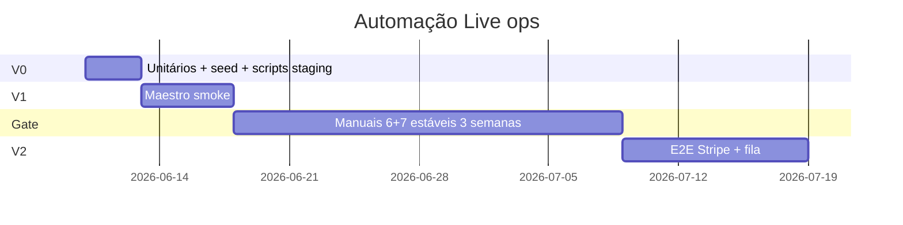

# Backlog — Automação de testes Live ops (BATATA)

**Objetivo:** reduzir o ciclo *alteração → APK → teste manual → bug* sem bloquear evolução do directo.  
**Documento manual:** [live-ops-testes-batata.md](./live-ops-testes-batata.md) (checklist APK / staging).  
**Estado:** **V0 implementado** · **V1 Maestro** (`.maestro/`, ver [maestro-batata.md](./maestro-batata.md)). V2 por fazer.

**Última revisão:** 2026-06-03

---

## Princípios

1. **Pirâmide primeiro:** unit → integração staging (RPC/edge/BD) → E2E UI por último.
2. **Um bug live corrigido** = idealmente **um teste ou script** que o reproduz (regra de “done”).
3. **Stripe WebView** não é alvo da V0/V1; simular settle na edge + asserts na BD.
4. **LiveKit/Mux** ficam fora de todas as fases iniciais.
5. **Gatilho para V2 (Maestro checkout):** testes manuais **#6 e #7** ✅ durante **3 semanas** seguidas em staging.

---

## Mapa: testes manuais ↔ automação

| Manual | Tema | V0 (script/RPC/unit) | V1 (Maestro smoke) | V2 (E2E parcial) |
|--------|------|----------------------|--------------------|------------------|
| **#3** | Stock artigo vendido | RPC `batata_update_live_item` + `batata_live_item_stock` | Abrir painel → Stock (sem assert vídeo) | Editar qty no painel + assert badge (frágil) |
| **#4** | Cancelar reserva | RPC `batata_live_bag_remove_request` + helpers Dart | — | Fluxo comprador remove saco (2 contas) |
| **#6** | Saco 2+ refs → Stripe | POST edge metadata compacta + 2 orders | Entrar saco + botão Pagar (sem pagar) | 2 refs + Stripe test mode |
| **#7** | 1 ref paga → € vendedora | GET settle + `batata_live_reconcile_stripe_order` | Painel Pagamentos visível | Pagar 1 ref + assert logs/BD |
| **#1** | Portes no checkout | Unit `fee_calculator` / breakdown | — | Opcional UI |
| **#8** | Reconcile sessão antiga | RPC reconcile + seed order `pago` | Abrir painel vendedora | — |

---

## Pré-requisitos (staging)

| Item | Descrição |
|------|-----------|
| Projeto Supabase **staging** | Separado de produção; variáveis no CI/local `.env.staging` (não commitar secrets). |
| Seed fixo | 1 vendedor, 1 comprador, 1 `live` `live`, 2+ `live_items`, produtos/checkout_product. |
| Stripe **test mode** | Chaves só em staging; edge `create-payment-intent` apontada ao projeto staging. |
| SQL | `live_ops_hotfix_batata.sql` aplicado em staging antes de qualquer job de teste. |
| Contas teste | Emails/uuids documentados em `docs/live-ops-automacao-seed.md` (criar na V0). |

---

# V0 — Primeira versão útil (2–3 dias)

**Meta:** deixar de depender do APK para validar **SQL + edge + reconcile**.  
**Comando local alvo:** `flutter test` + `dart run tool/live_ops_staging_check.dart` (ficheiro a criar).

## V0.1 — Unitários Dart (≈1 dia)

| ID | Entrega | Critérios de aceite |
|----|---------|-------------------|
| V0.1a | Expandir `test/live_reservation_queue_service_test.dart` | Cobre `isOpenSellerTreatReservation`, `isActiveSellerReservation`, `buyerBagRejectedLabel`, casos `bag_cancelled`. |
| V0.1b | `test/fee_calculator_test.dart` | Portes 3,50 € / 0 € mão; seguro 0,65 € + 5%; totais saco alinhados com `LiveInStreamCheckout`. |
| V0.1c | `test/order_status_test.dart` | `normalizeOrderStatusKey` para `pago`, `reserva_pendente`, variantes com espaços/BOM. |
| V0.1d | CI/local script | `flutter test` no README ou doc; falha = não mergear PR de live ops. |

**Ligação manual:** suporte a **#1** (totais); base para **#4** (cancelados).

## V0.2 — Seed staging (≈0,5 dia)

| ID | Entrega | Critérios de aceite |
|----|---------|-------------------|
| V0.2a | `supabase/sql/live_ops_test_seed.sql` ou doc com INSERTs | Idempotente; recria live + 2 items + users de teste. |
| V0.2b | `docs/live-ops-automacao-seed.md` | Uuids/emails/passwords de teste; como resetar seed. |

## V0.3 — Scripts integração API (≈1–1,5 dias)

Ferramenta: script Dart em `tool/` **ou** testes `integration_test` com tag `@Tags(['staging'])` que saltam sem env.

| ID | Fluxo | Passos automáticos | Critérios de aceite (= manual) |
|----|-------|-------------------|--------------------------------|
| V0.3a | **#7 reconcile** | 1) Seed: reserva `accepted` + order `reserva_pendente` com `live_id`, notes `stripe_checkout:ORDER`. 2) Simular pagamento: update order `pago` **ou** GET edge `checkout_return=success` com session Stripe test. 3) RPC `batata_live_reconcile_stripe_order`. | `orders.status = pago`, `live_id` preenchido; reserva `converted`; notes contêm `stripe_paid:`. |
| V0.3b | **#7 settle bag** | 2 orders + metadata `bag_order_ids` compacta; `settlePaidBagOrders` via GET success. | Ambas orders `pago`; cada reserva ligada `converted`. |
| V0.3c | **#4 cancelar** | RPC `batata_live_bag_remove_request` como comprador. | `status = rejected`, notes `bag_removed`; `batata_recompute_live_item_status` não deixa item incoerente. |
| V0.3d | **#3 stock vendido** | Item `sold`, qty 1; RPC `batata_update_live_item` qty 6; `batata_live_item_stock`. | `available_qty` > 0; `item_status` ≠ `sold` se há stock disponível (regra hotfix). |
| V0.3e | **#6 edge POST** | POST `create-payment-intent` `bag_checkout: true`, 2 `bag_lines`; sem UI. | HTTP 200; `checkoutUrl` presente; metadata Stripe sem `bag_orders_json` > 500 chars (inspecção API Stripe ou log). |

**Saída:** relatório console `PASS/FAIL` por cenário; tempo alvo **< 3 min** em staging.

## V0 — Definition of Done (fase completa)

- [ ] `flutter test` ≥ 25 testes unitários live ops (número mínimo acordado).
- [ ] Script staging corre em máquina dev com `.env.staging`.
- [ ] Documentado em [live-ops-testes-batata.md](./live-ops-testes-batata.md) secção «Antes do APK» → correr script V0.
- [ ] Manual **#3/#4/#7** pode ser pré-validado em staging **sem APK** (ainda falta UI/Stripe real).

**Horas poupadas esperadas:** 2–4 h/semana (menos ciclos APK por regressão SQL/RPC).

---

# V1 — Smoke UI (3–5 dias, após V0 estável)

**Ferramenta recomendada:** [Maestro](https://maestro.mobile.dev/) (YAML, CI-friendly).  
**Alternativa:** Patrol + `integration_test` se a equipa preferir só Dart.

## V1.1 — Infra Maestro (≈1 dia)

| ID | Entrega | Critérios de aceite |
|----|---------|-------------------|
| V1.1a | `.maestro/` + 1 flow `login.yaml` | Login com user seed staging; chega ao Home. |
| V1.1b | `config.yaml` / env | `APP_ID`, deep links, timeouts; doc «correr Maestro local». |
| V1.1c | CI opcional | Job manual `workflow_dispatch` que corre Maestro no emulator (não bloquear main no início). |

## V1.2 — Fluxos smoke (≈2–4 dias)

| ID | Fluxo | Critérios de aceite |
|----|-------|-------------------|
| V1.2a | Vendedora abre **painel studio** numa live seed | Painel abre; tabs Operações/Catálogo visíveis; sem crash 30s. |
| V1.2b | Comprador entra **live player** | Player carrega; saco ou catálogo acessível (stream pode estar mock/offline). |
| V1.2c | Comprador abre **checkout saco** (sem pagar) | Sheet com portes/total visível (= manual **#1** parcial). |
| V1.2d | Vendedora vê secção **Pagamentos** | Lista renderiza (pode estar vazia). |

**Ligação manual:** não substitui **#6** (Stripe) nem **#7** (€ real).

## V1 — Definition of Done

- [ ] 4 flows Maestro verdes em staging, 3 execuções seguidas.
- [ ] Falha Maestro documentada no PR (screenshot + flow name).
- [ ] Manual: antes do APK, correr `flutter test` + script V0; Maestro 1x/semana ou em PR live.

**Horas poupadas adicionais:** +1–2 h/semana.

---

# V2 — E2E checkout live (1–2 semanas, só após gatilho)

**Gatilho obrigatório:** manuais **#6** e **#7** ✅ em staging durante **3 semanas** com o mesmo SQL/edge.

## V2.1 — Stripe test end-to-end (≈1 semana)

| ID | Fluxo | Critérios de aceite (= manual) |
|----|-------|--------------------------------|
| V2.1a | **#7** 1 ref | Maestro/Patrol: reservar → checkout → Stripe test card → fechar browser → assert BD via API ou poll Supabase. Vendedora: `paid_count` > 0 (API logs ou query). |
| V2.1b | **#6** 2 refs | Um checkout; 2 orders `pago`; 2 reservas `converted`. |
| V2.1c | Regressão **#8** | Order `pago` antiga + abrir painel → `stale_reconciled` ou fila correcta (API). |

## V2.2 — UI vendedora pós-pago (≈3–5 dias)

| ID | Fluxo | Critérios de aceite |
|----|-------|-------------------|
| V2.2a | **#3** stock vendido | Pós-venda, Maestro tap Stock + aumentar qty; assert texto/qty (keys `semantics` se necessário). |
| V2.2b | **#4** cancelados | Comprador cancela; Maestro vendedora **não** vê Aceitar/Recusar (assert absence). |

## V2 — Definition of Done

- [ ] Suite E2E ≤ 15 min; flake rate < 10% em 10 runs (métrica no CI).
- [ ] Manual [live-ops-testes-batata.md](./live-ops-testes-batata.md): só **exploratório** (vídeo, 2 telemóveis, rede fraca).

**Horas poupadas adicionais:** +3–6 h/semana (se estável).

---

## O que permanece manual (todas as fases)

| Área | Motivo |
|------|--------|
| Stripe 3DS / banco real / produção | Sandbox ≠ produção |
| Vídeo LiveKit/Mux (latência, áudio, Queda) | Flake e infra externa |
| Dois dispositivos simultâneos | Realtime humano |
| Deploy produção SQL + edge | Smoke curto humano pós-deploy |
| Layout/player BATATA | Regressão visual |
| Contas staff/helper/RLS reais | Permissões complexas |
| APK release / Play Store | Pipeline distribuição |

---

## Cronograma sugerido (se 1 dev part-time)



---

## Ordem de implementação (tickets)

1. V0.1a → V0.1d (unit)  
2. V0.2a → V0.2b (seed)  
3. V0.3a (reconcile **#7**) — maior ROI  
4. V0.3d (**#3** stock) + V0.3c (**#4** cancel)  
5. V0.3e + V0.3b (**#6** edge)  
6. V1.1 → V1.2 (Maestro)  
7. Esperar gatilho 3 semanas  
8. V2.1 → V2.2  

---

## Comandos alvo (quando V0 existir)

```bash
# Local — sem Supabase
flutter test

# Staging — copiar tool/live_ops_staging_env.example → tool/live_ops_staging.env
dart run tool/live_ops_staging_check.dart

# SQL sanity (opcional)
# npx supabase db query --linked -f supabase/sql/live_ops_test_seed.sql

# Maestro — após V1
maestro test .maestro/
```

---

## Ligação ao doc de testes manual

Actualizar [live-ops-testes-batata.md](./live-ops-testes-batata.md) secção 0 com:

```text
0a. (Opcional, quando existir) dart run tool/live_ops_staging_check.dart em staging
0b. flutter test
— depois 1–4 actuais (SQL, edge, build APK)…
```

---

## Decisão de arquitecto (resumo)

| Pergunta | Resposta |
|----------|----------|
| Implementar agora? | **V0 sim**; V1 em seguida; **V2 só após gatilho**. |
| Maestro vs Patrol? | **Maestro** para smoke; Patrol só se quiseres E2E 100% Dart. |
| Maior ROI imediato? | **V0.3a** (reconcile/#7) + unitários **#4**. |

Quando quiseres começar implementação, abre ticket **«V0.1a unit live ops»** — não misturar com fixes de produção no mesmo PR sem necessidade.
